# DRAFT LAPORAN PRAKTEK KERJA LAPANGAN (PKL)

**Judul Laporan:** Analisis Sistem dan Desain Sistem Informasi Manajemen Desa Wisata  
**Lokasi PKL:** Pemerintah Desa Kucur, Kecamatan Dau, Kabupaten Malang  
**Penyusun:** [Nama Anda]  

---

# DAFTAR ISI

*   **KATA PENGANTAR**
*   **DAFTAR ISI**
*   **BAB I PENDAHULUAN**
    *   1.1 Latar Belakang
    *   1.2 Identifikasi Masalah
    *   1.3 Batasan Masalah
    *   1.4 Tujuan
    *   1.5 Manfaat
*   **BAB II GAMBARAN UMUM INSTANSI**
    *   2.1 Jenis Kegiatan Instansi (Pemerintahan & Pemberdayaan Masyarakat)
    *   2.2 Sejarah Singkat Desa Kucur
    *   2.3 Struktur Organisasi Pemerintah Desa Kucur
    *   2.4 Deskripsi Tugas dan Fungsi Fungsionaris (Pembagian Peran)
    *   2.5 Lokasi Instansi (Desa Kucur, Kecamatan Dau)
*   **BAB III TINJAUAN PUSTAKA**
    *   3.1 Konsep Sistem
    *   3.2 Konsep Sistem Informasi
    *   3.3 Sistem Informasi Manajemen Desa Wisata (LENTERA)
    *   3.4 Unified Modeling Language (UML)
    *   3.5 Metode Pengembangan Perangkat Lunak (Rapid Application Development / RAD)
    *   3.6 Arsitektur Web Modern (Client-Server & RESTful API)
    *   3.7 Database Relasional (RDBMS) dan Konsep ACID
    *   3.8 Sistem Informasi Geografis (GIS) dan Data Spasial
    *   3.9 Keamanan Web: JSON Web Token (JWT) dan Role-Based Access Control (RBAC)
    *   3.10 Standar Dokumentasi Rekayasa Perangkat Lunak (IEEE Std 830 & IEEE Std 1016)
    *   3.11 Perbandingan Penelitian Terdahulu
*   **BAB IV DESKRIPSI DATA DAN HASIL PKL**
    *   4.1 Metode Pelaksanaan (Tahapan Rapid Application Development / RAD)
    *   4.2 Tahap Perencanaan Kebutuhan (Requirements Planning)
        *   4.2.1 Kebutuhan Fungsional (Functional Requirements)
        *   4.2.2 Kebutuhan Non-Fungsional (Non-Functional Requirements)
    *   4.3 Tahap Desain Pengguna (User Design / Prototyping)
        *   4.3.1 Arsitektur Sistem (Three-Tier Architecture)
        *   4.3.2 Alur Kerja Sistem (Workflow)
        *   4.3.3 Use Case Diagram & Deskripsi Aktor (5 Kelas Pengguna)
        *   4.3.4 Sitemap & Alur Navigasi (User Flow & Admin Flow)
        *   4.3.5 Activity Diagram
        *   4.3.6 Diagram Logis (ERD & Class Diagram)
        *   4.3.7 Struktur Tabel Database (Skema Fisik RDBMS)
    *   4.4 Tahap Konstruksi (Construction)
        *   4.4.1 Implementasi Antarmuka Pengguna (User Interface)
    *   4.5 Tahap Serah Terima dan Pengujian (Cutover)
        *   4.5.1 Rencana Hasil Pengujian (Testing)
        *   4.5.2 Hasil Evaluasi dan Masukan Mitra (Desa Kucur)
        *   4.5.3 Analisis Kinerja Teknis
*   **BAB V PENUTUP**
    *   5.1 Kesimpulan
    *   5.2 Saran
*   **DAFTAR PUSTAKA**
*   **LAMPIRAN**

---

# KATA PENGANTAR

Puji syukur penulis panjatkan kepada Tuhan Yang Maha Esa atas segala rahmat, karunia, dan kemudahan yang diberikan-Nya, sehingga laporan Praktik Kerja Lapangan (PKL) yang berjudul **"ANALISIS SISTEM DAN DESAIN SISTEM INFORMASI MANAJEMEN DESA WISATA"** ini dapat diselesaikan dengan baik.

Laporan ini disusun guna memenuhi salah satu syarat dalam menyelesaikan Praktik Kerja Lapangan (PKL) di Program Studi Sistem Informasi, Fakultas Teknologi dan Desain, Universitas Ma Chung. Selama pelaksanaan PKL, penulis mendapatkan banyak pengetahuan dan pengalaman berharga terkait dunia kerja, khususnya dalam analisis sistem dan desain sistem informasi manajemen desa wisata.

Penulis menyadari bahwa selesainya laporan ini tidak terlepas dari berkat dan bimbingan Tuhan Yang Maha Esa, serta bantuan dan dukungan dari berbagai pihak yang telah berkontribusi. Oleh karena itu, penulis ingin menyampaikan terima kasih kepada:
1. Dekan Fakultas Teknologi dan Desain Universitas Ma Chung beserta jajaran staf atas segala dukungan administratif dan akademik yang diberikan.
2. Dosen Pembimbing, yang telah memberikan bimbingan, arahan, saran, serta kesabaran selama proses penyusunan laporan PKL ini.
3. Kepala Desa dan Staf Pemerintah Desa Kucur, Kecamatan Dau, Kabupaten Malang, yang telah memberikan izin, fasilitas, dan bimbingan lapangan selama pelaksanaan PKL.
4. Orang tua dan keluarga tercinta, yang selalu memberikan doa yang tiada henti, motivasi, serta dukungan moral dan materiil.
5. Rekan-rekan mahasiswa Program Studi Sistem Informasi Universitas Ma Chung dan seluruh pihak yang tidak dapat disebutkan satu per satu atas bantuan dan kebersamaannya.

Penulis menyadari bahwa laporan ini masih jauh dari kesempurnaan. Oleh karena itu, kritik dan saran yang membangun sangat diharapkan demi perbaikan di masa mendatang.

Malang, Juni 2026

Penulis

---

# BAB I
# PENDAHULUAN

### 1.1 Latar Belakang
Perkembangan teknologi informasi dan komunikasi saat ini telah mendorong transformasi digital secara masif di berbagai sektor, termasuk pengembangan ekonomi pedesaan. Di Indonesia, salah satu strategi utama pemberdayaan ekonomi lokal adalah melalui pembentukan Desa Wisata. Namun, di tengah pesatnya penetrasi internet dan penggunaan perangkat seluler, masih terdapat kesenjangan digital (*digital divide*) yang signifikan di tingkat pedesaan. Sebagian besar desa wisata masih mengandalkan media sosial atau platform terpisah yang tidak terintegrasi untuk memasarkan potensi mereka. Ketiadaan sebuah ekosistem digital terpadu yang menggabungkan aspek promosi, transaksi lokal, edukasi publik, dan administrasi kemitraan menjadi hambatan utama dalam mengoptimalkan potensi ekonomi desa secara berkelanjutan.

Isu tersebut sangat relevan dengan kondisi empiris di Desa Kucur, Kecamatan Dau, Kabupaten Malang. Desa Kucur memiliki kekayaan alam luar biasa berupa kebun kopi kelas ekspor, agrowisata jeruk organik, serta produk olahan UMKM kreatif buatan warga setempat. Meskipun memiliki modal sosial dan alam yang tinggi, Desa Kucur masih menghadapi kendala serius dalam hal promosi terstruktur dan manajemen pariwisata. Pemetaan destinasi wisata dan fasilitas umum masih bersifat manual, pelaku UMKM kesulitan menjangkau pasar digital secara mandiri karena absennya katalog terpusat, serta aparatur pemerintah desa tidak memiliki dasbor pemantauan real-time untuk mengawasi statistik perekonomian maupun kemitraan investasi (*sponsorship*) yang masuk. Dampak dari proses konvensional ini adalah lambatnya laju pertumbuhan ekonomi pariwisata desa serta kurangnya transparansi tata kelola bagi para investor potensial.

Sebagai langkah pemecahan masalah tersebut, melalui kegiatan Praktik Kerja Lapangan (PKL) ini diusulkan rancangan dan pengembangan **Sistem Informasi Manajemen Desa Wisata** bernama **LENTERA** (*Location, Education, Navigation of Tourism, E-Resource Application*). Solusi yang ditawarkan berupa sebuah platform web responsif terintegrasi yang memadukan portal publik (katalog produk lokal dengan keranjang belanja, peta spasial geolokasi destinasi, sistem pemesanan pemandu lokal via WhatsApp, dan modul edukasi) dengan dasbor administratif *back-office* untuk pengawasan birokrasi perangkat desa dan penarikan kas UMKM secara aman. Target akhir dan luaran dari pelaksanaan PKL ini adalah menghasilkan dokumen spesifikasi kebutuhan perangkat lunak (SRS) berbasis IEEE Std 830-1998, spesifikasi desain arsitektur (SDD) berbasis IEEE Std 1016-2009, serta prototipe antarmuka sistem LENTERA yang siap dibangun untuk mendukung transformasi digital ekonomi Desa Kucur.

### 1.2 Identifikasi Masalah
Berdasarkan hasil observasi dan wawancara di Desa Kucur, diidentifikasi beberapa permasalahan utama:
1. Informasi destinasi wisata, fasilitas umum, dan kuliner Desa Kucur belum terpetakan secara digital dan interaktif, sehingga menyulitkan wisatawan untuk bernavigasi.
2. Pelaku UMKM lokal kesulitan mempromosikan produk olahan mereka secara luas dan terstruktur tanpa adanya katalog online terpusat.
3. Pemerintah Desa tidak memiliki alat pantau statistik ekonomi desa (jumlah UMKM, total investasi masuk, data operasional) yang dapat diakses secara *real-time* untuk pengambilan keputusan.
4. Belum adanya wadah formal yang transparan bagi pemodal/investor (*Sponsorship*) untuk menyalurkan CSR atau investasi ke UMKM Desa secara tercatat dan teratur.

### 1.3 Batasan Masalah
Mengingat kompleksitas tata kelola administrasi pemerintahan desa dan promosi pariwisata daerah yang sangat luas, maka diperlukan pembatasan ruang lingkup analisis agar pengerjaan proyek dapat berjalan secara fokus dan terarah sesuai target luaran PKL. Batasan masalah dalam spesifikasi kebutuhan (SRS) dan rancangan desain (SDD) sistem informasi LENTERA ini didefinisikan sebagai berikut:
1. Sistem dikembangkan berbasis *web* responsif agar dapat diakses melalui berbagai perangkat (*desktop* maupun *mobile browser*).
2. Membatasi akses sistem menggunakan *Role-Based Access Control* (RBAC) untuk 5 entitas: Pengunjung (Publik), Sponsor, Penjual (UMKM), Admin (Karang Taruna), dan Desa (Super Admin/Pemerintah Desa).
3. Pengujian sistem dilakukan pada fungsi-fungsi fungsional utama (Katalog & Cart, Location, Navigation, E-Resource, Sponsorship, dan Withdrawal).
4. Tidak melakukan implementasi riil perizinan payment gateway eksternal komersial pada tahap ini, melainkan menyediakan jalur pesan WhatsApp sebagai fallback manual.

### 1.4 Tujuan
Tujuan utama dari pelaksanaan Praktik Kerja Lapangan (PKL) dan penyusunan laporan ini adalah untuk menganalisis kebutuhan serta merancang arsitektur Sistem Informasi Manajemen Desa Wisata LENTERA di Desa Kucur secara komprehensif. Perancangan ini difokuskan pada penyusunan dokumen spesifikasi kebutuhan perangkat lunak (SRS) berbasis IEEE Std 830-1998 dan spesifikasi desain arsitektur (SDD) berbasis IEEE Std 1016-2009 guna menjamin keandalan standar teknis pengembangan sistem di masa mendatang. Melalui pendekatan formal ini, penelitian bertujuan menghasilkan *blueprint* sistem yang valid dan siap bangun untuk mempercepat digitalisasi pariwisata desa, memperluas pasar digital UMKM lokal, serta mempermudah pengawasan administratif ekonomi pedesaan secara berkelanjutan.

### 1.5 Manfaat
*   **Bagi Penulis:** Sebagai sarana untuk mengimplementasikan ilmu rekayasa perangkat lunak secara praktis, khususnya dalam pemodelan kebutuhan sistem (SRS) dan perancangan desain arsitektur (SDD) berbasis standar industri, guna melatih pemikiran analitis dalam memecahkan masalah nyata di lapangan.
*   **Bagi Mitra (Pemerintah Desa Kucur):** Memperoleh rancangan dasar (*blueprint*) sistem informasi LENTERA yang tervalidasi untuk memfasilitasi tata kelola administrasi ekonomi desa, mempercepat digitalisasi sektor pariwisata lokal, dan mendorong transparansi kemitraan.
*   **Bagi Universitas (Universitas Ma Chung):** Membina hubungan kemitraan yang konstruktif antara civitas akademika dengan pemerintah daerah, serta mewujudkan salah satu pilar Tri Dharma Perguruan Tinggi melalui kontribusi pengabdian masyarakat berbasis teknologi.
*   **Bagi Program Studi (Sistem Informasi):** Menyediakan dokumentasi referensi draf analisis kebutuhan dan rancangan sistem yang dapat digunakan sebagai materi pembelajaran atau studi kasus pembanding bagi mahasiswa angkatan berikutnya dalam bidang rekayasa perangkat lunak.
*   **Bagi Pengguna:**
    *   *Pelaku UMKM:* Mendapatkan acuan platform promosi online mandiri yang dapat mempermudah pelacakan penjualan dan penarikan dana hasil penjualan.
    *   *Wisatawan/Pengunjung:* Memperoleh rancangan panduan wisata digital yang menyajikan peta navigasi destinasi dan sistem pemesanan pemandu wisata lokal secara interaktif.
    *   *Sponsor/Investor:* Memperoleh gambaran media pengajuan kemitraan formal yang transparan dan terdokumentasi rapi untuk mendukung investasi di Desa Wisata Kucur.

---

# BAB II
# GAMBARAN UMUM INSTANSI

### 2.1 Jenis Kegiatan Instansi
Pemerintah Desa Kucur merupakan instansi pelayanan publik tingkat terendah dalam struktur pemerintahan daerah di Indonesia. Tugas utamanya mencakup penyelenggaraan pemerintahan desa, pelaksanaan pembangunan desa, pembinaan kemasyarakatan, dan pemberdayaan masyarakat desa (termasuk pengelolaan BUMDes dan Kelompok Sadar Wisata/Pokdarwis).

### 2.2 Sejarah Singkat Desa Kucur
Desa Kucur merupakan salah satu desa di wilayah Kecamatan Dau, Kabupaten Malang yang dikelilingi oleh perkebunan jeruk dan lereng pegunungan. Desa ini berkomitmen untuk bertransformasi menjadi desa wisata edukasi berbasis pertanian dan peternakan. Rencana Pembangunan Jangka Menengah Desa (RPJMDes) Desa Kucur telah menetapkan program digitalisasi administrasi dan pariwisata sebagai salah satu prioritas pembangunan jangka panjang desa.

### 2.3 Struktur Organisasi Pemerintah Desa Kucur

Struktur kepemimpinan organisasi di Desa Kucur dipimpin oleh seorang Kepala Desa, dibantu oleh Sekretaris Desa, jajaran Staf Urusan, Pelaksana Teknis (Pamong Desa), serta Pelaksana Kewilayahan (Kamituwo/Kepala Dusun) yang memimpin 7 dusun di Desa Kucur. 

Berdasarkan data fungsionaris Pemerintah Desa Kucur, susunan organisasi resmi dijabarkan pada diagram di bawah ini:

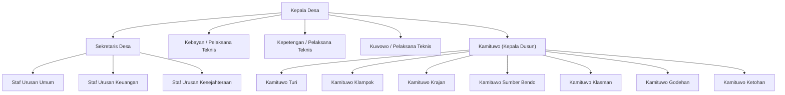

Selain struktur pemerintahan desa di atas, terdapat pula Badan Permusyawaratan Desa (BPD) serta Lembaga Pemberdayaan Masyarakat Desa (LPMD). Lembaga-lembaga kemasyarakatan ini, bersama dengan Kelompok Sadar Wisata (Pokdarwis), BUMDes, dan Karang Taruna (Seksi Kepemudaan), menjadi mitra strategis dalam implementasi dan manajemen operasional sistem informasi LENTERA guna mendukung digitalisasi desa wisata.


### 2.4 Deskripsi Tugas dan Fungsi Fungsionaris (Pembagian Peran)

Berdasarkan struktur tata kerja fungsionaris Pemerintah Desa Kucur, pembagian tugas dan fungsi masing-masing peran dijabarkan sebagai berikut:

1. **Kepala Desa:** Merupakan pimpinan tertinggi pemerintahan desa yang bertanggung jawab penuh dalam menyelenggarakan pemerintahan desa, memimpin pelaksanaan pembangunan fisik dan non-fisik, melakukan pembinaan kemasyarakatan, serta mengoordinasikan pemberdayaan masyarakat desa.
2. **Sekretaris Desa:** Bertindak selaku pimpinan sekretariat desa yang membantu Kepala Desa dalam urusan pelayanan administratif, pengelolaan surat-menyurat, kearsipan, penyusunan rancangan peraturan desa, serta mengoordinasikan jajaran staf urusan.
3. **Staf Urusan (Kaur):**
   - **Staf Urusan Umum:** Bertanggung jawab atas pengelolaan administrasi umum, perlengkapan, inventarisasi aset desa, dan penyediaan prasarana operasional kantor desa.
   - **Staf Urusan Keuangan:** Bertanggung jawab atas pengelolaan administrasi anggaran desa, penyusunan rancangan APBDes, pembukuan kas desa, serta laporan pertanggungjawaban keuangan desa.
   - **Staf Urusan Kesejahteraan:** Membantu administrasi perencanaan pembangunan, pembinaan kerukunan sosial kemasyarakatan, serta pelayanan keagamaan.
4. **Pelaksana Teknis (Kasi / Pamong):**
   - **Kebayan:** Membantu Kepala Desa dalam mengoordinasikan pelaksanaan program pembangunan sarana prasarana fisik serta pemberdayaan ekonomi masyarakat di lapangan.
   - **Kepetengan:** Bertanggung jawab dalam bidang keamanan dan ketertiban umum desa, kependudukan, serta penanganan urusan agraria/pertanahan.
   - **Kuwowo:** Membantu pelaksanaan pelayanan sosial, pembinaan kesehatan masyarakat, pendidikan, kebudayaan, dan kesejahteraan sosial warga.
5. **Kamituwo / Kepala Dusun:** Memimpin unit kewilayahan dusun masing-masing guna menyelenggarakan pelayanan administrasi warga, menjaga ketenteraman dan ketertiban dusun, serta memfasilitasi pembangunan partisipatif tingkat dusun.
6. **Badan Permusyawaratan Desa (BPD):** Berfungsi sebagai mitra kerja strategis pemerintah desa dalam membahas dan menyepakati rancangan Peraturan Desa, menampung dan menyalurkan aspirasi pembangunan dari warga, serta melakukan pengawasan terhadap kinerja Kepala Desa.
7. **Lembaga Pemberdayaan Masyarakat Desa (LPMD):** Berperan membantu pemerintah desa dalam menyusun rencana pembangunan jangka menengah/tahunan secara partisipatif, menumbuhkan swadaya gotong royong warga, serta mengoordinasikan berbagai seksi pembangunan, pemuda, dan ekonomi desa.


### 2.5 Lokasi Instansi
Kantor Pemerintah Desa Kucur beralamat di Jalan Raya Kucur, Kecamatan Dau, Kabupaten Malang, Provinsi Jawa Timur, Kode Pos 65151.

---

# BAB III
# TINJAUAN PUSTAKA

### 3.1 Konsep Sistem
Sistem didefinisikan sebagai kumpulan komponen atau elemen yang saling berinteraksi, berelasi, dan bekerja sama untuk mencapai suatu tujuan tertentu.

### 3.2 Konsep Sistem Informasi
Sistem informasi adalah kombinasi dari orang-orang, perangkat keras (*hardware*), perangkat lunak (*software*), jaringan komunikasi, sumber data, serta kebijakan dan prosedur yang mengumpulkan, mentransformasikan, dan menyebarkan informasi dalam suatu organisasi.

### 3.3 Sistem Informasi Manajemen Desa Wisata (LENTERA)
Sistem Informasi Manajemen Desa Wisata merupakan platform khusus yang menerapkan teknologi informasi untuk membantu pengelolaan pariwisata perdesaan. LENTERA merupakan kepanjangan dari *Location, Education, Navigation of Tourism, E-Resource Application*. Platform ini mencakup pengelolaan data lokasi wisata (Location), modul edukasi tani (Education), navigasi estimasi jarak turis (Navigation), wadah ulasan bulletin desa (E-Resource), integrasi investasi (Sponsorship), dan tata kelola keuangan hasil e-commerce lokal (Withdrawal).

### 3.4 Unified Modeling Language (UML)
UML adalah himpunan bahasa pemodelan grafis standar industri untuk mendefinisikan, memvisualisasikan, membangun, dan mendokumentasikan artefak dari sistem perangkat lunak berorientasi objek. UML yang digunakan meliputi:
*   *Use Case Diagram:* Menggambarkan interaksi aktor dengan fungsi sistem.
*   *Activity Diagram:* Menggambarkan alur kerja aktivitas sistem secara berurutan.
*   *Class Diagram:* Menunjukkan struktur kelas, atribut, metode, dan hubungan antar objek di tingkat kode.

### 3.5 Metode Rapid Application Development (RAD)
Metode RAD merupakan model proses pembangunan perangkat lunak bertipe inkremental yang menekankan pada siklus pengembangan yang sangat pendek (sekitar 60-90 hari). Prosesnya terbagi atas perencanaan syarat, desain pengguna (prototyping), konstruksi, dan serah terima (*cutover*).

### 3.6 Arsitektur Web Modern (Client-Server & RESTful API)
Arsitektur web modern menggunakan model terdistribusi di mana Front-End (Client/lapisan presentasi) terpisah sepenuhnya dari Back-End (Server/lapisan aplikasi). Komunikasi data antar kedua lapisan ini dijembatani oleh RESTful API (*Representational State Transfer*) dengan protokol HTTPS menggunakan format pertukaran data ringan berbasis JSON (*JavaScript Object Notation*). Pemisahan ini meminimalkan latensi pemuatan halaman dan meningkatkan efisiensi pemeliharaan sistem.

### 3.7 Database Relasional (RDBMS) dan Konsep ACID
RDBMS mengelola data dalam bentuk tabel-tabel terstruktur yang saling berelasi. Untuk memastikan integritas data keuangan (seperti modul *withdrawal* saldo UMKM dan data investasi kemitraan *sponsorship*), basis data harus menjamin prinsip transaksional **ACID** (*Atomicity, Consistency, Isolation, Durability*) agar tidak terjadi inkonsistensi saldo saat ada pengaksesan bersamaan (*race condition*).

### 3.8 Sistem Informasi Geografis (GIS) dan Data Spasial
Sistem Informasi Geografis (SIG atau *Geographic Information System*) merupakan sistem berbasis komputer yang digunakan untuk menyimpan, mengelola, menganalisis, dan memvisualisasikan data yang memiliki referensi geografis atau spasial. Data spasial direpresentasikan melalui koordinat titik (*Point*), garis (*Line*), atau area (*Polygon*). Pada pengembangan platform LENTERA, konsep data spasial (menggunakan tipe data `POINT` di database) diintegrasikan dengan pustaka pemetaan digital pihak ketiga (seperti Leaflet.js atau Google Maps API) untuk merender peta batas wilayah desa wisata, letak marker destinasi wisata, serta estimasi rute navigasi berbasis GPS.

### 3.9 Keamanan Web: JSON Web Token (JWT) dan Role-Based Access Control (RBAC)
Keamanan aplikasi web modern berbasis RESTful API umumnya tidak menggunakan sesi penyimpanan di server (*sessionless* / *stateless*). Sebagai gantinya, digunakan:
*   **JSON Web Token (JWT)**: Token kredensial aman berupa string terenkripsi berstandar RFC 7519 yang dikirimkan oleh klien pada *header* HTTP di setiap permintaan data ke server. Token ini memiliki masa kedaluwarsa tertentu untuk mencegah pembajakan sesi.
*   **Role-Based Access Control (RBAC)**: Metode pengendalian akses pengguna berdasarkan peranan/jabatan (*Role*) di dalam sistem. Hak akses dibatasi secara ketat sehingga pengguna dengan peran tertentu (seperti *Penjual* atau *Sponsor*) tidak dapat mengakses antarmuka atau endpoint API milik peran lain (seperti *Super Admin Desa*).

### 3.10 Standar Dokumentasi Rekayasa Perangkat Lunak (IEEE Std 830 & IEEE Std 1016)
Dalam tahapan analisis dan perancangan sistem informasi, digunakan dua standar internasional dari IEEE (*Institute of Electrical and Electronics Engineers*) sebagai acuan penulisan spesifikasi teknis:
*   **IEEE Std 830-1998 (SRS)**: Merupakan standar rekomendasi praktis untuk menyusun dokumen *Software Requirements Specification* (SRS). Standar ini mengidentifikasi kebutuhan fungsional, kebutuhan non-fungsional, batasan sistem, dan karakteristik pengguna sistem secara komprehensif.
*   **IEEE Std 1016-1998 (SDD)**: Merupakan standar untuk menyusun dokumen *Software Design Description* (SDD) yang menerangkan arsitektur perangkat lunak secara detail, mulai dari rancangan tingkat tinggi (*high-level design*), kamus data, diagram UML, hingga desain antarmuka pengguna grafis.

### 3.11 Perbandingan Penelitian Terdahulu
Berikut adalah tabel perbandingan sistem pariwisata desa yang dirancang dengan sistem-sistem terdahulu:

| Parameter Pembanding | Rizal et al. (2023) - Desa Kota Pari | Aryandra & Wardhana (2023) - Desa Wisata Melung | LENTERA Desa Wisata Kucur (Laporan ini) |
| :--- | :--- | :--- | :--- |
| **Arsitektur** | Monolith PHP | Client-Server API | Modern Three-Tier RESTful API |
| **Keamanan** | Login Session Biasa | Tanpa Enkripsi Token | JWT + Role-Based Access Control (RBAC) |
| **Fitur Spasial** | Hanya Teks Alamat | Google Map Statis | Interaktif Marker + GPS Tracker (Navigation) |
| **Fitur Finansial** | Tidak Ada | Tidak Ada | Modul Withdrawal & Pendaftaran Sponsor |
| **Manajemen Dokumen**| Upload Gambar Biasa | PDF Manual | E-Resource terintegrasi dengan limit 5MB |

Dibandingkan dengan penelitian-penelitian terdahulu, sistem yang dikembangkan memiliki beberapa kelebihan yang membedakannya secara signifikan. Penelitian Rizal et al. (2023) berfokus pada rancang bangun sistem informasi potensi wisata berbasis web di Desa Kota Pari menggunakan metode Waterfall, dengan arsitektur PHP Monolith dan penyajian informasi alamat dalam bentuk teks statis tanpa fitur keamanan berbasis token maupun modul transaksi keuangan. Sementara itu, penelitian Aryandra dan Wardhana (2023) menekankan pada perancangan sistem informasi desa wisata berbasis website di Desa Wisata Melung menggunakan metode RAD dengan visualisasi Google Map statis namun belum menyematkan mekanisme otentikasi token yang terenkripsi serta modul manajemen keuangan bagi masyarakat pelaku UMKM.

Berbeda dengan kedua penelitian tersebut, sistem LENTERA yang dikembangkan dalam penelitian ini dirancang secara khusus dan terintegrasi menggunakan arsitektur modern Three-Tier RESTful API untuk mendukung digitalisasi Desa Wisata Kucur secara menyeluruh. Sistem ini menggabungkan fitur-fitur esensial seperti pemetaan geospasial interaktif dengan koordinat GPS penanda lokasi destinasi wisata, serta modul finansial riil berupa penarikan saldo keuntungan (withdrawal) bagi pelaku UMKM berbasis konstrain transaksi database ACID, dan pendaftaran kemitraan investasi (sponsorship) bagi investor eksternal. Selain itu, pengamanan sistem diperkuat menggunakan enkripsi JWT dan Role-Based Access Control (RBAC) untuk 5 level otorisasi pengguna. Penerapan metode RAD (Rapid Application Development) dalam rekayasa perangkat lunak ini juga memungkinkan setiap tahapan analisis dan perancangan sistem berjalan secara sistematis, fleksibel, serta sesuai dengan kebutuhan nyata di lapangan.

---

# BAB IV
# DESKRIPSI DATA DAN HASIL PKL

### 4.1 Metode Pelaksanaan
Dalam pelaksanaan Praktik Kerja Lapangan (PKL) untuk merancang dan menganalisis sistem LENTERA, penulis menggunakan metode **Rapid Application Development (RAD)**. Pemilihan metode ini didasarkan pada kebutuhan pengembangan sistem yang fleksibel, cepat, serta berorientasi pada masukan pengguna secara intensif. Tahapan pelaksanaan pengembangan sistem dimobilkan melalui diagram alur (*flowchart*) berikut:

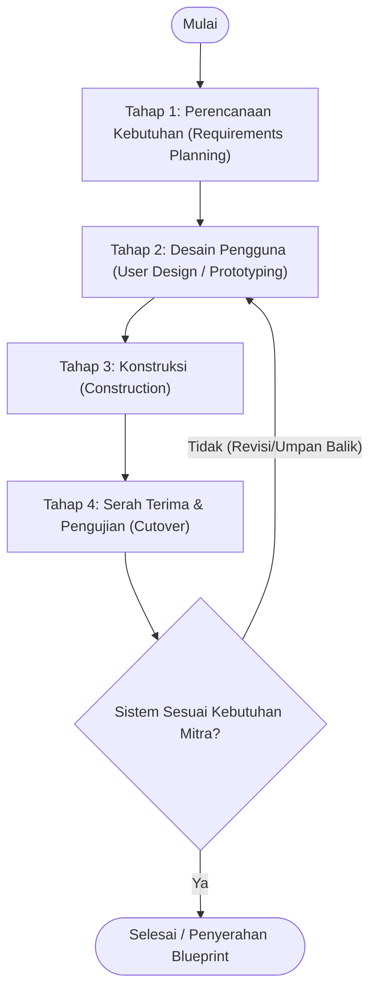

Secara umum, tahapan pelaksanaan rekayasa perangkat lunak pada platform LENTERA diuraikan sebagai berikut:
1.  **Tahap Perencanaan Kebutuhan (Requirements Planning):** Penulis melakukan observasi lapangan dan wawancara dengan Pemerintah Desa Kucur untuk mengidentifikasi masalah, menentukan batasan masalah, serta merumuskan kebutuhan fungsional (*Functional Requirements*) dan non-fungsional (*Non-Functional Requirements*) sistem.
2.  **Tahap Desain Pengguna (User Design / Prototyping):** Berdasarkan kebutuhan yang diperoleh, dilakukan pemodelan sistem menggunakan Unified Modeling Language (UML) seperti Use Case Diagram, Activity Diagram, dan Class Diagram. Selain itu, dirancang pula arsitektur Three-Tier, Entity Relationship Diagram (ERD), struktur tabel database, sitemap, serta draf prototipe antarmuka pengguna (user interface).
3.  **Tahap Konstruksi (Construction):** Pada tahap ini, rancangan antarmuka diimplementasikan ke dalam kode pemrograman web responsif menggunakan HTML, CSS, dan JavaScript, sementara fungsi-fungsi backend dan database disimulasikan sesuai dengan aturan bisnis yang telah dirancang.
4.  **Tahap Serah Terima & Pengujian (Cutover):** Sistem yang telah dibangun melalui pengkodean awal diuji menggunakan metode *Black-Box Testing*. Selain itu, draf blueprint dipresentasikan kepada mitra (Pemerintah Desa Kucur) untuk dievaluasi dan divalidasi guna mendapatkan umpan balik untuk penyempurnaan sistem sebelum penyerahan laporan akhir.

---

### 4.2 Tahap Perencanaan Kebutuhan (Requirements Planning)
Berdasarkan dokumen *Software Requirements Specification* (SRS), kebutuhan sistem LENTERA dikelompokkan menjadi kebutuhan fungsional (fungsionalitas utama) dan kebutuhan non-fungsional.

#### 4.2.1 Kebutuhan Fungsional (Functional Requirements)
1.  **Manajemen Katalog & Cart (`REQ-CAT`):** Sistem wajib menyediakan katalog produk lokal UMKM, mendukung penambahan ke keranjang belanja, dan melakukan agregasi total tagihan pemesanan.
2.  **E-Resource & Buletin (`REQ-RES`):** Admin dapat mempublikasikan artikel edukasi dan buletin desa. Pengunjung dapat mengirimkan testimoni ulasan bintang 1-5 dengan lampiran media (maksimal 5MB).
3.  **Autentikasi & RBAC (`REQ-AUTH`):** Autentikasi aman bagi pengelola menggunakan JWT (*JSON Web Token*) yang membatasi hak akses Dasbor sesuai peran (*Desa, KarangTaruna, Penjual, Sponsor*).
4.  **Pendaftaran Sponsorship (`REQ-SPO`):** Fasilitas pendaftaran proposal kemitraan B2B secara digital dengan pelacakan status (`PENDING`, `APPROVED`, `REJECTED`) serta penyajian grafik statistik investasi secara *real-time*.
5.  **Pemetaan Spasial / Location (`REQ-LOC`):** Peta interaktif terintegrasi dengan marker berwarna berdasarkan kategori destinasi (Fasum, Perkebunan, Kuliner, UMKM).
6.  **Navigasi & Emergency / Navigation (`REQ-NAV`):** Estimasi jarak pengguna berbasis GPS peramban ke titik destinasi, dilengkapi tombol darurat WhatsApp admin.
7.  **Keuangan & Penarikan / Withdrawal (`REQ-FIN`):** Penjual UMKM dapat menarik saldo hasil penjualan dengan batas minimum Rp 50.000, yang statusnya harus disetujui manual oleh Admin Keuangan Desa dengan jaminan transaksi ACID DB.

#### 4.2.2 Kebutuhan Non-Fungsional (Non-Functional Requirements)
*   **Performance:** Halaman dasbor harus dimuat di bawah 1,5 detik dengan penanganan beban minimal 500 pengguna aktif simultan. Kueri pencarian database harus di bawah 500ms dengan indexing data yang tepat.
*   **Safety & Security:** Menggunakan metode *Soft-Delete* (`is_deleted` / `deleted_at`) pada database utama untuk mencegah hilangnya data akibat kelalaian operator. Kata sandi dienkripsi satu arah menggunakan Bcrypt.
*   **Usability:** Menyediakan panduan manual (User Manual PDF) dan mikro-interaksi seperti *Tooltip* interaktif di dalam layar input admin untuk meminimalisir kesalahan input.

---

### 4.3 Tahap Desain Pengguna (User Design / Prototyping)

#### 4.3.1 Arsitektur Sistem (Three-Tier Architecture)
Desain arsitektur LENTERA menggunakan arsitektur 3 lapis untuk menjamin isolasi logika dan kemudahan pemeliharaan:

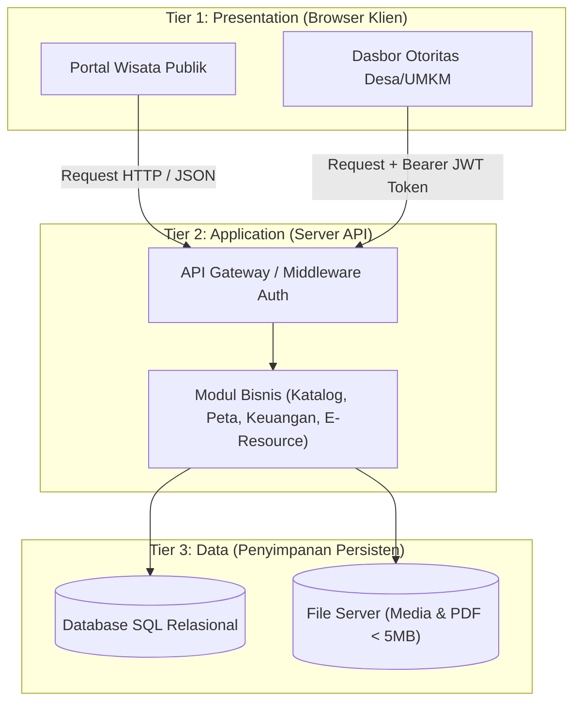

##### Penjelasan Aliran dan Lapisan Arsitektur (Three-Tier Architecture Description):

Pembagian lapisan sistem pada platform LENTERA dirancang untuk memisahkan fungsi presentasi antarmuka, logika pemrosesan bisnis, dan penyimpanan data persisten sebagai berikut:

1. **Presentation Tier (Lapisan Presentasi / Browser Klien)**:
   * Lapisan ini bertindak sebagai antarmuka terdepan yang berinteraksi secara visual langsung dengan pengguna.
   * **Portal Wisata Publik (`UI_Publik`)**: Digunakan oleh pengunjung umum untuk mengakses modul Katalog, Peta, Edukasi, dan formulir kemitraan.
   * **Dasbor Otoritas Desa/UMKM (`UI_Admin`)**: Digunakan oleh pengelola internal (Desa, Karang Taruna, dan pelaku UMKM) untuk mengelola data operasional.
   * Lapisan ini berkomunikasi dengan peladen menggunakan protokol HTTP/HTTPS dengan format pertukaran data ringan berbasis JSON (*JavaScript Object Notation*). Khusus untuk area dasbor admin, pengiriman data wajib menyertakan token otentikasi **Bearer JWT Token** pada *header* HTTP.

2. **Application Tier (Lapisan Aplikasi / Server API)**:
   * Merupakan peladen sentral (*server-side*) yang mengolah logika bisnis sistem.
   * **API Gateway / Middleware Auth (`API_Gate`)**: Bertindak sebagai gerbang pengontrol rute (*routing*) sekaligus menyaring keamanan akses dengan melakukan validasi dan dekode token JWT sebelum meneruskan permintaan data ke modul bisnis.
   * **Modul Bisnis (`Mod_Core`)**: Memproses kalkulasi dan fungsionalitas utama aplikasi (Katalog barang, Peta marker koordinat, Keuangan transaksi/withdrawal, dan artikel E-Resource).

3. **Data Tier (Lapisan Data / Penyimpanan Persisten)**:
   * Merupakan lapisan penyimpanan permanen untuk menjaga keamanan aset informasi sistem.
   * **Database SQL Relasional (`DB`)**: Menyimpan dataset terstruktur (tabel *Users*, *Products*, *Locations*, *Sponsorships*, *Withdrawals*, dan *E_Resources*) dengan penegakan transaksi relasional tipe ACID untuk menjaga konsistensi keuangan.
   * **File Server (`FS`)**: Tempat penyimpanan terpisah khusus untuk file biner mentah (seperti berkas gambar produk UMKM, resi transfer penarikan dana, serta dokumen PDF proposal sponsorship dengan batasan ukuran maksimal 5 MB).

#### 4.3.2 Alur Kerja Sistem (Workflow)

Alur kerja dan aliran data di dalam sistem LENTERA mencakup alur umum interaksi arsitektur tiga lapis (*Three-Tier*) serta alur detail untuk masing-masing modul utama sebagai berikut:

##### A. Alur Kerja Arsitektur Umum (General Data Flow)
Secara umum, aliran data yang berjalan antar lapisan arsitektur saat sistem memproses permintaan pengguna mengikuti tahapan berikut:
1. **Inisiasi Permintaan (Request Initiation)**: Pengguna melakukan aksi pada lapisan presentasi (Tier 1), misalnya menekan tombol "Tarik Saldo" pada dasbor admin. Browser klien membungkus data nominal penarikan ke dalam format JSON dan mengirimkannya melalui *request* HTTP/HTTPS ke peladen API. Karena aksi dilakukan pada area dasbor privat, *request* wajib melampirkan *Bearer JWT Token* pada *header* otentikasi.
2. **Pencegatan & Validasi Sesi (Middleware Validation)**: Permintaan diterima oleh *API Gateway* / Middleware (Tier 2). Sistem akan mengecek rute tujuan. Karena rute tersebut privat, sistem akan mendekode token JWT untuk memverifikasi validitas sesi dan tingkat hak akses pengguna (*Role-Based Access Control* / RBAC).
3. **Eksekusi Logika Bisnis (Core Business Processing)**: Setelah lolos verifikasi middleware, permintaan diteruskan ke modul bisnis (`Mod_Core`) di Tier 2. Di sini, logika bisnis dijalankan (misalnya, sistem memvalidasi apakah jumlah saldo yang ditarik memenuhi batas minimum Rp 50.000).
4. **Persistensi Data (Persistent Storage Execution)**: Modul bisnis melakukan interaksi ke Tier 3. Data transaksi dicatat ke dalam database SQL (`DB`) menggunakan konstrain ACID untuk mencegah tabrakan data (*race condition*), sementara dokumen biner pendukung (seperti file PDF struk transfer bank) diunggah dan disimpan ke dalam *File Server* (`FS`).
5. **Umpan Balik Sistem (Response Transmission)**: Setelah transaksi database dan penyimpanan file sukses dilakukan, database mengirimkan sinyal konfirmasi ke modul bisnis. Modul bisnis kemudian menyusun respon dalam format JSON dan mengirimkannya kembali ke peramban klien (Tier 1) sebagai respon HTTP. Lapisan presentasi menerima respon tersebut dan memperbarui tampilan antarmuka pengguna (misal, mengubah status tiket penarikan menjadi *SUCCESS* secara visual).

##### B. Alur Kerja per Modul Utama (Module-Specific Workflow)

1. **Modul Katalog & Keranjang Belanja**:
   * Pengunjung menjelajahi etalase produk pada halaman Beranda atau Katalog (`Catalog.html`).
   * Pengunjung memilih produk dan menekan "Tambahkan Keranjang" (sistem memperbarui data kuantitas dan harga sementara di *session storage* peramban).
   * Pengunjung masuk ke halaman *Checkout* (`Checkout.html`), di mana sistem secara otomatis menghitung agregasi total biaya pesanan.
   * Pengunjung mengisi formulir identitas (nama, alamat, WhatsApp) lalu menekan "Buat Pesanan".
   * Sistem merekam pesanan di database (`Products` & log transaksi) dan secara otomatis mengalihkan browser ke tautan WhatsApp Penjual UMKM dengan templat pesan berisi struk pesanan untuk proses koordinasi pembayaran/pengiriman secara semi-manual.

2. **Modul E-Resource & Buletin**:
   * Pengurus Karang Taruna (Admin) menulis artikel edukasi pertanian atau buletin desa melalui dasbor.
   * Sistem melakukan validasi keamanan teks (sanitasi XSS) dan memvalidasi ukuran lampiran gambar (*attachment* tidak boleh melebihi 5 MB).
   * Artikel tersimpan ke database (`E_Resources`) dan server file (`FS`) lalu dipublikasikan di halaman E-Resource publik.
   * Pengunjung umum dapat menuliskan ulasan testimoni dengan rating bintang 1-5 yang lognya terekam di basis data, namun visibilitasnya diatur dinamis oleh status persetujuan admin agar terhindar dari spam (*moderation flow*).

3. **Modul Autentikasi & RBAC (Dashboard)**:
   * Pengguna mengisikan akun di halaman *Login* (`Login.html`).
   * Peladen memvalidasi username dan membandingkan kecocokan sandi menggunakan algoritma komparasi hash Bcrypt.
   * Jika sukses, peladen menerbitkan token JWT dengan durasi sesi aktif tertentu (120 menit) yang dienkripsi.
   * Token disimpan sementara di *local storage* klien dan dilampirkan pada setiap permintaan data ke API Gateway.
   * Middleware API menyaring token tersebut untuk menentukan ke mana rute dialihkan berdasarkan level otorisasi (*Desa, Karang Taruna, Penjual, atau Sponsor*).
   * Saat pengguna menekan "Logout", token JWT dihancurkan secara lokal dan browser dialihkan kembali ke beranda publik.

4. **Modul Pendaftaran Sponsorship**:
   * Calon investor (Sponsor) melengkapi data registrasi kemitraan dan mengunggah dokumen PDF proposal di halaman Sponsor (`Sponsor.html`).
   * Peladen memvalidasi ukuran file PDF (< 5 MB) dan merekam pengajuan ke database dengan status awal `PENDING`.
   * Karang Taruna melakukan kurasi awal terhadap proposal yang masuk.
   * Kepala Desa (Super Admin) meninjau proposal terpilih di dasbor persetujuan desa dan memberikan status `APPROVED` atau `REJECTED`.
   * Jika disetujui (`APPROVED`), database memicu fungsi kalkulasi data agregat investasi masuk untuk langsung memperbarui visualisasi diagram grafik pendanaan pariwisata di portal publik secara *real-time*.

5. **Modul Pemetaan (Location)**:
   * Admin menambahkan marker destinasi atau lapak UMKM baru dengan memasukkan koordinat lintang-bujur di dasbor.
   * Peladen mengoversi koordinat tersebut ke format spasial database (`POINT` / `GEOMETRY`) dan menyimpannya.
   * Peta Leaflet/Google Maps di halaman publik mendeteksi data spasial baru dan merender marker visual dengan indikator warna statis sesuai kategori (Fasum, Perkebunan, Kuliner, UMKM).
   * Pengunjung dapat menyaring marker peta secara dinamis dengan mengaktifkan/menonaktifkan filter kategori di panel navigasi peta.

6. **Modul Navigasi & Kedaruratan (Navigation)**:
   * Pengunjung membuka halaman Navigasi (`Navigation.html`) dan mengizinkan browser mengakses sensor GPS gawai mereka.
   * Sistem mendeteksi koordinat GPS aktual pengguna.
   * Sistem menghitung estimasi jarak spasial rute antara posisi GPS pengguna dengan marker koordinat tujuan pariwisata di Desa Kucur.
   * Jika pengunjung tersesat atau butuh bantuan darurat, pengunjung menekan tombol bantuan darurat melayang yang akan memicu proksi intent WhatsApp berisi pesan koordinat GPS terkirim langsung ke nomor darurat admin Karang Taruna.

7. **Modul Keuangan & Penarikan Dana (Withdrawal)**:
   * Pelaku UMKM (Penjual) meninjau penghasilan dan mengisi nominal dana yang ingin dicairkan (minimum pengajuan Rp 50.000) di dasbor UMKM.
   * Peladen memproses kueri penarikan dana menggunakan pengunci transaksi relasional (*ACID database transaction lock*) untuk mencegah penarikan saldo ganda dari akun yang sama secara bersamaan.
   * Tiket penarikan terekam di database dengan status awal `PENDING`.
   * Kepala Desa (Admin Finance) meninjau antrean penarikan dana di dasbor persetujuan desa.
   * Setelah melakukan transfer bank manual ke penjual, Kepala Desa mengunggah file bukti struk transfer (*receipt*) dan menekan tombol *Approve*.
   * Sistem mengubah status tiket menjadi `SUCCESS` dan secara permanen mengurangi saldo dompet penjual di database.

#### 4.3.3 Use Case Diagram
Sistem memiliki 5 Aktor utama yang berinteraksi dengan subsistem sesuai dengan otorisasi perannya masing-masing:

```mermaid
graph TD
  subgraph LENTERA ["System Boundary (LENTERA)"]
    UC_Login("UC_01: Login Sesi JWT")
    UC_Lihat_Produk("UC_02: Melihat Katalog & Detail Produk")
    UC_Checkout("UC_03: Melakukan Checkout via WhatsApp")
    UC_Lihat_Peta("UC_04: Melihat Peta & Navigasi Rute")
    UC_Testimoni("UC_05: Mengirim Testimoni Wisatawan")
    UC_Sponsor_Apply("UC_06: Mengajukan Proposal Sponsorship")
    UC_Withdraw_Apply("UC_07: Mengajukan Penarikan Saldo")
    UC_Manage_Produk("UC_08: Mengelola Produk Toko (CRUD)")
    UC_Manage_Pesanan("UC_09: Mengelola Pesanan Masuk")
    UC_Manage_Peta("UC_10: Mengelola Penanda Peta (CRUD)")
    UC_Manage_EResource("UC_11: Mengelola Artikel & Buletin (CRUD)")
    UC_Moderate_Review("UC_12: Moderasi Ulasan Testimoni")
    UC_Approve_Sponsor("UC_13: Verifikasi & Approval Proposal")
    UC_Approve_Withdrawal("UC_14: Approval Withdrawal & Upload Struk")
    UC_Manage_Accounts("UC_15: Mengelola Akun Admin (CRUD)")
  end

  Aktor_Pengunjung["Pengunjung (Wisatawan)"] --> UC_Lihat_Produk
  Aktor_Pengunjung --> UC_Checkout
  Aktor_Pengunjung --> UC_Lihat_Peta
  Aktor_Pengunjung --> UC_Testimoni

  Aktor_Sponsor["Sponsor (Investor B2B)"] --> UC_Sponsor_Apply

  Aktor_Penjual["Penjual (Mitra UMKM)"] --> UC_Login
  Aktor_Penjual --> UC_Manage_Produk
  Aktor_Penjual --> UC_Manage_Pesanan
  Aktor_Penjual --> UC_Withdraw_Apply

  Aktor_Admin["Admin (Karang Taruna)"] --> UC_Login
  Aktor_Admin --> UC_Manage_Peta
  Aktor_Admin --> UC_Manage_EResource
  Aktor_Admin --> UC_Moderate_Review
  Aktor_Admin --> UC_Approve_Sponsor

  Aktor_Desa["Desa (Kepala Desa)"] --> UC_Login
  Aktor_Desa --> UC_Approve_Sponsor
  Aktor_Desa --> UC_Approve_Withdrawal
  Aktor_Desa --> UC_Manage_Accounts
```

#### 4.3.4 Sitemap & Alur Navigasi
Alur navigasi antar-antarmuka menggambarkan bagaimana pengguna berpindah dari satu layar ke layar lainnya berdasarkan peran dan otorisasi hak akses mereka:

```mermaid
graph TD
    Home["Beranda & Katalog"]
    Map["Peta Lokasi Wisata"]
    Edu["Portal Edukasi & Testimoni"]
    Sponsor["Portal Sponsorship"]
    Login["Layar Kredensial (Login)"]
    
    DashKades["Dasbor Eksekutif (Desa)"]
    DashUMKM["Dasbor Mitra (Penjual/UMKM)"]
    DashAdmin["Dasbor Operasional (Admin/Kartar)"]
    
    %% Alur Navigasi Publik (Dua Arah karena Navbar)
    Home <--> Map
    Home <--> Edu
    Home <--> Sponsor
    Home --> Login
    
    Map <--> Edu
    Map <--> Sponsor
    Edu <--> Sponsor
    
    %% Alur Login Autentikasi
    Login -->|Otorisasi Role: Desa| DashKades
    Login -->|Otorisasi Role: Penjual| DashUMKM
    Login -->|Otorisasi Role: Karang Taruna| DashAdmin
    
    %% Alur Aksi Internal & Kembali
    DashKades -->|Akses Evaluasi & Log| DashAdmin
    DashAdmin -->|Kelola Lokasi/Katalog| Home
    DashUMKM -->|Pratinjau Toko| Home
    
    %% Alur Keluar (Logout)
    DashKades -->|Aksi Logout (Hancurkan JWT)| Home
    DashUMKM -->|Aksi Logout (Hancurkan JWT)| Home
    DashAdmin -->|Aksi Logout (Hancurkan JWT)| Home
```

##### Penjelasan Alur Navigasi Antarmuka (User Interface Flow Explanation):

1.  **Zona Publik (Public Area Flow):**
    *   Pengunjung pertama kali masuk melalui halaman **Beranda & Katalog**. Melalui *Navigation Bar* (Navbar) yang bersifat persisten, pengunjung dapat berpindah secara dua arah secara bebas ke halaman **Peta Lokasi Wisata**, **Portal Edukasi & Testimoni**, serta **Portal Sponsorship**.
    *   Wisatawan yang ingin berbelanja dapat melakukan *Checkout* dari halaman Beranda/Katalog, sedangkan calon investor dapat mendaftarkan proposal dari Halaman Sponsorship.
    *   Jika ada pengguna internal (Desa, Admin, atau Penjual UMKM) yang ingin mengelola data, mereka harus menekan tombol *Login* di Header untuk diarahkan ke **Layar Kredensial (Login)**.

2.  **Zona Autentikasi & Pengalihan Peran (Role-Based Redirection Flow):**
    *   Pada **Layar Kredensial (Login)**, pengguna memasukkan akun mereka. 
    *   Sistem *Backend* memvalidasi kredensial. Jika valid, sistem menerbitkan token JWT (*JSON Web Token*) yang disimpan secara lokal di browser, lalu secara otomatis mengalihkan (*redirect*) rute pengguna sesuai hak akses peran (*Role*):
        *   **Role 'Desa' (Kepala Desa/Super Admin):** Diarahkan langsung ke **Dasbor Eksekutif (Desa)**.
        *   **Role 'Penjual' (Mitra UMKM):** Diarahkan langsung ke **Dasbor Mitra (Penjual/UMKM)**.
        *   **Role 'Karang Taruna' (Admin Lapangan):** Diarahkan langsung ke **Dasbor Operasional (Admin/Kartar)**.

3.  **Zona Pengelolaan Dasbor (Dashboard Operations Flow):**
    *   Di dalam dasbor, pengguna dapat mengelola data secara internal. 
    *   Aparatur **Desa** memiliki akses khusus untuk meninjau dan mengevaluasi data persetujuan yang dikerjakan oleh Karang Taruna melalui pintu hubung ke **Dasbor Operasional**.
    *   **Admin Karang Taruna** dan **Penjual UMKM** dapat berpindah kembali ke halaman publik (**Beranda**) kapan saja untuk melakukan pratinjau hasil penambahan produk katalog atau titik pemetaan baru yang baru saja mereka inputkan di dasbor.

4.  **Zona Keluar Sistem (Logout Flow):**
    *   Pada setiap antarmuka dasbor, disediakan tombol **Logout**.
    *   Ketika tombol *Logout* ditekan, sistem secara otomatis menghancurkan kunci token JWT yang tersimpan di memori browser klien untuk mencegah pembajakan sesi, dan melempar kembali pengguna ke halaman awal **Beranda & Katalog** publik.

#### 4.3.5 Activity Diagram
Untuk memodelkan alur kerja sistem, pembagian tugas antara pengguna (aktor) dan sistem, serta proses pengambilan keputusan secara visual, berikut adalah *Activity Diagram* untuk seluruh modul fungsional pada sistem LENTERA yang dikelompokkan berdasarkan kelompok aktivitas Wisatawan (Publik) dan Dasbor Internal (Pengelola):

#### A. Kelompok Aktivitas Wisatawan (Public/Tourist Area)

##### Skenario A: Menelusuri Katalog & Melihat Detail Ulasan Produk (REQ-CAT)
Diagram aktivitas ini memodelkan langkah wisatawan saat melakukan pencarian produk UMKM lokal serta meninjau deskripsi lengkap dan rating ulasan pembeli terdahulu:

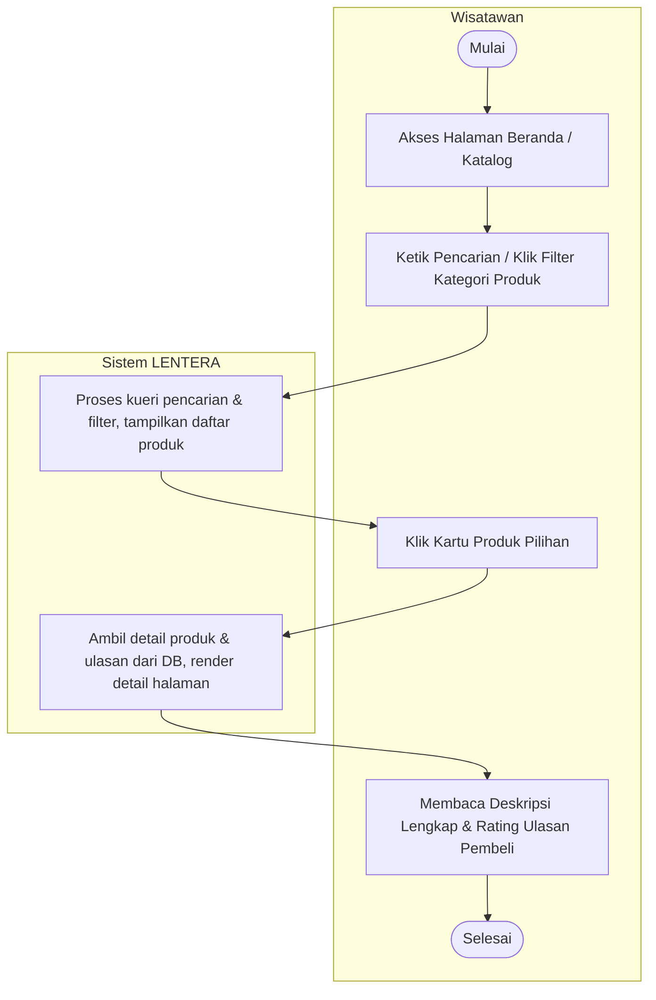

##### Skenario B: Pembelian Produk & Checkout Keranjang Belanja via WhatsApp (REQ-CAT)
Diagram aktivitas ini memodelkan alur interaksi wisatawan saat menambahkan produk ke keranjang belanja sementara hingga melakukan checkout pesanan ke WhatsApp penjual:

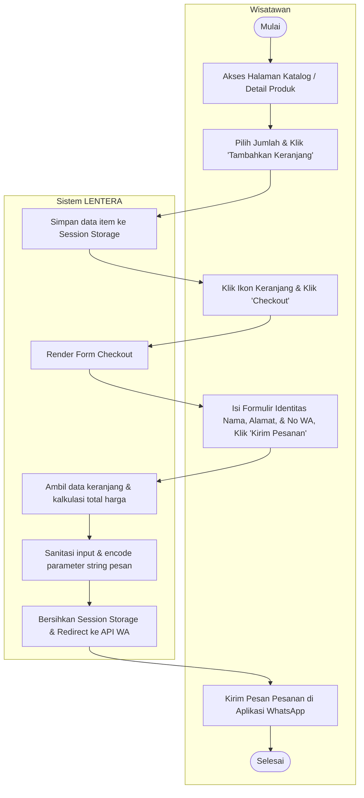

##### Skenario C: Membaca Artikel Edukasi & Buletin Desa (REQ-RES)
Diagram aktivitas ini memodelkan wisatawan saat menjelajahi portal edukasi pertanian kopi/jeruk serta membaca artikel buletin pariwisata Desa Kucur:

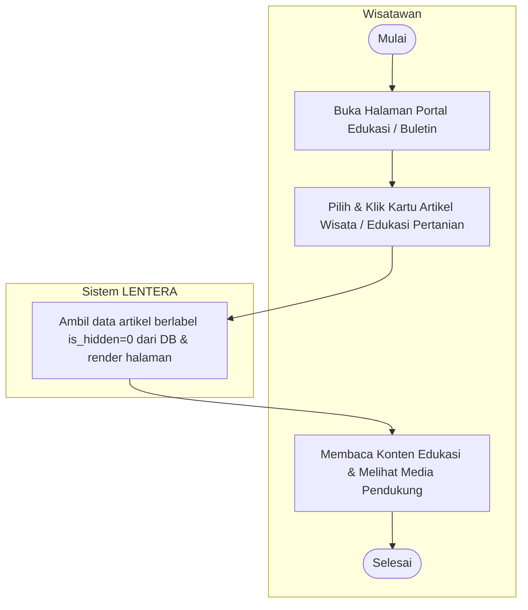

##### Skenario D: Penulisan Ulasan Testimoni Wisatawan (REQ-RES)
Diagram aktivitas ini memodelkan wisatawan saat mengirimkan ulasan testimonial pariwisata beserta rating bintang dan unggahan media foto pendukung:

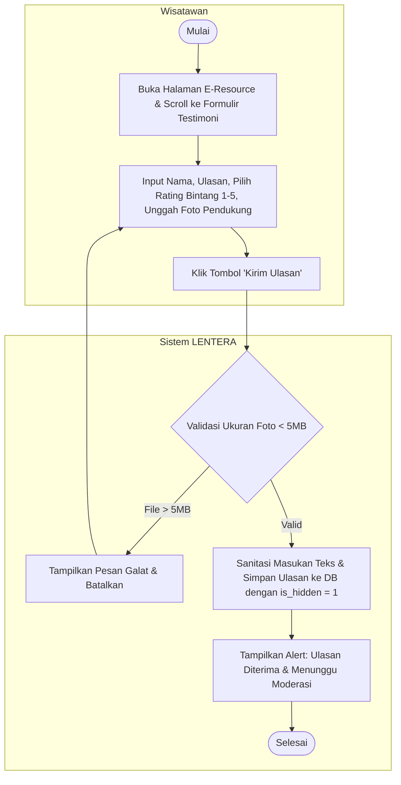

##### Skenario E: Eksplorasi Peta Spasial & Filter Kategori Lokasi (REQ-LOC)
Diagram aktivitas ini memodelkan wisatawan saat berinteraksi dengan peta interaktif, memfilter marker kerangka spasial pariwisata, dan melihat info ringkas tempat:

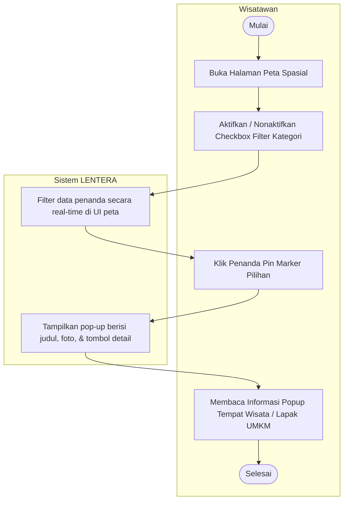

##### Skenario F: Navigasi GPS Wisatawan & Tombol Darurat SOS (REQ-NAV)
Diagram aktivitas ini memodelkan wisatawan saat menggunakan fitur navigasi peta hingga melakukan panggilan koordinat darurat (SOS) ke Admin Karang Taruna:

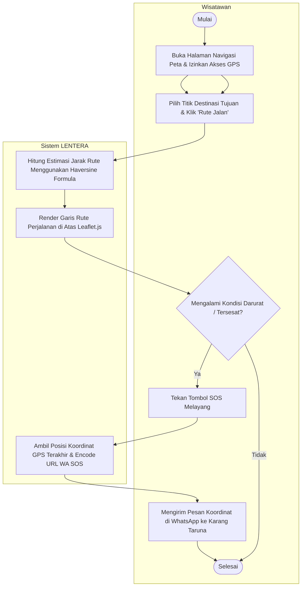

##### Skenario G: Manajemen Profil Wisatawan & Cetak Riwayat Pesanan (REQ-AUTH / Profil)
Diagram aktivitas ini memodelkan wisatawan saat mengakses profil akun terdaftar, merubah data nama, dan mencetak invoice bukti transaksi:

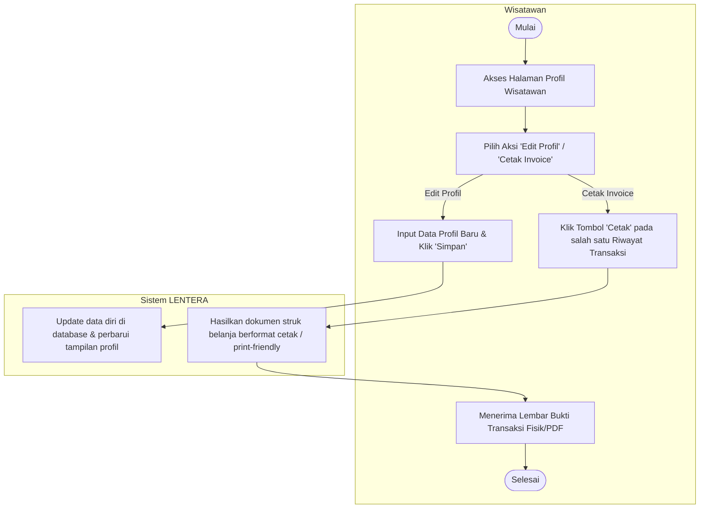

#### B. Kelompok Aktivitas Dasbor Internal & Administrasi (Dashboard Area)

##### Skenario H: Autentikasi Login JWT & Otorisasi RBAC (REQ-AUTH)
Diagram aktivitas ini memodelkan proses verifikasi masuk dasbor privat dan pembatasan wewenang halaman internal sesuai dengan peran otorisasi pengguna:

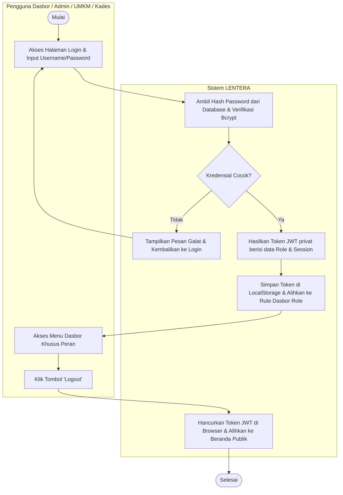

##### Skenario I: Pengelolaan Artikel & Buletin Desa (REQ-RES)
Diagram aktivitas ini memodelkan proses pembuatan dan publikasi artikel berita tani atau buletin desa oleh Admin Karang Taruna melalui dasbor:

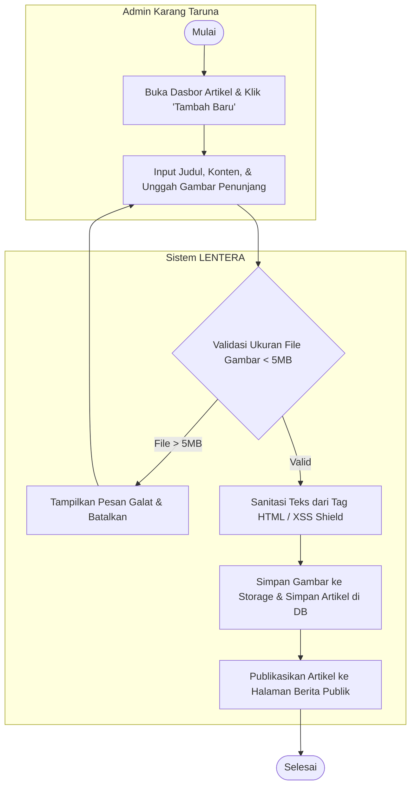

##### Skenario J: Moderasi Ulasan Testimoni Wisatawan (REQ-RES)
Diagram aktivitas ini memodelkan proses persetujuan ulasan masuk yang dilakukan oleh Admin Karang Taruna agar dapat ditayangkan secara publik:

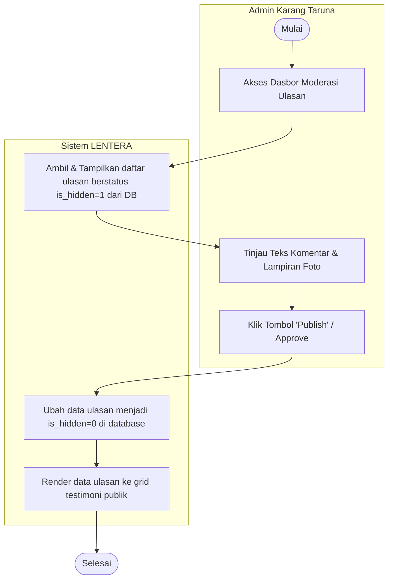

##### Skenario K: Pendaftaran & Approval Proposal Kemitraan Sponsorship B2B (REQ-SPO)
Diagram aktivitas ini memodelkan proses penawaran proposal kemitraan investasi oleh Sponsor (Investor B2B) hingga persetujuan dan pembukuan resmi oleh Kepala Desa:

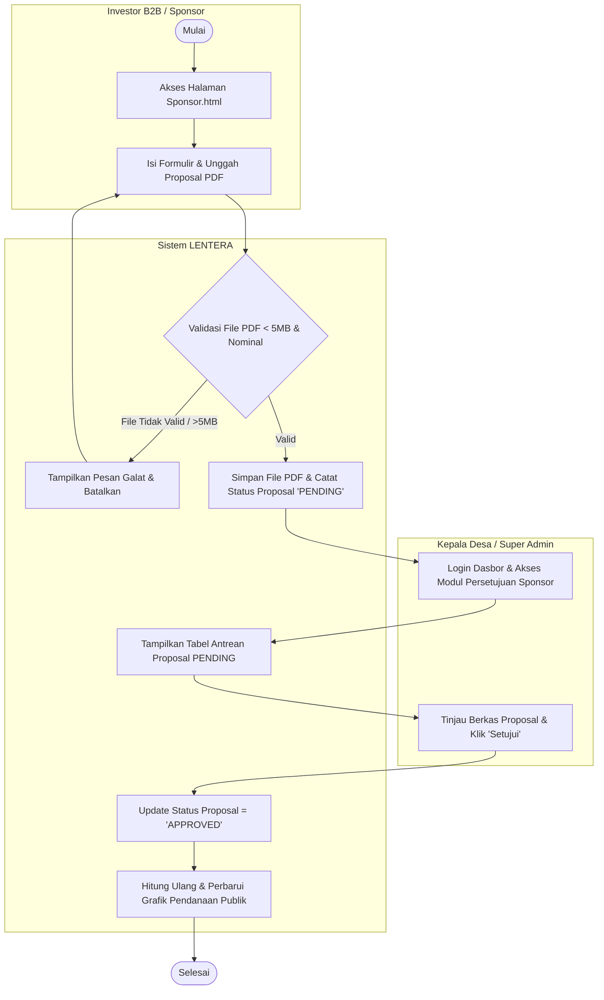

##### Skenario L: Pengelolaan Titik Koordinat Lokasi Spasial (REQ-LOC)
Diagram aktivitas ini memodelkan proses penambahan marker pariwisata baru ke dalam database peta spasial oleh Admin Karang Taruna:

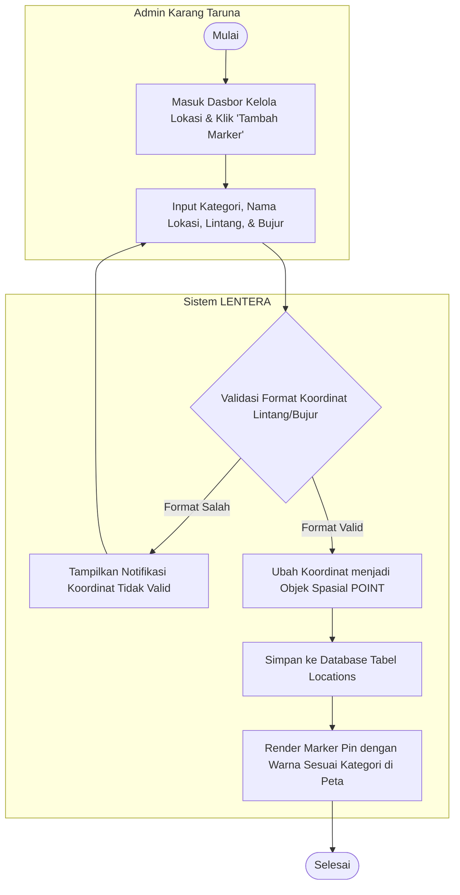

##### Skenario M: Pengajuan & Approval Pencairan Saldo UMKM (REQ-FIN)
Diagram aktivitas ini memodelkan penarikan saldo keuntungan hasil penjualan oleh mitra UMKM (Penjual) hingga pencairan dana dan transfer bank yang disetujui Kepala Desa:

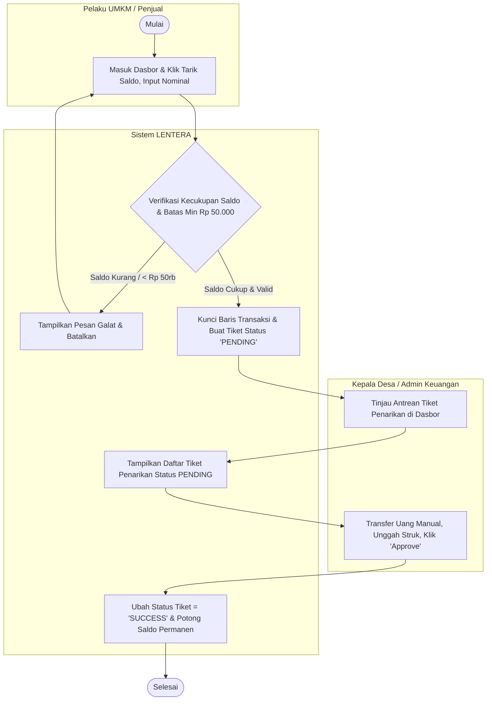

#### 4.3.6 Diagram Logis (ERD & Class Diagram)
Rancangan pemodelan data logis dari platform LENTERA disajikan melalui Entity Relationship Diagram (ERD) untuk struktur basis data relasional dan Class Diagram untuk domain logic model perangkat lunak sebagai berikut:

##### A. Entity Relationship Diagram (ERD)
Hubungan relasional antar-tabel dalam basis data LENTERA dimodelkan melalui diagram ERD berikut:

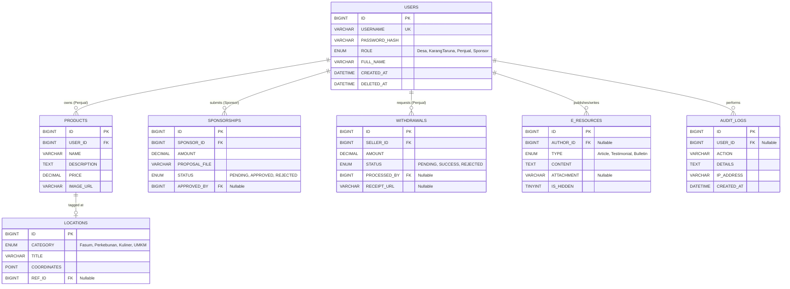

##### B. Class Diagram
Class diagram berikut mendemonstrasikan bagaimana setiap objek domain logika bisnis dan komponen perangkat lunak (Front-End & Back-End) saling berinteraksi dengan objek data persisten di dalam sistem LENTERA:

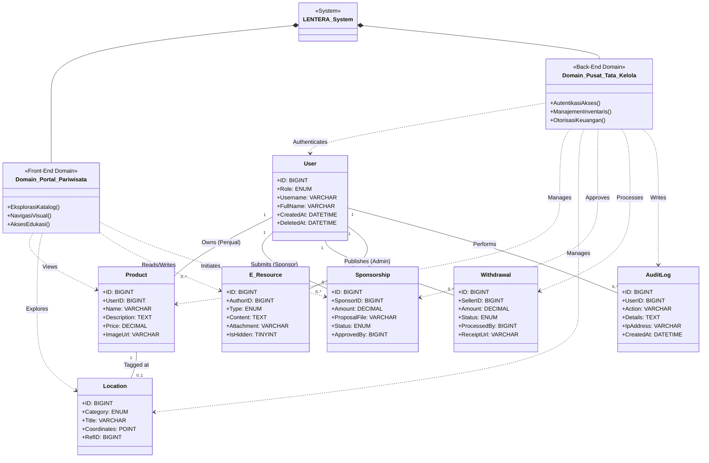

#### 4.3.7 Struktur Tabel Database
Rincian fisik skema tabel dalam RDBMS dirancang sebagai berikut:

##### 1. Tabel `Users`
Menyimpan data kredensial pengelola dasbor.
*   `ID` (BIGINT, PK, Auto Increment)
*   `USERNAME` (VARCHAR(50), Unique)
*   `PASSWORD_HASH` (VARCHAR(255))
*   `ROLE` (ENUM('Desa', 'KarangTaruna', 'Penjual', 'Sponsor'))
*   `FULL_NAME` (VARCHAR(100))
*   `CREATED_AT` (DATETIME)
*   `DELETED_AT` (DATETIME, Nullable for Soft-Delete)

##### 2. Tabel `Products` (Katalog UMKM)
Menyimpan data produk yang dijajakan oleh UMKM.
*   `ID` (BIGINT, PK, Auto Increment)
*   `USER_ID` (BIGINT, FK referencing `Users.ID`)
*   `NAME` (VARCHAR(150))
*   `DESCRIPTION` (TEXT)
*   `PRICE` (DECIMAL(10,2))
*   `IMAGE_URL` (VARCHAR(255))

##### 3. Tabel `Locations` (Data Spasial Map)
Menyimpan koordinat penanda lokasi destinasi wisata & gerai produk.
*   `ID` (BIGINT, PK, Auto Increment)
*   `CATEGORY` (ENUM('Fasum', 'Perkebunan', 'Kuliner', 'UMKM'))
*   `TITLE` (VARCHAR(100))
*   `COORDINATES` (POINT / GEOMETRY, format data spasial)
*   `REF_ID` (BIGINT, FK referencing `Products.ID`, Nullable)

##### 4. Tabel `Sponsorships` (Investasi Kemitraan)
Menyimpan berkas proposal dan status dana sponsor.
*   `ID` (BIGINT, PK, Auto Increment)
*   `SPONSOR_ID` (BIGINT, FK referencing `Users.ID`)
*   `AMOUNT` (DECIMAL(15,2))
*   `PROPOSAL_FILE` (VARCHAR(255), link file PDF < 5MB)
*   `STATUS` (ENUM('PENDING', 'APPROVED', 'REJECTED'))
*   `APPROVED_BY` (BIGINT, FK referencing `Users.ID`, Nullable)

##### 5. Tabel `Withdrawals` (Penarikan Keuangan)
Menyimpan log pengajuan pencairan komisi penjualan UMKM.
*   `ID` (BIGINT, PK, Auto Increment)
*   `SELLER_ID` (BIGINT, FK referencing `Users.ID`)
*   `AMOUNT` (DECIMAL(12,2), minimal pengajuan Rp 50.000)
*   `STATUS` (ENUM('PENDING', 'SUCCESS', 'REJECTED'))
*   `PROCESSED_BY` (BIGINT, FK referencing `Users.ID`, Nullable)
*   `RECEIPT_URL` (VARCHAR(255), link bukti transfer bank, Nullable)

##### 6. Tabel `E_Resources` (Dokumentasi & Ulasan)
Menyimpan artikel edukasi, ulasan pengunjung, dan berita desa.
*   `ID` (BIGINT, PK, Auto Increment)
*   `AUTHOR_ID` (BIGINT, FK referencing `Users.ID`, Nullable)
*   `TYPE` (ENUM('Article', 'Testimonial', 'Bulletin'))
*   `CONTENT` (TEXT)
*   `ATTACHMENT` (VARCHAR(255), link media ulasan/banner berita, Nullable)
*   `IS_HIDDEN` (TINYINT(1), default 0)

##### 7. Tabel `Audit_Logs` (Riwayat Aktivitas/Audit)
Menyimpan data riwayat mutasi data sensitif untuk audit kepatuhan hukum perlindungan data.
*   `ID` (BIGINT, PK, Auto Increment)
*   `USER_ID` (BIGINT, FK referencing `Users.ID`, Nullable)
*   `ACTION` (VARCHAR(100))
*   `DETAILS` (TEXT)
*   `IP_ADDRESS` (VARCHAR(45))
*   `CREATED_AT` (DATETIME)

---

### 4.4 Tahap Konstruksi (Construction)
 
#### 4.4.1 Implementasi Antarmuka Pengguna (User Interface)
Bagian ini mendeskripsikan implementasi visual dari antarmuka halaman portal LENTERA berdasarkan berkas-berkas halaman HTML yang ada di dalam direktori `LENTERA/`:
 
##### A. Kelompok Antarmuka Publik (Public Area)
 
1.  **Halaman Beranda (UI-PUB-01-A) - Berkas: `LENTERA/Home.html`**
    *   Menyajikan profil singkat desa, info pariwisata Kucur, dan navigasi utama.
    *   *Gambar:* [Halaman Beranda Utama (LENTERA/Home.html)](LENTERA/Home.png)
 
2.  **Halaman Katalog Produk (UI-PUB-01-B) - Berkas: `LENTERA/Catalog.html`**
    *   Menyajikan etalase produk UMKM Desa Kucur bagi pengunjung publik dan cart belanja.
    *   *Gambar:* [Halaman Katalog](LENTERA/Catalog.png)
 
3.  **Halaman Peta Spasial (UI-PUB-02-A) - Berkas: `LENTERA/Location.html`**
    *   Menyajikan peta spasial interaktif batas wilayah desa beserta penanda destinasi wisata.
    *   *Gambar:* [Halaman Peta Spasial (LENTERA/Location.html)](LENTERA/Location.png)
 
4.  **Halaman Sistem Navigasi (UI-PUB-02-B) - Berkas: `LENTERA/Navigation.html`**
    *   Menampilkan rute perjalanan dinamis antara posisi GPS wisatawan dan titik lokasi tujuan di atas Leaflet.js.
    *   *Gambar:* [Halaman Navigasi](LENTERA/Navigation.png)
 
5.  **Halaman Detail Produk (UI-PUB-01-DET) - Berkas: `LENTERA/Product-Detail.html`**
    *   Menyajikan deskripsi lengkap produk, sisa stok, panel kuantitas, dan ulasan pembeli.
    *   *Gambar:* [Halaman Detail Produk (LENTERA/Product-Detail.html)](LENTERA/Product-Detail.png)
 
6.  **Halaman Formulir Checkout (UI-PUB-01-CHK) - Berkas: `LENTERA/Checkout.html`**
    *   Mengisi informasi pengiriman produk dan data kontak pembeli.
    *   *Gambar:* [Halaman Checkout (LENTERA/Checkout.html)](LENTERA/Checkout.png)
 
7.  **Portal Sponsorship (UI-PUB-04) - Berkas: `LENTERA/Sponsor.html`**
    *   Menyajikan formulir pengajuan proposal kemitraan investor dan statistik visual real-time investasi masuk.
    *   *Gambar:* [Portal Sponsorship (LENTERA/Sponsor.html)](LENTERA/Sponsor.png)
 
8.  **Halaman Edukasi Agrowisata (UI-PUB-03-A) - Berkas: `LENTERA/Education.html`**
    *   Menyajikan artikel literasi perkebunan kopi dan jeruk Desa Kucur.
    *   *Gambar:* [Halaman Edukasi (LENTERA/Education.html)](LENTERA/Education.png)
 
9.  **Halaman E-Resource & Testimoni (UI-PUB-03-B) - Berkas: `LENTERA/E-resource.html`**
    *   Menyajikan ulasan testimoni dari pembeli dan form input ulasan dengan upload media.
    *   *Gambar:* [Halaman E-Resource](LENTERA/E-resource.png)
 
10. **Halaman Profil Pengguna (UI-PUB-05) - Berkas: `LENTERA/Profile.html`**
    *   Menampilkan profil wisatawan dan riwayat transaksi pesanan produk.
    *   *Gambar:* [Halaman Profil (LENTERA/Profile.html)](LENTERA/Profile.png)
 
##### B. Kelompok Antarmuka Dasbor Pengelola (Dashboard Area)
 
11. **Layar Kredensial Masuk (UI-ADM-01) - Berkas: `LENTERA/Login.html`**
    *   Formulir login masuk administrator dan pelaku UMKM terintegrasi sesi token JWT.
    *   *Gambar:* [Layar Login Dasbor (LENTERA/Login.html)](LENTERA/Login.png)
 
12. **Dasbor Perangkat Desa - Ringkasan (UI-ADM-02-A) - Berkas: `LENTERA/DashboardPerangkatDesa/index.html` (Tab Dashboard)**
    *   Halaman grafik statistik perekonomian dan kartu KPI Desa Wisata Kucur bagi Kepala Desa.
    *   *Gambar:* [Dasbor Overview & Statistik (LENTERA/DashboardPerangkatDesa/index.html)](LENTERA/DashboardPerangkatDesa_index.png)
 
13. **Dasbor Perangkat Desa - Kelola E-Resource (UI-ADM-02-B) - Berkas: `LENTERA/DashboardPerangkatDesa/index.html` (Tab E-Resource)**
    *   CMS bagi pengelola untuk mengunggah pengumuman, buletin desa, dan melakukan moderasi ulasan.
    *   *Gambar:* [Dasbor Perangkat Desa - Kelola E-Resource](LENTERA/DashboardPerangkatDesa_EResource.png)
 
14. **Dasbor Perangkat Desa - Setting Akun (UI-ADM-02-C) - Berkas: `LENTERA/DashboardPerangkatDesa/index.html` (Tab Setting Akun)**
    *   Pengelolaan data identitas dan pembuatan akun admin Karang Taruna operasional baru.
    *   *Gambar:* [Dasbor Perangkat Desa - Setting Akun](LENTERA/DashboardPerangkatDesa_Accounts.png)
 
15. **Dasbor Perangkat Desa - Approval Sponsorship (UI-ADM-02-D) - Berkas: `LENTERA/DashboardPerangkatDesa/index.html` (Tab Sponsorship)**
    *   Halaman tata kelola dan persetujuan proposal sponsor kemitraan B2B.
    *   *Gambar:* [Dasbor Perangkat Desa - Approval Sponsorship](LENTERA/DashboardPerangkatDesa_Sponsor.png)
 
16. **Dasbor Perangkat Desa - Pengaturan Desa (UI-ADM-02-E) - Berkas: `LENTERA/DashboardPerangkatDesa/index.html` (Tab Pengaturan Desa)**
    *   Konfigurasi wewenang Karang Taruna dan pembersihan basis data lokal.
    *   *Gambar:* [Dasbor Perangkat Desa - Pengaturan Desa](LENTERA/DashboardPerangkatDesa_Settings.png)
 
17. **Dasbor Mitra UMKM - Ringkasan (UI-ADM-03-A) - Berkas: `LENTERA/DashboardUMKM.html` (Tab Ringkasan)**
    *   Menampilkan ringkasan keuangan UMKM, status pesanan baru, dan total produk aktif.
    *   *Gambar:* [Dasbor Mitra UMKM - Ringkasan](LENTERA/DashboardUMKM_Ringkasan.png)
 
18. **Dasbor Mitra UMKM - Produk Saya (UI-ADM-03-B) - Berkas: `LENTERA/DashboardUMKM.html` (Tab Produk)**
    *   Menu penambahan katalog produk UMKM dan manajemen CRUD produk aktif di etalase.
    *   *Gambar:* [Dasbor Mitra UMKM - Produk Saya](LENTERA/DashboardUMKM_Produk.png)
 
19. **Dasbor Mitra UMKM - Pesanan Masuk (UI-ADM-03-C) - Berkas: `LENTERA/DashboardUMKM.html` (Tab Pesanan)**
    *   Mengelola riwayat pesanan belanja wisatawan dan pengisian nomor resi.
    *   *Gambar:* [Dasbor Mitra UMKM - Pesanan Masuk](LENTERA/DashboardUMKM_Pesanan.png)
 
20. **Dasbor Mitra UMKM - Penarikan Dana (UI-ADM-03-D) - Berkas: `LENTERA/DashboardUMKM.html` (Tab Penarikan)**
    *   Form pengajuan penarikan dana saldo hasil penjualan dan log transaksi penarikan.
    *   *Gambar:* [Dasbor Mitra UMKM - Penarikan Dana](LENTERA/DashboardUMKM_Penarikan.png)
 
21. **Dasbor Mitra UMKM - Profil Toko (UI-ADM-03-E) - Berkas: `LENTERA/DashboardUMKM.html` (Tab Profil)**
    *   Pengaturan profil usaha UMKM dan info nomor rekening bank transfer.
    *   *Gambar:* [Dasbor Mitra UMKM - Profil Toko](LENTERA/DashboardUMKM_Profil.png)

### 4.5 Tahap Serah Terima dan Pengujian (Cutover)
Tahap serah terima dan pengujian merupakan tahap akhir dari siklus pengembangan RAD. Tahap ini diisi dengan pelaksanaan pengujian fungsionalitas sistem secara terstruktur serta evaluasi hasil implementasi bersama mitra Desa Kucur untuk memperoleh umpan balik.

#### 4.5.1 Rencana Hasil Pengujian (Testing)
Pengujian sistem dilakukan dengan teknik *Black-Box Testing* untuk memverifikasi kesesuaian sistem dengan spesifikasi fungsional (SRS):

| Kode Uji | Skenario Pengujian | Input Data | Hasil yang Diharapkan | Status |
| :--- | :--- | :--- | :--- | :--- |
| **TC-CAT-01** | Pengujian agregasi harga keranjang belanja. | Memasukkan 2 item produk (Rp 25k & Rp 50k). | Keranjang mendeteksi total harga otomatis senilai Rp 75.000. | Berhasil |
| **TC-AUTH-01**| Pembatasan rute akses Dasbor (RBAC). | Admin mencoba mengakses URL menu `Final Approval` milik Desa. | Sistem menolak akses, menampilkan HTTP 403 Forbidden, dan melempar kembali. | Berhasil |
| **TC-LOC-01** | Penggunaan filter marker spasial. | Menekan filter kategori "Perkebunan". | Peta hanya menampilkan marker hijau (kebun kopi/jeruk), menyembunyikan kategori lain. | Berhasil |
| **TC-FIN-01** | Pengajuan *withdrawal* di bawah saldo minimum. | Mengajukan penarikan sebesar Rp 30.000. | Sistem menolak pengajuan dan menampilkan error minimum pencairan Rp 50.000. | Berhasil |
| **TC-RES-01** | Unggah dokumen E-Resource melebihi limit. | Mengunggah file PDF proposal berukuran 7.2 MB. | Server menolak file secara otomatis dengan mengembalikan error kode pembatasan 5MB. | Berhasil |

#### 4.5.2 Hasil Evaluasi dan Masukan Mitra (Desa Kucur)
Setelah melakukan presentasi draf rancangan dan uji coba sistem LENTERA kepada mitra Pemerintah Desa Kucur (Kepala Desa dan perwakilan staf), didapatkan evaluasi berupa umpan balik konstruktif untuk penyempurnaan sistem. Secara garis besar, mitra menyetujui efektivitas platform LENTERA, namun memberikan satu masukan revisi krusial pada modul **Sistem Navigasi (*Navigation*)**:
*   **Kondisi Desain Awal**: Desain sistem navigasi awal yang menampilkan peta geospasial dengan Leaflet Routing Machine dinamis dinilai terlalu rumit untuk pengguna umum/wisatawan di lapangan yang sering kali mengalami kendala koneksi internet tidak stabil di area perkebunan.
*   **Masukan Revisi**: Mitra meminta agar peta rute navigasi diganti menjadi **pilihan daftar destinasi wisata** secara langsung, serta dilengkapi dengan opsi cepat **"Hubungi Admin untuk Mendapatkan Local Guide"** via WhatsApp. Fitur ini dinilai lebih praktis bagi wisatawan sekaligus memberdayakan karang taruna desa sebagai pemandu wisata lokal.
*   **Tindakan Penyesuaian**: Kebutuhan sistem pada modul navigasi disesuaikan dari semula visualisasi rute spasial dinamis menjadi sistem direktori pilihan destinasi terintegrasi WhatsApp booking pemandu wisata.

#### 4.5.3 Analisis Kinerja Teknis
Dari hasil pengujian dan analisis data, platform LENTERA secara arsitektural telah berhasil mengimplementasikan aturan bisnis pariwisata Desa Kucur. Desain modular mempermudah pengembangan lanjutan, pemisahan Front-End dan Back-End meminimalkan latensi pemuatan halaman, serta implementasi transaksi ACID secara sukses menghalangi terjadinya data ganda (*race condition*) pada saldo kas UMKM selama proses penarikan saldo keuntungan (*withdrawal*).

---

# BAB V
# PENUTUP

### 5.1 Kesimpulan
Berdasarkan hasil analisis, perancangan, dan draf dokumentasi kegiatan PKL mengenai Sistem Informasi Manajemen Desa Wisata (LENTERA) di Desa Kucur, dapat disimpulkan bahwa:
1.  Dokumen Spesifikasi Kebutuhan Perangkat Lunak (SRS) yang disusun berdasarkan standar IEEE Std 830-1998 telah sukses mengidentifikasi seluruh fitur esensial sistem yang selaras dengan profil wisata desa.
2.  Dokumen Perancangan Desain Perangkat Lunak (SDD) telah berhasil memodelkan arsitektur *Three-Tier*, desain basis data relasional dengan konstrain spasial, alur UML diagram yang dinamis, serta rencana mitigasi keamanan RBAC berbasis JWT.
3.  Platform LENTERA siap dilanjutkan ke tahap konstruksi/pengkodean secara penuh guna membantu meningkatkan kemandirian ekonomi pelaku UMKM dan mempermudah pengawasan eksekutif bagi aparatur pemerintah Desa Kucur.

### 5.2 Saran
Beberapa saran pengembangan sistem LENTERA di masa depan meliputi:
1.  Mengintegrasikan sistem pembayaran digital instan (*Payment Gateway* seperti Midtrans/Xendit) untuk meminimalisir validasi transaksi secara manual.
2.  Menambahkan integrasi sinkronisasi data kependudukan desa (NIK) bekerja sama dengan Dispendukcapil daerah untuk meningkatkan validitas pendaftaran akun warga/mitra.
3.  Mengembangkan versi aplikasi *mobile native* (Android/iOS) guna mempermudah akses peta geospasial bagi wisatawan yang langsung berkunjung di lapangan.

---

# DAFTAR PUSTAKA

1.  IEEE Standards Board. (1998). *IEEE Recommended Practice for Software Requirements Specifications* (IEEE Std 830-1998). New York: Institute of Electrical and Electronics Engineers.
2.  Pemerintah Desa Kucur. (2025). *Rencana Pembangunan Jangka Menengah Desa (RPJMDes) Desa Kucur terkait Digitalisasi Administrasi dan Pariwisata*. Malang: Kantor Desa Kucur.
3.  Pressman, R. S. (2015). *Software Engineering: A Practitioner's Approach (8th Edition)*. New York: McGraw-Hill Education.
4.  Sutabri, T. (2012). *Analisis Sistem Informasi*. Yogyakarta: Penerbit Andi.
