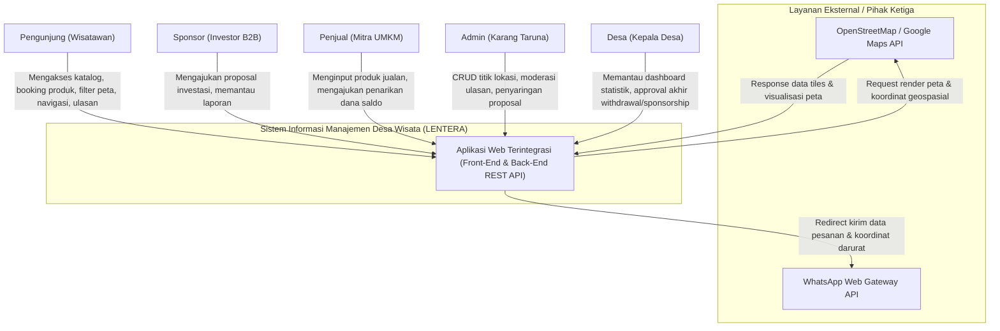
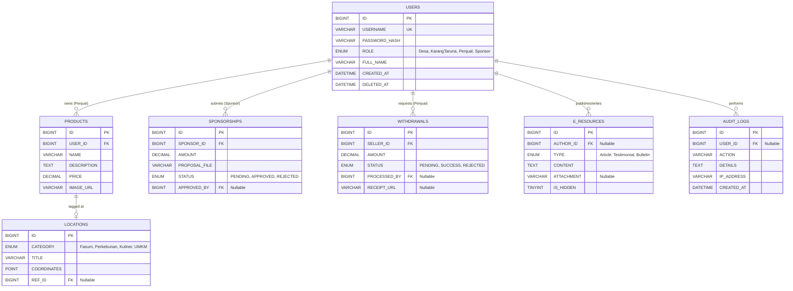
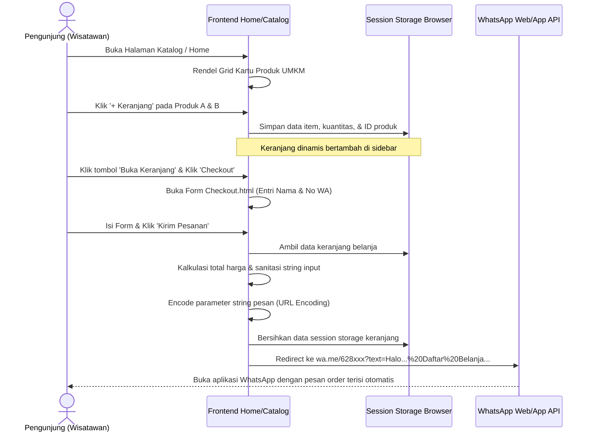
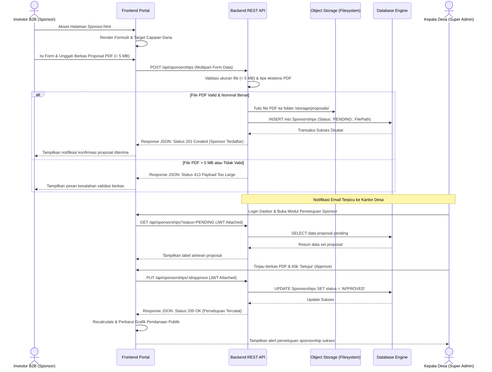
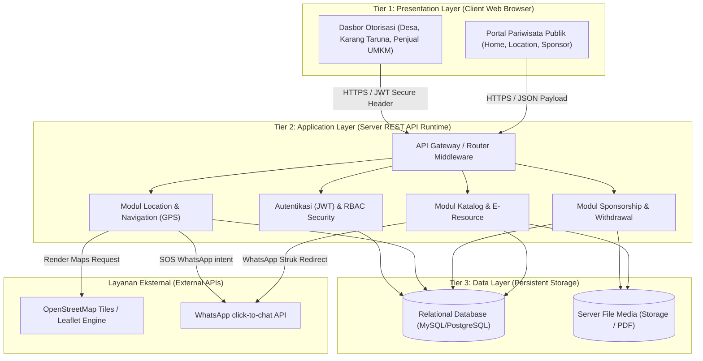
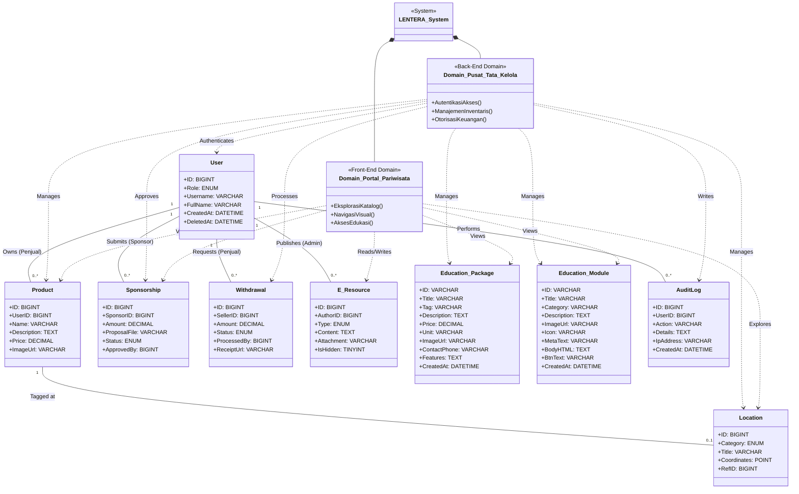

# Software Requirements and Design Specification (SRDS)
## untuk
## Sistem Informasi Manajemen Desa Wisata (LENTERA)
**Berdasarkan Standar Gabungan:** IEEE Std 830-1998 (SRS) & IEEE Std 1016-1998 (SDD)

---

# Table of Contents
1. [Introduction](#1-introduction)
   - 1.1 [Purpose](#11-purpose)
   - 1.2 [Scope](#12-scope)
   - 1.3 [Intended Audience and Document Use](#13-intended-audience-and-document-use)
   - 1.4 [References](#14-references)
   - 1.5 [Definitions, Acronyms, and Abbreviations](#15-definitions-acronyms-and-abbreviations)
   - 1.6 [Document Overview](#16-document-overview)
2. [Overall Description](#2-overall-description)
   - 2.1 [System or Product Perspective](#21-system-or-product-perspective)
   - 2.2 [System or Product Functions](#22-system-or-product-functions)
   - 2.3 [User Characteristics](#23-user-characteristics)
   - 2.4 [Constraints, Assumptions, and Dependencies](#24-constraints-assumptions-and-dependencies)
   - 2.5 [Operational Environment](#25-operational-environment)
3. [Functional Requirements](#3-functional-requirements)
   - 3.1 [Registrasi Transaksi Produk & Manajemen Katalog (REQ-CAT)](#31-registrasi-transaksi-produk--manajemen-katalog-req-cat)
   - 3.2 [Tata Laksana Dokumentasi & E-Resource (REQ-RES)](#32-tata-laksana-dokumentasi--e-resource-req-res)
   - 3.3 [Otorisasi Log-In dan Dasbor (REQ-AUTH)](#33-otorisasi-log-in-dan-dasbor-req-auth)
   - 3.4 [Otomatisasi Proposal Sponsorship (REQ-SPO)](#34-otomatisasi-proposal-sponsorship-req-spo)
   - 3.5 [Pemetaan Spasial Desa / Location (REQ-LOC)](#35-pemetaan-spasial-desa--location-req-loc)
   - 3.6 [Sistem Navigasi & Kedaruratan / Navigation (REQ-NAV)](#36-sistem-navigasi--kedaruratan--navigation-req-nav)
   - 3.7 [Tata Kelola Keuangan / Withdrawal (REQ-FIN)](#37-tata-kelola-keuangan--withdrawal-req-fin)
4. [Non-Functional Requirements](#4-non-functional-requirements)
   - 4.1 [Performance Requirements](#41-performance-requirements)
   - 4.2 [Safety and Security Requirements](#42-safety-and-security-requirements)
   - 4.3 [Reliability and Availability](#43-reliability-and-availability)
   - 4.4 [Usability and Human Factors](#44-usability-and-human-factors)
   - 4.5 [Maintainability and Support](#45-maintainability-and-support)
   - 4.6 [Portability and Compatibility](#46-portability-and-compatibility)
   - 4.7 [Other Quality Attributes](#47-other-quality-attributes)
5. [External Interface Requirements](#5-external-interface-requirements)
   - 5.1 [User Interfaces](#51-user-interfaces)
   - 5.2 [Hardware Interfaces](#52-hardware-interfaces)
   - 5.3 [Software Interfaces](#53-software-interfaces)
   - 5.4 [Communications Interfaces](#54-communications-interfaces)
6. [Other Requirements (Optional)](#6-other-requirements-optional)
   - 6.1 [Legal or Regulatory Requirements](#61-legal-or-regulatory-requirements)
   - 6.2 [Internationalization and Localization](#62-internationalization-and-localization)
   - 6.3 [Data Requirements](#63-data-requirements)
7. [Verification and Validation](#7-verification-and-validation)
   - 7.1 [Requirements Verification Methods](#71-requirements-verification-methods)
   - 7.2 [Acceptance Criteria](#72-acceptance-criteria)
8. [Appendices](#8-appendices)
   - 8.1 [Appendix A: Glossary](#81-appendix-a-glossary)
   - 8.2 [Appendix B: Use Cases / Scenarios](#82-appendix-b-use-cases--scenarios)
   - 8.3 [Appendix C: Traceability Matrix](#83-appendix-c-traceability-matrix)
   - 8.4 [Appendix D: Supporting Diagrams](#84-appendix-d-supporting-diagrams)

---

# 1. Introduction

### 1.1 Purpose
Tujuan dari dokumen spesifikasi dan perancangan terintegrasi (*Software Requirements and Design Specification*) ini adalah untuk menetapkan spesifikasi kebutuhan perangkat lunak keseluruhan sekaligus merinci arsitektur teknis dari **Sistem Informasi Manajemen Desa Wisata** **Versi 1.0**. Dokumen ini mencakup spesifikasi kebutuhan fungsional dan non-fungsional, arsitektur sistem (Three-Tier), rancangan struktur data basis data relasional, antarmuka pengguna, serta model aliran aplikasi. Dokumen ini merupakan acuan formal terintegrasi bagi seluruh tim rekayasa perangkat lunak (manajer proyek, analis, desainer antarmuka, pengembang *full-stack*, dan *quality assurance*) selama fase konstruksi, pengujian, audit, dan implementasi sistem secara riil.

### 1.2 Scope
Platform Sistem Informasi Manajemen Desa Wisata adalah sebuah aplikasi berbasis web responsif modern skala produksi yang dirancang khusus untuk memajukan digitalisasi potensi ekonomi dan pariwisata Desa Kucur, Kecamatan Dau, Kabupaten Malang. Ruang lingkup aplikasi ini meliputi:
1.  **Portal Publik (Front-End Eksternal)**: Layanan terdepan untuk wisatawan dan investor publik yang menyajikan Katalog Produk UMKM lokal terintegrasi keranjang belanja, peta geospasial interaktif (titik marker destinasi), sistem panduan rute navigasi berbasis GPS, portal artikel buletin edukatif desa, formulir pengajuan investasi sponsorship B2B, serta formulir pengisian testimoni/ulasan wisatawan.
2.  **Dashboard Area (Back-End Internal)**: Panel administratif terproteksi berbasis otorisasi token *JSON Web Token* (JWT) dengan alur *Role-Based Access Control* (RBAC) yang terbagi untuk 3 entitas pengguna: pelaku wirausaha UMKM (Penjual), Karang Taruna (Admin), dan Kepala Desa (Super Admin/Desa). Fungsi internal ini mencakup manajemen basis data (CRUD Katalog & Lokasi), moderasi testimoni, pelacakan proposal kemitraan investor, pengelolaan tiket pencairan dana (*withdrawal*) penjual, serta dasbor visualisasi grafik analitik statistik KPI ekonomi desa secara *real-time*.

### 1.3 Intended Audience and Document Use
Dokumen gabungan ini dirancang untuk beberapa pembaca sasaran:
1.  **Manajer Proyek & Aparatur Desa**: Berfokus pada Bab 1 (*Introduction*) dan Bab 2 (*Overall Description*) untuk memahami arah, cakupan, batasan, dan tujuan bisnis sistem LENTERA secara konseptual.
2.  **Desainer UI/UX & Pengembang Aplikasi (*Developers*)**: Membaca secara menyeluruh dengan menaruh perhatian penuh pada Bab 3 (*Functional Requirements*), Bab 5 (*External Interface Requirements*), dan Bab 6 (*Other Requirements / Data Requirements*) untuk menerjemahkan spesifikasi kebutuhan dan rancangan skema data ke dalam bentuk kode sumber (*source code*).
3.  **Penguji Perangkat Lunak (*QA / Testers*)**: Menggunakan Bab 3 (*Functional Requirements*) dan Bab 7 (*Verification and Validation*) sebagai landasan utama penyusunan skenario uji coba (*test cases*) dan penentuan kriteria penerimaan sistem (*acceptance criteria*).

Secara umum, alur dokumen bergerak dari konseptual (Bab 1 dan 2), kebutuhan fungsional (Bab 3), kualitas non-fungsional (Bab 4), rancangan antarmuka & integrasi sistem (Bab 5), arsitektur teknis data & deployment (Bab 6), metode pengujian (Bab 7), dan kumpulan diagram pelengkap (Bab 8).

### 1.4 References
1.  IEEE Standards Board. (1998). *IEEE Recommended Practice for Software Requirements Specifications* (IEEE Std 830-1998). New York: Institute of Electrical and Electronics Engineers.
2.  IEEE Standards Board. (1998). *IEEE Recommended Practice for Software Design Descriptions* (IEEE Std 1016-1998). New York: Institute of Electrical and Electronics Engineers.
3.  Rencana Pembangunan Jangka Menengah Desa (RPJMDes) Desa Kucur terkait Digitalisasi Administrasi dan Pariwisata.

### 1.5 Definitions, Acronyms, and Abbreviations
*   **LENTERA**: *Location, Education, Navigation of Tourism, E-Resource Application*. Platform ekosistem digital terpadu untuk digitalisasi potensi Desa Kucur.
*   **UMKM**: Usaha Mikro, Kecil, dan Menengah. Warga pelaku wirausaha lokal yang menjual komoditas melalui sistem katalog LENTERA.
*   **API**: *Application Programming Interface*. Protokol penghubung komunikasi data antar sistem.
*   **REST / RESTful**: *Representational State Transfer*. Arsitektur standar komunikasi data berbasis protokol HTTP/HTTPS stateless menggunakan format JSON.
*   **JWT**: *JSON Web Token* (RFC 7519). Token terenkripsi untuk otentikasi sesi akses internal dasbor.
*   **RBAC**: *Role-Based Access Control*. Pembatasan hak akses sistem berdasarkan klasifikasi peran pengguna.
*   **ACID**: *Atomicity, Consistency, Isolation, Durability*. Standar integritas transaksi database relasional.
*   **Soft-Delete**: Teknik penghapusan semu data menggunakan penanda stempel waktu (`deleted_at`) tanpa menghapus baris data secara fisik dari disk.
*   **GIS**: *Geographic Information System*. Sistem pengolah data spasial/koordinat geografis.
*   **i18n**: *Internationalization*. Rancangan aplikasi agar mampu mendukung multi-bahasa dengan mudah.

### 1.6 Document Overview
Dokumen ini disusun untuk mengintegrasikan kebutuhan fungsional (persyaratan bisnis) dengan rancangan arsitektural (desain teknis). Bagian awal memaparkan deskripsi sistem secara konseptual dan batasan operasionalnya. Bagian tengah menjabarkan rincian kebutuhan fungsi, non-fungsional, arsitektur data, skema database, ERD, Class Diagram, dan visual antarmuka pengguna. Bagian akhir merinci metode verifikasi sistem serta lampiran diagram alir use case dan traceability matrix.

---

# 2. Overall Description

### 2.1 System or Product Perspective
Sistem Informasi Manajemen Desa Wisata merupakan sebuah platform perangkat lunak baru yang dikembangkan secara mandiri (*new, self-contained product*) untuk merintis digitalisasi Desa Wisata Kucur. Meskipun dikembangkan secara terpisah dari sistem eksternal, sistem ini dirancang dengan antarmuka modular yang memungkinkannya bersinergi dengan ekosistem perangkat lunak lainnya. 

Secara khusus, hubungan Sistem Informasi Manajemen Desa Wisata terhadap entitas pengguna dan layanan eksternal dimodelkan melalui **Context Diagram** berikut:



Sistem ini diimplementasikan menggunakan arsitektur **Three-Tier Architecture** terdistribusi yang memisahkan fungsionalitasnya ke dalam tiga lapisan:
1.  **Presentation Tier (Client Side)**: Lapisan antarmuka pengguna berbasis browser responsif modern. Menggunakan framework Javascript dan CSS kustom untuk merender antarmuka publik dan dasbor administratif. Komunikasi ke peladen dilakukan secara asinkron menggunakan format data JSON.
2.  **Application Tier (Server Side)**: Server web yang bertindak sebagai pelaksana logika bisnis utama (*business logic layer*). Lapisan ini bertugas melakukan sanitasi input, pemrosesan transaksi belanja, validasi token JWT (*JSON Web Token*), pemrosesan kalkulasi radius koordinat, dan menangani webhook eksternal.
3.  **Data Tier (Database Side)**: Lapisan penyimpanan persisten yang menggabungkan Relational Database Management System (RDBMS) dengan dukungan data spasial (GIS) untuk mencatat koordinat geospasial serta *File Server* terpisah untuk menyimpan aset media/gambar dan proposal PDF (dibatasi maksimum 5 MB).

### 2.2 System or Product Functions
Fungsionalitas utama yang disediakan oleh Sistem Informasi Manajemen Desa Wisata didekomposisikan secara terstruktur untuk memisahkan layanan publik eksternal dan panel tata kelola internal dasbor.

Berikut adalah bagan dekomposisi fungsional tingkat tinggi (*high-level functional decomposition*) dari sistem:

*   **Sistem Informasi Manajemen Desa Wisata**
    *   **1. Subsistem Portal Publik (Front-End Eksternal)**
        *   **1.1 Modul Katalog UMKM & Keranjang Belanja**
            *   1.1.1 Penayangan Katalog Produk Warga
            *   1.1.2 Manajemen Sesi Keranjang Belanja (*Shopping Cart*)
            *   1.1.3 Agregasi Harga & Formulir Pemesanan (Pemesanan Fallback WhatsApp)
        *   **1.2 Modul Pemetaan Spasial Desa (Location)**
            *   1.2.1 Visualisasi Pin Peta Interaktif Kategori Tempat
            *   1.2.2 Penyaringan Kategori Tempat (Fasum, Perkebunan, Kuliner, UMKM)
        *   **1.3 Modul Navigasi Wisata & Kedaruratan (Navigation)**
            *   1.3.1 Deteksi GPS & Estimasi Jarak Spasial Rute ke Tujuan
            *   1.3.2 Tombol Kontak Darurat via WhatsApp
        *   **1.4 Modul Edukasi & E-Resource Publik**
            *   1.4.1 Portal Artikel Edukasi Perkebunan Kopi & Jeruk
            *   1.4.2 Formulir Input Testimoni, Rating Ulasan, & Unggahan Gambar Wisatawan
        *   **1.5 Modul Kemitraan Sponsorship**
            *   1.5.1 Formulir Registrasi Investor B2B & Unggah Dokumen Proposal PDF
            *   1.5.2 Penayangan Grafik Statistik Agregat Investasi Masuk
    *   **2. Subsistem Dasbor Tata Kelola (Back-End Internal)**
        *   **2.1 Modul Manajemen Akses & Autentikasi**
            *   2.1.1 Otorisasi Login Kredensial & Pembangkitan Sesi Token JWT
            *   2.1.2 Layer Middleware Keamanan Peran (*Role-Based Access Control* / RBAC)
        *   **2.2 Modul Administratif Data (CRUD)**
            *   2.2.1 CRUD Data Katalog Produk Milik UMKM
            *   2.2.2 CRUD Pin Marker Spasial Lokasi
            *   2.2.3 CRUD Berita & Konten Artikel Edukasi Desa
        *   **2.3 Modul Verifikasi & Persetujuan (Approval)**
            *   2.3.1 Approval Tiket Penarikan Saldo (*Withdrawal*) UMKM dengan Proteksi ACID
            *   2.3.2 Verifikasi & Persetujuan Proposal Sponsorship Investor
            *   2.3.3 Dashboard KPI Visualisasi Grafik Statistik Kinerja Agregat Eksekutif

### 2.3 User Characteristics
Sirkulasi operasional dan keamanan data Sistem Informasi Manajemen Desa Wisata didukung oleh lima tingkatan pengguna dengan keahlian, peran, dan karakteristik yang berbeda:

1.  **Pengunjung (Wisatawan)**:
    *   *Profil & Peran*: Masyarakat umum luar desa yang berkunjung secara digital untuk mengeksplorasi potensi pariwisata, membaca buletin desa, menelusuri lokasi geografis tempat wisata, serta melakukan transaksi belanja produk lokal UMKM.
    *   *Tingkat Keahlian*: Rendah hingga Menengah. Terbiasa menggunakan smartphone untuk media sosial dan belanja online biasa, namun tidak memahami detail teknis sistem.
    *   *Karakteristik Kebutuhan*: Memerlukan antarmuka visual yang responsif, minimalis, dan sangat intuitif. Alur navigasi pencarian produk, render peta marker, kalkulasi estimasi rute GPS, serta proses checkout belanja harus berjalan cepat tanpa menimbulkan kebingungan.
2.  **Sponsorship (Investor B2B)**:
    *   *Profil & Peran*: Lembaga, donatur, atau perorangan pemodal eksternal yang mengajukan proposal pendanaan atau program CSR untuk berinvestasi ke unit usaha komoditas perkebunan atau infrastruktur Desa Kucur.
    *   *Tingkat Keahlian*: Menengah hingga Tinggi. Memiliki pemahaman yang baik terkait administrasi bisnis, berkas PDF formal, serta monitoring laporan keuangan periodik.
    *   *Karakteristik Kebutuhan*: Membutuhkan panel pemantau personal yang transparan untuk mengunggah proposal investasi baru, memantau riwayat penyaluran dana donasi pribadi secara kuantitatif, serta membaca file laporan perkembangan (*progres*) dari admin desa.
3.  **Admin (Karang Taruna)**:
    *   *Profil & Peran*: Pemuda pengurus Karang Taruna desa yang ditugaskan sebagai staf operasional harian sistem. Bertanggung jawab atas keakuratan data di lapangan, pembaruan konten pariwisata, serta melakukan kurasi awal pendaftaran investor.
    *   *Tingkat Keahlian*: Menengah. Memiliki pemahaman teknologi komputer yang memadai, terbiasa berselancar internet, menggunakan browser web, dan mampu mengelola file dokumen digital.
    *   *Karakteristik Kebutuhan*: Membutuhkan antarmuka pengisian data Dasbor administratif yang terstruktur. Memerlukan fungsionalitas CRUD katalog produk, CRUD koordinat lokasi wisata, moderasi testimoni ulasan wisatawan, serta kemudahan melihat dokumen PDF pengajuan investor baru.
4.  **Penjual (Mitra UMKM)**:
    *   *Profil & Peran*: Warga Desa Kucur asli pelaku usaha mikro, kecil, dan menengah yang memajang produk lokal mereka di katalog web untuk meningkatkan penjualan, serta mengelola pendapatan saldo penjualan.
    *   *Tingkat Keahlian*: Rendah hingga Menengah. Memiliki kemampuan dasar menggunakan browser web atau WhatsApp, namun memerlukan penyederhanaan antarmuka untuk menghindari kesalahan input data.
    *   *Karakteristik Kebutuhan*: Membutuhkan Dasbor penjual yang bersih dengan kolom input produk yang dibekali keterangan bantuan (*Interactive Tooltips*). Membutuhkan transparansi saldo dompet digital dagangannya serta kejelasan mekanisme penarikan saldo keuntungan (*withdrawal*) yang mudah.
5.  **Desa (Kepala Desa / Super Admin)**:
    *   *Profil & Peran*: Kepala Desa atau jajaran perangkat eksekutif birokrasi tertinggi desa. Berfungsi sebagai pengawas operasional global tanpa terlibat dalam pemeliharaan teknis harian.
    *   *Tingkat Keahlian*: Rendah hingga Menengah. Berorientasi pada kepemimpinan, monitoring kinerja desa, serta pengambilan keputusan administratif yang sah.
    *   *Karakteristik Kebutuhan*: Membutuhkan dasbor visual yang menyajikan grafik statistik ringkasan kinerja global (total nominal donasi masuk, akumulasi omset UMKM, jumlah mitra aktif) secara instan. Memegang kontrol penuh atas pembukaan akun dasbor baru serta tombol keputusan persetujuan akhir (*approval*) transaksi penarikan dana keuangan UMKM.

### 2.4 Constraints, Assumptions, and Dependencies

#### 2.4.1 Technical Constraints (Batasan Teknis)
1.  **Platform & Peramban**: Sistem harus dapat diakses dan berfungsi secara optimal di semua perangkat mobile (smartphone/tablet) dan desktop (PC/Laptop) dengan ukuran layar minimal lebar 320px (Mobile Portrait breakpoint) hingga resolusi Full HD 1080p.
2.  **Runtime Environment**: Sisi server (*backend*) wajib berjalan pada lingkungan Node.js (versi LTS minimal v16 ke atas) atau PHP (versi minimal v8.1 ke atas). Sisi klien (*frontend*) harus dibangun menggunakan Vanilla Javascript murni atau pustaka Javascript modern tanpa bergantung pada plugin browser yang usang (seperti Flash Player, Java Applet, dll.).
3.  **Database Relasional**: Basis data wajib bertumpu pada MySQL (v8.0+) atau PostgreSQL (v14+) yang mendukung constraint integritas foreign key, indexing data spasial (`POINT`), dan mekanisme isolasi transaksi relasional bertipe ACID untuk modul pencairan dana (*withdrawal*).
4.  **Batas Kapasitas Media (Asset Size Limits)**: Untuk mencegah kehabisan kapasitas disk server dan degradasi kecepatan unggah di area dengan koneksi lambat, server API wajib menyaring dan menolak semua berkas gambar (.jpg, .png, .webp) atau dokumen (.pdf) yang ukurannya melebihi batas mutlak **5 MB** per berkas.
5.  **Enkripsi Kata Sandi & Sesi**: Kredensial password wajib disimpan menggunakan algoritma hashing *Bcrypt* dengan minimal *salt factor* 10. Sesi otentikasi dasbor wajib menggunakan JSON Web Token (JWT) yang disimpan di *local storage* klien dengan masa kedaluwarsa maksimal 120 menit.

#### 2.4.2 Assumptions about Inputs, Operations, or Usage (Asumsi Input, Operasional, dan Penggunaan)
1.  **Akurasi Data Masukan Klien**: Diasumsikan wisatawan yang menggunakan modul navigasi memberikan izin akses sensor geolokasi browser (*GPS location access*) secara aktif dan gawai mereka memancarkan data latitude/longitude yang akurat (margin error kurang dari 10 meter).
2.  **Kestabilan Jaringan Pengguna**: Diasumsikan pengguna umum mengakses portal LENTERA dalam kondisi jaringan internet seluler yang stabil (minimal kecepatan 3G atau 10 Mbps). Jika sinyal terputus di lereng perkebunan Desa Kucur, diasumsikan pengguna masih dapat membaca halaman statis yang tersimpan dalam *browser cache*.
3.  **Pemahaman Teknologi Operator**: Operator Dasbor (Karang Taruna dan Penjual UMKM) diasumsikan memiliki pengetahuan dasar tentang penggunaan browser web, proses pengunggahan file gambar/pdf, dan dasar keamanan sandi (tidak membagikan kredensial login kepada pihak luar).
4.  **Konfirmasi Pembayaran Manual**: Sebelum modul integrasi pembayaran otomatis (*payment gateway*) diaktifkan secara komersial, diasumsikan proses transfer pembayaran produk UMKM dilakukan secara transfer manual antar-rekening bank oleh wisatawan, yang divalidasi manual oleh penjual via chat WhatsApp.

#### 2.4.3 Dependencies (Ketergantungan Eksternal dan Regulasi)
1.  **Ketergantungan API Pemetaan Spasial**: Fungsionalitas peta interaktif dan navigasi (modul Location & Navigation) bergantung penuh pada kelangsungan layanan penyedia eksternal seperti Google Maps API, Mapbox, atau Leaflet.js yang terhubung ke server tile OpenStreetMap (OSM). Jika penyedia menghentikan akses API key, modul peta tidak akan merender marker koordinat secara visual.
2.  **Ketergantungan WhatsApp Web Gateway**: Proses checkout belanja katalog semi-manual dan pengiriman koordinat kedaruratan bergantung pada ketersediaan protokol link Click-to-Chat WhatsApp API (`https://wa.me/`). Perubahan kebijakan API atau struktur tautan oleh Meta Inc. akan berdampak langsung pada kegagalan pengiriman pesan invoice belanja dan kontak darurat.
3.  **Kepatuhan Hukum Regulasi Privasi (UU PDP)**: Sistem bergantung pada regulasi hukum perlindungan data pribadi yang berlaku di Indonesia (UU PDP). Sistem diwajibkan secara hukum untuk mengenkripsi data kontak wisatawan, menyembunyikan data ulasan sensitif sebelum dimoderasi, serta menyediakan lembar kebijakan privasi yang harus disetujui pengguna (checkbox) pada formulir registrasi kemitraan.
4.  **Legalitas Kemitraan Finansial**: Keberlanjutan status pendaftaran proposal investor (*Sponsorship*) dan arus kas pencairan dana (*Withdrawal*) UMKM secara hukum bergantung pada perizinan BUMDes (Badan Usaha Milik Desa) Desa Kucur sebagai badan hukum penampung dana modal eksternal yang sah.

### 2.5 Operational Environment

#### 2.5.1 Client-Side Operating Environment (Lingkungan Operasional Klien)
1.  **Hardware (Perangkat Keras)**: 
    *   *Perangkat Mobile (Smartphone/Tablet)*: Minimal RAM 2 GB, dilengkapi sensor geolokasi GPS (*Global Positioning System*) fungsional dengan akurasi koordinat spasial tinggi.
    *   *Perangkat Desktop (PC/Laptop)*: Standard display monitor dengan kartu grafis dasar pendukung akselerasi perangkat keras peramban untuk rendering peta Leaflet/Google Maps.
2.  **Sistem Operasi (OS)**: Agnostik terhadap platform. Mendukung Android (v8.0 Oreo ke atas), iOS (v13 ke atas), Windows (7/8/10/11), macOS, dan distribusi Linux berbasis desktop.
3.  **Peramban Web (Web Browser)**: Peramban web modern yang mendukung standard HTML5, CSS3 Grid/Flexbox, ECMAScript 6+, Fetch API, dan Geolocation API. Di antaranya:
    *   Google Chrome (v100+)
    *   Mozilla Firefox (v98+)
    *   Apple Safari (v15+)
    *   Microsoft Edge (v100+)
    *   *Catatan*: Browser dilarang mematikan fitur eksekusi Javascript dan izin geospasial agar modul Peta/Navigasi dapat berjalan normal.

#### 2.5.2 Server-Side Operating Environment (Lingkungan Operasional Peladen)
1.  **Hardware Peladen (Server Hardware)**: 
    *   *Processor (CPU)*: Minimal 2 vCPUs (Virtual CPUs) dengan arsitektur x86_64 atau ARM64.
    *   *Random Access Memory (RAM)*: Minimal 4 GB (direkomendasikan 8 GB untuk menangani penarikan grafik statistik masif secara bersamaan).
    *   *Penyimpanan (Storage)*: Minimal 40 GB Solid State Drive (SSD) dengan kecepatan baca-tulis tinggi untuk basis data relasional.
2.  **Sistem Operasi (OS)**: Windows Server (v2016 atau lebih baru) atau Linux Distribution skala produksi (seperti Ubuntu Server 20.04 LTS / Debian 11 / CentOS 8).
3.  **Runtime & Middleware**:
    *   Runtime Node.js (v16.x LTS atau v18.x LTS) atau runtime PHP (v8.1 atau v8.2).
    *   Web Server / Reverse Proxy: Nginx (v1.20+) atau Internet Information Services (IIS v10.0) yang dikonfigurasi dengan sertifikat enkripsi SSL/TLS (Let's Encrypt atau SSL Komersial).
4.  **Database Management System (DBMS)**: MySQL Server (v8.0 ke atas) atau PostgreSQL (v14 ke atas) yang berjalan lokal atau pada cluster database terpisah.

#### 2.5.3 Environmental Conditions & Real-Time Constraints (Kondisi Lingkungan & Batasan Waktu-Nyata)
1.  **Kondisi Jaringan (Network Conditions)**: Peladen harus terhubung ke jaringan internet dengan bandwidth minimal 100 Mbps (symmetrical upload/download) dan memiliki alamat IP Publik Statis (*Static Public IP*) untuk menjamin kestabilan pemanggilan REST API dari peramban klien. Sisi klien harus memiliki akses internet (minimal jaringan seluler 3G/4G atau koneksi Wi-Fi stabil).
2.  **Batasan Waktu Respon API (Performance & Response Constraints)**: 
    *   Server harus mampu memproses kueri API reguler (CRUD katalog, filter koordinat lokasi) dengan waktu respon (*response latency*) kurang dari **500 milidetik**.
    *   Logika otentikasi (login dasbor) dan pengunggahan berkas media harus diselesaikan dalam waktu di bawah **2 detik** dalam kondisi beban normal.
4.  **Pencadangan Berjangka Terjadwal (Scheduled Backups)**: Basis data relasional harus melakukan pencadangan otomatis (*auto-backup*) setiap hari pada pukul 02:00 WIB (periode lalu lintas pengguna terendah) dengan durasi pencadangan maksimal tidak menghentikan layanan web melebihi **5 menit** (*minimum downtime*).

---

# 3. Functional Requirements

### 3.1 Registrasi Transaksi Produk & Manajemen Katalog (REQ-CAT)
*   **Description**: Fitur ini memfasilitasi transaksi ekonomi lokal melalui sistem katalog produk digital UMKM, manajemen keranjang belanja sementara, serta proses checkout terintegrasi WhatsApp.
*   **Inputs**:
    *   Aksi Pengunjung menekan tombol "Tambahkan Keranjang" pada katalog.
    *   Input data pemesan (Nama, Alamat Pengiriman, nomor WhatsApp) pada form Checkout.
    *   Input data produk (Nama, Deskripsi, Harga, file berkas gambar katalog) pada Dasbor Admin/Penjual.
*   **Processing**:
    *   Sistem menyimpan item produk terpilih di memori penyimpanan sesi browser (*session storage*) dan menghitung agregasi total harga belanja secara otomatis.
    *   Sistem melakukan validasi kelayakan format data masukan form checkout.
    *   Sistem menyimpan status pesanan di basis data, mengunggah aset gambar katalog (dibatasi filter maks. 5 MB), serta merangkum rincian belanja menjadi parameter draf pesan yang terkompresi *url-encoded*.
*   **Outputs**:
    *   Visualisasi kartu katalog produk (`Catalog.html` & `Home.html`) secara publik.
    *   Indikator jumlah item di keranjang belanja.
    *   Respon popup struk tagihan checkout.
    *   Pengalihan halaman web secara otomatis ke tautan Click-to-Chat WhatsApp penjual berisi draf order terstruktur.
*   **Detailed Functional Requirements (Persyaratan Kebutuhan Rinci)**:
    *   **REQ-CAT-01**: Fasilitas *backend* wajib menampilkan (*serve*) suplai katalog komprehensif didukung deskripsi akurat dan variabel parameter penentu jenis.
    *   **REQ-CAT-02**: Antarmuka pengunjung harus mendukung penambahan, pengurangan, dan penghapusan *item* produk dalam sesi keranjang secara dinamis sebelum masuk ke tahap *checkout*.
    *   **REQ-CAT-03**: Sistem harus mampu melakukan agregasi harga transaksi secara otomatis berdasarkan keranjang belanja pengguna yang terhubung ke gerbang rekonsiliasi pada sisi admin.
    *   **REQ-CAT-04**: Jika masukan rincian pesanan dari pelanggan tidak valid, sistem harus menolak *submission* secara *front-end* dan menampilkan pesan galat validasi.
*   **Associated Use Cases**: `UC_Katalog`, `UC_Manage_Katalog`.
*   **Constraints**:
    *   Proses checkout ditolak jika kolom Nama atau nomor WhatsApp kosong (galat validasi).
    *   Berkas file gambar produk dibatasi maksimal 5 MB.
*   **Priority**: High (Tinggi).
*   **Traceability**: Mapped to REQ-CAT-01 s/d REQ-CAT-04, Komponen Antarmuka A1 (Katalog Etalase & Cart) dan Komponen B2, Estimasi Waktu: 120 Jam.

---

### 3.2 Tata Laksana Dokumentasi & E-Resource (REQ-RES)
*   **Description**: Fitur ini berfungsi sebagai Content Management System (CMS) sederhana untuk mempublikasikan artikel edukasi wisata, buletin desa, serta ulasan testimoni dari wisatawan.
*   **Inputs**:
    *   Input artikel/buletin baru oleh Admin (input judul, konten teks berita, file dokumen PDF/gambar).
    *   Input ulasan oleh Pengunjung (input nama, komentar, ulasan bintang 1-5, file lampiran gambar testimoni).
    *   Aksi klik tombol moderasi status publikasi ulasan/artikel oleh Admin.
*   **Processing**:
    *   Sistem memfilter masukan teks dari tag script berbahaya (mitigasi XSS), menyimpan file biner gambar/PDF ke storage server (maks. 5 MB), dan mencatat data berlabel `is_hidden = 1` (testimoni disembunyikan sebelum dimoderasi).
    *   Sistem mengubah status visibilitas konten di database saat tombol moderasi ditekan admin.
*   **Outputs**:
    *   Grid kartu artikel berita/pertanian (`Education.html`) di portal publik.
    *   Senarai testimoni bintang ulasan wisatawan yang telah disetujui admin.
    *   Pesan kesalahan di layar jika file upload melebihi ukuran batas.
*   **Detailed Functional Requirements (Persyaratan Kebutuhan Rinci)**:
    *   **REQ-RES-01**: Tersedianya fasilitas penyuntingan objek *form* di *Dashboard* yang mampu mencegat, memvalidasi ukuran, dan melontarkan ke *server attachment* lampiran multi-tipe (URL teks, PDF dokumen wisata, citra statis foto).
    *   **REQ-RES-02**: Sistem harus menjalankan fungsi penyebaran dan pengaturan penanda status publisitas (misal: menyembunyikan informasi yang tertinggal/kedaluwarsa).
    *   **REQ-RES-03**: Sistem harus secara otomatis menolak unggahan *file* lampiran yang melampaui batas toleransi ukuran maksimum (*Constraint* 5 MB) dengan mengembalikan notifikasi penolakan ke layar pengunggah.
*   **Associated Use Cases**: `UC_Review`.
*   **Constraints**:
    *   Semua file lampiran ulasan/artikel dibatasi keras maksimal berukuran 5 MB.
*   **Priority**: Medium (Menengah).
*   **Traceability**: Mapped to REQ-RES-01 s/d REQ-RES-03, Komponen Antarmuka A3 (CMS & Ulasan) dan Dasbor Admin, Estimasi Waktu: 80 Jam.

---

### 3.3 Otorisasi Log-In dan Dasbor (REQ-AUTH)
*   **Description**: Modul pintu gerbang autentikasi dan penegakan sistem otorisasi peran (*Role-Based Access Control* / RBAC) untuk memisahkan hak akses dasbor admin, penjual, sponsor, dan kades.
*   **Inputs**:
    *   Kredensial login (Username dan Password) di layar Login Dasbor.
    *   Sesi token JWT yang disisipkan pada header HTTP (`Authorization: Bearer <token>`) pada setiap request halaman privat.
    *   Aksi menekan tombol "Logout" di dasbor.
*   **Processing**:
    *   Peladen mencocokkan username dan password di database dengan enkripsi hash *Bcrypt*. Jika valid, server membangkitkan token JWT dengan umur sesi 120 menit.
    *   Middleware keamanan server menyaring JWT pada request HTTP. Jika peran role tidak sesuai dengan rute privat, middleware menghentikan proses (HTTP 403 Forbidden).
    *   Aksi logout menghancurkan data token JWT dari local storage peramban.
*   **Outputs**:
    *   Pengalihan rute browser ke halaman Utama Dasbor sesuai peran jika login sukses.
    *   Popup peringatan merah jika login gagal atau sesi token kedaluwarsa.
    *   Pesan galat HTTP 403 Forbidden jika terjadi pelanggaran hak akses peran.
*   **Detailed Functional Requirements (Persyaratan Kebutuhan Rinci)**:
    *   **REQ-AUTH-01**: Sistem wajib memiliki mekanisme pembangkitan Kunci Sesi atau Token Rahasia (*Secure Login Request* / JWT) mutlak untuk dapat menembus terowongan *Dashboard* Eksekutif LENTERA.
    *   **REQ-AUTH-02**: Terdapat fitur pemblokiran navigasi rute secara instan pada sistem manakala peran bawahan (`role='karangtaruna'`) memaksakan parameter kueri URL di tab persetujuan (*Approval Sponsor*) milik Kepala Aparatur Utama (`role='desa'`).
    *   **REQ-AUTH-03**: Sistem wajib menghancurkan token otentikasi aktif dari penyimpan lokal klien bilamana staf admin menekan fitur tombol *Logout*.
*   **Associated Use Cases**: Semua Use Case Dasbor internal (`UC_Withdrawal`, `UC_Manage_Katalog`, `UC_Approve_Sponsor`, `UC_Final_Approve`).
*   **Constraints**:
    *   Token JWT secara otomatis kedaluwarsa jika pengguna tidak aktif selama 120 menit.
*   **Priority**: High (Tinggi).
*   **Traceability**: Mapped to REQ-AUTH-01 s/d REQ-AUTH-03, Komponen Tata Kelola B1 (Middleware Security JWT), Estimasi Waktu: 60 Jam.

---

### 3.4 Otomatisasi Proposal Sponsorship (REQ-SPO)
*   **Description**: Fitur untuk menjembatani registrasi pengajuan investasi B2B dari calon sponsor kemitraan luar desa, pelacakan proses verifikasi, serta visualisasi grafik donasi.
*   **Inputs**:
    *   Input registrasi Sponsor (Nama instansi, nominal donasi, berkas PDF proposal kemitraan).
    *   Aksi klik tombol status persetujuan (Approve/Reject) oleh Kepala Desa di Dasbor Approval.
*   **Processing**:
    *   Sistem memvalidasi lampiran berkas PDF (< 5 MB), menyimpan file ke storage, dan mencatat pengajuan di database berlabel status `PENDING`.
    *   Saat Kepala Desa melakukan Approve, status di DB diperbarui menjadi `APPROVED` dan sistem memicu fungsi kalkulasi donasi masuk.
*   **Outputs**:
    *   Antrean draf proposal sponsorship di dasbor persetujuan Kades.
    *   Grafik statistik donasi masuk aktual yang ter-render di portal publik (`Sponsor.html`).
    *   Laporan perkembangan dana di dasbor privat investor.
*   **Detailed Functional Requirements (Persyaratan Kebutuhan Rinci)**:
    *   **REQ-SPO-01**: Sistem harus memfasilitasi pengiriman rinci identitas institusi donatur melalui isian perlindungan form *Front-End*, yang status kelahirannya direkam berlabel `PENDING` di memori abadi.
    *   **REQ-SPO-02**: Sistem memungkinkan Aparatur Desa melakukan kapabilitas pengubahan baris catatan status persetujuan (*Approval*), menolak (`REJECTED`) atau memberlakukan legalitas penyetujuan (`APPROVED`) terhadap proposal terkait.
    *   **REQ-SPO-03**: Sistem harus mampu merender statistik kalkulasi gabungan kumpulan penanam modal yang diklasifikasikan ke dalam grafik pendanaan (*Real Time*) berdasarkan parameter proposal bersatus `APPROVED`.
*   **Associated Use Cases**: `UC_Sponsor`, `UC_Approve_Sponsor`, `UC_Final_Approve`.
*   **Constraints**:
    *   Dokumen proposal wajib berformat PDF dengan ukuran maksimal 5 MB.
*   **Priority**: Medium (Menengah).
*   **Traceability**: Mapped to REQ-SPO-01 s/d REQ-SPO-03, Komponen Tata Kelola B3 (Sponsorship Manager), Estimasi Waktu: 100 Jam.

---

### 3.5 Pemetaan Spasial Desa / Location (REQ-LOC)
*   **Description**: Modul visualisasi spasial interaktif untuk memetakan fasilitas umum, kebun pariwisata, kuliner, dan lokasi lapak UMKM Desa Kucur menggunakan integrasi peta digital.
*   **Inputs**:
    *   Aksi klik penyaringan (*checkbox filter*) kategori peta oleh pengunjung.
    *   Entri data titik tempat (koordinat desimal Latitude & Longitude, Nama tempat, Kategori pin) oleh Admin di Dasbor.
*   **Processing**:
    *   Sistem memanggil Leaflet API untuk merender basis peta, memfilter pin marker tempat berdasarkan input checkbox, dan menampilkan marker berkode warna kategori.
    *   Dasbor admin memvalidasi keabsahan koordinat desimal, lalu menyimpannya ke database menggunakan tipe data spasial `POINT` / `GEOMETRY`.
*   **Outputs**:
    *   Kanvas peta interaktif (`Location.html`) dengan marker pin berkode warna kategori.
    *   Jendela popup berisi foto dan info detail tempat/UMKM ketika marker diklik.
    *   Tampilan peta publik ter-update secara langsung.
*   **Detailed Functional Requirements (Persyaratan Kebutuhan Rinci)**:
    *   **REQ-LOC-01**: Antarmuka pengunjung harus mampu menampilkan peta *embedded* (via integrasi API Pihak Ketiga seperti Google Maps/Leaflet) lengkap dengan sebaran *marker* berwarna sesuai kategori klasifikasi.
    *   **REQ-LOC-02**: Sistem harus menyediakan panel interaktif agar pengguna dapat menyaring (*filter*) *marker* berdasarkan kategori lokasi.
    *   **REQ-LOC-03**: *Backend* wajib menyediakan fungsionalitas CRUD bagi admin untuk memetakan atau memindahkan titik penanda lokasi fasilitas dan entitas UMKM baru.
*   **Associated Use Cases**: `UC_Peta`, `UC_Manage_Katalog`.
*   **Constraints**:
    *   Koordinat masukan wajib berformat desimal lintang-bujur (*latitude-longitude*) yang valid secara geografis.
*   **Priority**: High (Tinggi).
*   **Traceability**: Mapped to REQ-LOC-01 s/d REQ-LOC-03, Komponen Antarmuka A2 (Peta & Spatial Data) dan Dasbor Admin, Estimasi Waktu: 120 Jam.

---

### 3.6 Sistem Navigasi & Kedaruratan / Navigation (REQ-NAV)
*   **Description**: Modul penghitung estimasi jarak rute perjalanan antara posisi GPS terkini wisatawan dengan titik wisata di Desa Kucur, serta penyediaan jalur pintas kedaruratan WhatsApp.
*   **Inputs**:
    *   Izin pembacaan sensor geolokasi GPS peramban oleh Wisatawan.
    *   Aksi menekan tombol melayang bantuan darurat oleh Wisatawan.
*   **Processing**:
    *   Sistem menarik koordinat posisi GPS aktual gawai klien, lalu melakukan kalkulasi rumus radius spasial (*Haversine Formula*) dari koordinat wisatawan ke koordinat marker tujuan.
    *   Saat tombol darurat diklik, sistem mengekstrak koordinat terakhir klien, mengemasnya dalam format url-encoded, dan memicu intent WhatsApp Click-to-Chat.
*   **Outputs**:
    *   Rendering rute jalan dan teks numerik estimasi jarak (kilometer/meter) di layar gawai wisatawan.
    *   Pengalihan otomatis ke WhatsApp chat berisi teks koordinat bantuan darurat.
*   **Detailed Functional Requirements (Persyaratan Kebutuhan Rinci)**:
    *   **REQ-NAV-01**: Sistem harus sanggup melakukan kalkulasi estimasi jarak dari titik lokasi GPS pengunjung ke titik destinasi wisata yang dituju.
    *   **REQ-NAV-02**: Sistem harus memiliki gerbang layanan peringatan (*emergency contact*) yang melempar *intent* koneksi ke layanan perpesanan (WhatsApp) milik aparatur pelayan desa.
*   **Associated Use Cases**: `UC_Peta`.
*   **Constraints**:
    *   Modul navigasi gagal beroperasi jika sensor GPS gawai mati atau wisatawan menolak izin geolokasi browser.
*   **Priority**: Medium (Menengah).
*   **Traceability**: Mapped to REQ-NAV-01 s/d REQ-NAV-02, Komponen Antarmuka A2 (Leaflet & Geolocation API), Estimasi Waktu: 90 Jam.

---

### 3.7 Tata Kelola Keuangan / Withdrawal (REQ-FIN)
*   **Description**: Fungsionalitas tata kelola pencairan dana saldo keuntungan hasil transaksi katalog UMKM bagi pelaku wirausaha penjual, yang diproteksi transaksi basis data yang aman.
*   **Inputs**:
    *   Input nominal rupiah penarikan dan klik tombol "Tarik Saldo" oleh Penjual UMKM di Dasbor.
    *   Unggah resi bukti transfer bank (file gambar/struk) dan klik tombol "Approve" oleh Kepala Desa di Dasbor Approval.
*   **Processing**:
    *   Backend mengunci baris database saldo milik penjual (`SELECT FOR UPDATE`), memverifikasi batas minimal penarikan Rp 50.000, memotong saldo sementara, dan menulis antrean tiket berstatus `PENDING` (dibungkus transaksi ACID).
    *   Saat Kades mengklik Approve dan mengunggah resi transfer, status tiket diperbarui menjadi `SUCCESS` secara permanen dan resi diunggah ke storage.
*   **Outputs**:
    *   Pemotongan saldo pendapatan pada Dasbor penjual secara instan.
    *   Daftar antrean pengajuan withdrawal pada dasbor persetujuan Kades.
    *   Tiket pencairan berstatus `SUCCESS` lengkap dengan bukti struk bagi penjual.
*   **Detailed Functional Requirements (Persyaratan Kebutuhan Rinci)**:
    *   **REQ-FIN-01**: Sistem Dasbor `Penjual` harus memiliki modul pengajuan penarikan dana tunai (*Withdrawal*) yang terkunci dan dilarang diajukan apabila ambang batas minimum agregasi saldo pendapatan belum tercapai.
    *   **REQ-FIN-02**: *Backend* harus mengunci status mutasi finansial `Pending` dari *Withdrawal* untuk diizinkan beralih menjadi `Success` murni hanya melalui persetujuan manual tingkat otoritas `Admin`/`Desa`.
    *   **REQ-FIN-03**: Semua arus mutasi angka transaksional dompet elektronik dalam modul ini wajib diproses menggunakan jaminan eksekusi yang *ACID-compliant* (tercegah dari tabrakan duplikasi penarikan).
*   **Associated Use Cases**: `UC_Withdrawal`, `UC_Final_Approve`.
*   **Constraints**:
    *   Pengajuan penarikan dana ditolak mutlak jika jumlah nominal di bawah Rp 50.000 atau saldo dompet tidak mencukupi.
*   **Priority**: High (Tinggi).
*   **Traceability**: Mapped to REQ-FIN-01 s/d REQ-FIN-03, Komponen Tata Kelola B3 (Financial Domain), Estimasi Waktu: 80 Jam.

---

# 4. Non-Functional Requirements

### 4.1 Performance Requirements
1.  **Waktu Respon (Response Time)**: 
    *   Waktu pemuatan halaman publik (Home, Katalog, Lokasi) tidak boleh melebihi **1,5 detik** pada koneksi internet standar (10 Mbps).
    *   Waktu pemuatan halaman transaksional privat (Dasbor Kades, Dasbor UMKM) harus di bawah **2,0 detik**.
    *   Kueri pencarian database, filter peta spasial, dan pemrosesan data ORM harus diselesaikan dalam waktu kurang dari **500 milidetik** menggunakan arsitektur indeks database (*indexing*) pada kolom kunci pencarian (`username`, `role`, `category`, `status`, `deleted_at`).
2.  **Kapasitas Beban (Throughput & Concurrency)**: 
    *   Sistem harus mampu menangani minimal **500 pengguna aktif secara bersamaan** (*concurrent users*) pada portal publik tanpa degradasi performa visual.
    *   Sistem harus mampu melayani minimal **20 sesi admin dasbor simultan** dalam melakukan manipulasi database (DML).
    *   Web Server (Nginx/IIS) dikonfigurasi menggunakan pooling koneksi (*connection pooling*) dan kompresi GZIP untuk mengoptimalkan throughput data HTTP.
3.  **Skalabilitas (Scalability)**:
    *   *Vertical Scaling*: Arsitektur backend harus agnostik dan mendukung ekspansi sumber daya RAM serta vCPUs pada server Windows Server / Linux VPS jika terjadi lonjakan volume transaksi.
    *   *Horizontal Scaling*: REST API didesain tanpa status (*stateless*) menggunakan otentikasi JWT, memungkinkan pendistribusian beban kerja API ke beberapa server node menggunakan load balancer di masa mendatang.
4.  **Optimasi Aset Media**: 
    *   Setiap berkas gambar produk UMKM atau foto ulasan wisatawan yang diunggah wajib diproses otomatis di sisi server menggunakan pustaka kompresi (*Sharp* di Node.js atau *GD library* di PHP).
    *   Gambar dikonversi menjadi format `.webp` dengan resolusi maksimal lebar 1200px untuk menghemat penyimpanan disk server dan meminimalkan latensi *bandwidth* pengakses seluler.

### 4.2 Safety and Security Requirements
1.  **Pengendalian Akses (Security Controls)**:
    *   Autentikasi Dasbor wajib dilindungi oleh otentikasi berbasis *Role-Based Access Control* (RBAC).
    *   Setiap request API area privat wajib memvalidasi token JWT (*JSON Web Token*) yang ditransmisikan melalui HTTP header `Authorization: Bearer <token>`.
    *   Seluruh lalu lintas transmisi data yang bersifat sensitif wajib dienkripsi menggunakan protokol **HTTPS** bersertifikat TLS v1.2 atau TLS v1.3.
2.  **Mitigasi Risiko Siber (Risk Mitigation)**:
    *   *SQL Injection Defense*: Semua interaksi database wajib menggunakan parameterisasi kueri (*prepared statements*) yang ditangani oleh Prisma ORM / Sequelize / Eloquent untuk mencegah injeksi instruksi SQL ilegal melalui form.
    *   *XSS (Cross-Site Scripting) Defense*: Semua form input teks bebas (seperti deskripsi produk, naskah artikel, dan komentar ulasan) wajib dibersihkan menggunakan fungsi sanitasi html di server sebelum disimpan ke database.
    *   *CSRF (Cross-Site Request Forgery) Defense*: Dasbor administratif wajib dilindungi oleh token CSRF atau menggunakan HttpOnly Cookies untuk transmisi sesi JWT.
3.  **Perlindungan Data (Data Protection)**:
    *   *Soft-Delete*: Operasi penghapusan data tidak boleh menghapus baris fisik basis data. Kolom `deleted_at` diisi stempel waktu untuk menandai status nonaktif. Data tetap persisten untuk audit historis dan pemulihan data kelalaian operator.
    *   *Enkripsi Kredensial*: Password pengguna wajib di-hash satu arah menggunakan algoritma *Bcrypt* dengan garam (*salt factor*) minimal 10.
    *   *Verifikasi Tindakan Kritis*: Penghapusan data, penolakan investasi, dan approval transaksi withdrawal keuangan wajib menampilkan jendela konfirmasi (*confirmation modal*) berlapis untuk mencegah kesalahan klik operator.

### 4.3 Reliability and Availability
1.  **Persyaratan Waktu Aktif (Uptime SLA)**: 
    *   Sistem ditargetkan memiliki keandalan waktu aktif (*uptime SLA*) minimal **99,5%** dalam jangka waktu satu bulan (maksimum downtime tidak melebihi 3,65 jam per bulan).
2.  **Toleransi Kesalahan (Fault-Tolerance)**:
    *   *WhatsApp Checkout Fallback*: Ketika integrasi payment gateway mengalami kendala koneksi atau peladen bank mati, sistem secara otomatis mengalihkan alur checkout belanja ke modul semi-manual via chat WhatsApp agar perputaran ekonomi warga tetap berjalan.
    *   *Database Transaction Rollback*: Setiap operasi transaksi keuangan (seperti pengurangan saldo dan pembuatan antrean withdrawal) wajib dibungkus dalam blok `Transaction` basis data. Jika terjadi kegagalan di tengah proses, database secara otomatis melakukan *Rollback* untuk mengembalikan data ke status semula, menghindari saldo berkurang tanpa adanya tiket sukses (*orphan records*).
3.  **Penanganan & Pencatatan Galat (Error Handling & Logging)**:
    *   *Standardized Error Response*: Sistem backend wajib menangkap galat menggunakan blok *try-catch* dan mengembalikan respon JSON terstandardisasi (misal: `{"status": "error", "message": "Instruksi tidak dapat diproses"}`) dengan kode status HTTP yang sesuai (400, 401, 403, 404, 500).
    *   *Private Error Logging*: Detail stack trace galat internal server atau kegagalan database dilarang keras ditampilkan ke layar peramban klien publik. Informasi galat teknis wajib dicatat secara privat di file log peladen server menggunakan pustaka logging (seperti *Winston* atau *Morgan*) untuk kebutuhan penelusuran debugging pengembang.
    *   *Database Automated Backups*: Basis data dikonfigurasi melakukan *auto-backup* harian ke penyimpanan cloud terpisah setiap pukul 02:00 WIB untuk pemulihan bencana (*Disaster Recovery*).

### 4.4 Usability and Human Factors
1.  **Standar Antarmuka Pengguna (User Interface Standards)**:
    *   Gaya visual wajib mengusung estetika web modern (bertema alam lestari, palet hijau-abu, sudut elemen membulat (*rounded corners*), transisi hover halus, dan bayangan kartu yang tipis).
    *   Layout dasbor administratif wajib menerapkan menu navigasi panel samping (*sidebar navigation*) yang seragam untuk meminimalkan waktu penyesuaian kognitif operator desa.
    *   Setiap elemen interaktif (tombol aksi, link, field input) harus memiliki status visual yang konsisten saat ditekan (*active*), disentuh kursor (*hover*), maupun saat dikunci/nonaktif (*disabled*).
2.  **Persyaratan Aksesibilitas (Accessibility)**:
    *   Kontras warna tulisan teks terhadap latar belakang wajib memenuhi standar keterbacaan tinggi (skala rasio kontras warna minimal 4.5:1) guna memudahkan pembacaan oleh perangkat desa yang berusia lanjut.
    *   Sistem menggunakan font sans-serif modern **Inter** atau **Outfit** yang ditarik dari Google Fonts dengan ukuran font minimal 14px untuk teks biasa (*body text*) dan 18px-32px untuk judul (*headings*).
    *   Setiap elemen media gambar wajib dilengkapi atribut `alt` (alternative text) untuk mendukung pembaca layar (*screen reader*).
3.  **Target Ketergunaan (Usability Goals)**:
    *   *Error Prevention*: Setiap label form input dibekali panduan melayang (*Interactive Tooltips*) mengenai batasan tipe berkas dan format data untuk mencegah kesalahan input operator desa.
    *   *Clear Error Guidance*: Validasi kesalahan input harus dikembalikan dalam kalimat bahasa Indonesia yang ramah dan solutif (contoh: "Nomor WhatsApp harus diawali angka 08..." bukan "Regex error match").
    *   *User Documentation*: Paket serah terima perangkat lunak wajib menyertakan dokumen panduan operasional format PDF (*User SOP Manual*) yang memandu admin Karang Taruna dan Penjual secara visual langkah demi langkah.

### 4.5 Maintainability and Support
1.  **Standar Penulisan Kode (Coding Standards)**:
    *   Pengembangan kode backend dan frontend wajib mengikuti kaidah standard linting industri (seperti ESLint untuk Javascript/Node.js, atau PSR-12 untuk runtime PHP).
    *   Logika program wajib dipisahkan secara terstruktur menggunakan paradigma berorientasi objek (OOP) di mana logika controller bisnis, database access (ORM), dan routing terisolasi dengan rapi.
2.  **Modularitas (Modularity)**:
    *   Sistem backend dikembangkan menjadi sekumpulan servis (*core services*) independen (layanan otentikasi JWT, uploader attachment, utilitas sanitasi string). Hal ini menjamin perbaikan pada satu modul tidak mengganggu modul lainnya.
3.  **Dokumentasi Pengembang (Developer Documentation)**:
    *   Kode sumber harus dilengkapi dengan komentar inline yang koheren untuk setiap fungsi kontrol transaksi keuangan.
    *   Rute-rute REST API wajib didokumentasikan skema *request* dan *response* JSON-nya (misal menggunakan standard Swagger / Postman Collection) untuk mempermudah pemeliharaan jangka panjang.
4.  **Proses Dukungan Teknis (Support Processes)**:
    *   Serah terima sistem dibekali dengan modul berkas panduan instalasi server (*Deployment & Installation Guide*).
    *   Sistem dilengkapi repositori file log Winston/Morgan yang memudahkan tim IT desa di masa mendatang melakukan penelusuran jika terjadi gangguan peladen.

### 4.6 Portability and Compatibility
1.  **Platform yang Didukung (Supported Platforms)**:
    *   *Client-Side*: Berjalan responsif pada peramban web modern Android, iOS, Windows, macOS, dan Linux tanpa memerlukan kompilasi native khusus platform.
    *   *Viewport Compatibility*: Mendukung responsivitas tata letak kanvas fleksibel (breakpoint mobile 320px - 768px, tablet 768px - 1024px, dan desktop monitor 1024px - 1920px).
2.  **Integrasi Sistem Warisan (Legacy Integration Considerations)**:
    *   Arsitektur REST API dipersiapkan untuk sinkronisasi masa depan dengan portal kependudukan pemerintah daerah (Dispendukcapil) menggunakan konektor API HTTP/JSON untuk validasi NIK warga.
    *   Sistem mendukung ekspor data laporan transaksional (donasi investor, pencairan dana UMKM) ke format dataset umum (.csv / .json) agar dapat diintegrasikan dengan pembukuan kas manual milik bendahara desa.

### 4.7 Other Quality Attributes
1.  **Interoperabilitas (Interoperability)**:
    *   Sistem menggunakan protokol komunikasi open RESTful API stateless dengan format data bertukar JSON yang standar. Hal ini menjamin frontend web LENTERA dapat dengan mudah digantikan dengan antarmuka mobile native (iOS/Android App) di masa mendatang tanpa merombak logika database.
2.  **Keterujian (Testability)**:
    *   Pemisahan controller backend dari file server asset memudahkan tim pengembang melakukan pengujian otomatis unit (*unit testing*) menggunakan Jest/PHPUnit serta pengujian integrasi endpoint API (*integration testing*) menggunakan Postman/Supertest secara mandiri.
3.  **Kemandirian Reusability (Reusability)**:
    *   Modul-modul universal seperti otentikasi JWT Middleware, uploader filter file 5MB, dan pembersih input XSS dirancang agnostik (independen dari domain desa wisata Kucur) sehingga dapat dimanfaatkan kembali sebagai *white-label engine* untuk proyek digitalisasi desa lainnya.
4.  **Aturan Bisnis Operasional (Business Rules)**:
    *   *Hierarki Otoritas Persetujuan*: Karang Taruna (`role='karangtaruna'`) berwenang mengelola katalog produk, pemetaan tempat umum, berita, dan menyaring proposal donasi. Perangkat Desa (`role='desa'`) memegang kendali final atas penarikan dana keuangan UMKM, persetujuan donasi investor, dan manajemen hak akses akun.
    *   *Ketentuan Penarikan Saldo*: Transaksi penarikan saldo keuntungan (*Withdrawal*) oleh Penjual UMKM dibatasi keras hanya boleh diajukan apabila saldo pendapatan berjalan telah mencapai batas minimum Rp 50.000.
    *   *Kebijasi Kemitraan*: Investor berhak mendapatkan laporan progres keuangan di dasbor monitoring pribadinya, dan dana sponsor yang disetujui (`APPROVED`) otomatis memperbarui visualisasi diagram grafik pendanaan di portal publik.
    *   *Auto-Hide Katalog Pasif*: Sistem menyembunyikan katalog UMKM dari halaman publik secara otomatis jika penjual tidak melakukan aktivitas transaksi/pembaruan data selama 90 hari berturut-turut untuk menjaga kesegaran informasi pariwisata desa.

---

# 5. External Interface Requirements

### 5.1 User Interfaces
Antarmuka pengguna sistem manajemen desa wisata LENTERA mengusung konsep visual modern, bersih, fungsional, dan bertema alam lestari (*sustainable eco-tourism*) yang diselaraskan dengan identitas geografis potensi Desa Kucur. 

#### 5.1.1 Standar Desain Grafis (GUI Standards & Guidelines)
Untuk menjamin keseragaman visual, kegunaan (*usability*), dan keterbacaan tingkat tinggi di seluruh modul platform, tim pengembang wajib mengikuti pedoman desain antarmuka berikut:
1.  **Sistem Grid & Tata Letak Responsif**:
    *   *Grid Sistem*: Desktop (lebar >= 1024px) menggunakan sistem grid 12 kolom (*12-column grid system*) dengan lebar *gutter* 24px dan batas luar tepi (*container margin*) 48px. Mobile (lebar < 768px) menggunakan tata letak 4 kolom atau kolom tunggal berbasis *CSS Flexbox* dengan margin tepi minimal 16px.
    *   *Pecahan Breakpoints*: Pendekatan responsif dikelompokkan ke dalam empat batas dimensi layar:
        *   Mobile Portrait: 320px s/d 480px.
        *   Mobile Landscape & Tablet: 481px s/d 1023px.
        *   Desktop Standar: 1024px s/d 1439px.
        *   Desktop High-Definition: >= 1440px.
2.  **Sistem Token Warna (Color Palette System)**:
    *   *Warna Aksen Primer (Primary Accent)*: Emerald Green (`#2E7D32`, RGB: 46, 125, 50) - Melambangkan keasrian alam dan perkebunan Desa Kucur. Digunakan untuk komponen penunjuk tindakan utama (CTA Buttons), tautan aktif, tajuk atas (*header*), dan marker spasial kategori perkebunan pertanian.
    *   *Warna Netral Sekunder (Secondary Neutral)*: Soft Gray (`#F5F5F5` dan `#ECEFF1`) - Berfungsi sebagai warna latar belakang (*background canvas*) kartu produk untuk menonjolkan visualisasi gambar komoditas dan mengurangi tingkat kelelahan mata pengguna.
    *   *Warna Penanda Interaktif (Interactive Markers)*:
        *   Yellow (`#FBC02D`): Penanda kategori lokasi UMKM lokal, visualisasi ikon rating bintang ulasan, dan notifikasi konfirmasi ringan.
        *   Orange (`#EF6C00`): Penanda kategori wisata kuliner desa.
        *   Red (`#D84315` / `#C62828`): Penanda pos darurat kesehatan/fasum, pemberitahuan kesalahan (*error validation alerts*), serta tombol tindakan destruktif kritis (seperti tombol hapus katalog / tolak proposal).
3.  **Sistem Tipografi & Hirarki Teks**:
    *   *Font Family*: Menggunakan font sans-serif modern **Inter** (untuk kejelasan angka dan data administratif dasbor) atau **Outfit** (untuk aspek dekoratif portal publik pariwisata) yang ditarik secara dinamis dari penyedia Google Fonts.
    *   *Hirarki Ukuran*:
        *   Judul Utama (H1): 32px (Bold, line-height: 1.25)
        *   Judul Bagian/Card (H2): 24px (Semi-Bold, line-height: 1.3)
        *   Sub-judul/Widget (H3): 18px (Medium, line-height: 1.4)
        *   Teks Utama / Body (P): 14px (Regular, line-height: 1.5)
        *   Teks Keterangan / Caption: 12px (Regular/Light, line-height: 1.5)
4.  **Transisi State Interaktif (Interactive States)**:
    *   *Hover State*: Semua tombol interaktif wajib mengalami perubahan opasitas turun menjadi 85% atau penggelapan warna (darken) sebesar 10% dengan durasi transisi lembut (`transition: all 0.2s ease-in-out`).
    *   *Focus State*: Semua kolom masukan formulir (*input field*) yang sedang aktif disentuh kursor wajib menampilkan outline berwarna Emerald Green setebal 2px (`outline: 2px solid #2E7D32; outline-offset: 1px`).
    *   *Disabled State*: Tombol yang dinonaktifkan (misalnya tombol tarik saldo saat saldo di bawah batas minimum Rp 50.000) berubah warna menjadi abu-abu pudar (`#BDBDBD`), teks menjadi redup, dan kursor berubah menjadi penanda `not-allowed`.
5.  **Aksesibilitas Kontras (WCAG AA Conformance)**:
    *   Rasio kontras warna teks terhadap latar belakang wajib memenuhi standar minimal 4.5:1 untuk teks biasa dan 3:1 untuk teks besar.
    *   Setiap elemen tombol ikon murni (tanpa teks) wajib menyematkan tag pembantu pembaca layar `aria-label` (contoh: `<button aria-label="Buka Keranjang Belanja">`).

#### 5.1.2 Alur Navigasi Antarmuka (Navigation Flowchart)
Alur pergerakan pengguna terbagi atas zona portal publik terbuka dua arah (dihubungkan oleh Menu Bilah Navigasi) dan zona dasbor privat yang dibatasi otorisasi ketat berbasis peran (*Role-Based Access Control* / RBAC) yang memanfaatkan token JWT:

```mermaid
graph TD
    Home["Beranda & Katalog"]
    Map["Peta Lokasi Wisata"]
    Edu["Portal Edukasi & Testimoni"]
    Sponsor["Portal Sponsorship"]
    Login["Layar Kredensial (Login)"]
    
    DashKades["Dasbor Eksekutif (Desa)"]
    DashUMKM["Dasbor Mitra (Penjual/UMKM)"]
    DashAdmin["Dasbor Operasional (Admin/Kartar)"]
    
    %% Alur Navigasi Publik (Dua Arah karena Navbar)
    Home <--> Map
    Home <--> Edu
    Home <--> Sponsor
    Home --> Login
    
    Map <--> Edu
    Map <--> Sponsor
    Edu <--> Sponsor
    
    %% Alur Login Autentikasi
    Login -->|Otorisasi Role: Desa| DashKades
    Login -->|Otorisasi Role: Penjual| DashUMKM
    Login -->|Otorisasi Role: Karang Taruna| DashAdmin
    
    %% Alur Aksi Internal & Kembali
    DashKades -->|Akses Evaluasi & Log| DashAdmin
    DashAdmin -->|Kelola Lokasi/Katalog| Home
    DashUMKM -->|Pratinjau Toko| Home
    
    %% Alur Keluar (Logout)
    DashKades -->|Aksi Logout (Hancurkan JWT)| Home
    DashUMKM -->|Aksi Logout (Hancurkan JWT)| Home
    DashAdmin -->|Aksi Logout (Hancurkan JWT)| Home
```

#### 5.1.3 Panduan & Spesifikasi Tata Letak Halaman (Screen Layouts & Guidelines)
Sistem memiliki 10 antarmuka utama yang dirancang fungsional dan responsif. Pengguna dapat merujuk ke berkas kode HTML dan demonstrasi visualnya di dalam sub-direktori [LENTERA/](file:///d:/Perkuliahan/KEPENTINGAN%20PKL/lentera/LENTERA):

1.  **Halaman Beranda**: 
    *   *Spesifikasi Layout*: Bilah navigasi lengket (*sticky navigation bar*) di bagian atas, dilanjutkan dengan hero section bertema petani kopi Jawa yang menampilkan video profil desa via YouTube embed modal.
    *   *Komponen & Widget*: Navbar menu utama, banner info desa wisata, tombol CTA video modal ("Tonton Video"), dan etalase berita desa/E-Resource terbaru (**Kabar Desa**). Blok Kabar Desa ini menampilkan 1 Berita Utama (Headline) dan 3 Update Terbaru yang disinkronkan langsung dari data administratif di dasbor admin (tersimpan di *local storage*).
    *   *Mockup File*: `LENTERA/Home.png`
2.  **Halaman Katalog Produk**: 
    *   *Spesifikasi Layout*: Grid responsif (3 kolom pada desktop, 1 kolom pada mobile) yang menampilkan daftar dagangan lokal.
    *   *Komponen & Widget*: Kartu produk yang memuat foto produk (rasio 1:1), judul, nama penjual, harga dalam Rupiah, rating bintang (1-5), tombol "Beli Sekarang", dan tombol "+ Keranjang". Di sudut kanan bawah terdapat Tombol Melayang Keranjang (*Floating Cart Button*) dengan lencana angka dinamis penunjuk jumlah barang belanjaan. Mengklik tombol ini memicu laci keranjang belanja (*shopping cart drawer*) bergeser keluar dari tepi kanan layar.
    *   *Mockup File*: `LENTERA/Catalog.png`
3.  **Halaman Peta Spasial (Location)**:
    *   *Spesifikasi Layout*: Tampilan layar penuh (*full-screen canvas map*) terintegrasi Leaflet.js yang menyajikan sebaran titik destinasi desa.
    *   *Komponen & Widget*: Panel checkbox filter melayang di sudut kiri atas untuk menyaring jenis marker: [x] Agrowisata Perkebunan (Marker Hijau), [x] Sentra UMKM (Marker Kuning), [x] Kuliner Lokal (Marker Jingga), [x] Pos Kedaruratan & Fasum (Marker Merah). Di sudut kanan bawah terdapat Tombol Melayang Kontak Darurat (*Emergency SOS FAB*) berwarna merah terang. Mengetuk marker membuka popup geospasial yang berisi foto destinasi, nama lokasi, dan tombol info.
    *   *Mockup File*: `LENTERA/Location.png`
4.  **Halaman Sistem Navigasi (Navigation)**:
    *   *Spesifikasi Layout*: Rendering rute jalan dan navigasi rujukan langsung di atas peta interaktif.
    *   *Komponen & Widget*: Informasi jarak aktual dalam meter/kilometer dari posisi GPS wisatawan ke titik destinasi, penggambaran rute garis jalan dari Leaflet Routing Machine, dan tombol "Hubungi WhatsApp" untuk kontak darurat.
    *   *Mockup File*: `LENTERA/Navigation.png`
5.  **Halaman Detail Produk**:
    *   *Spesifikasi Layout*: Pembagian dua kolom simetris pada desktop (kiri: penampil galeri gambar komoditas; kanan: informasi spesifikasi & pembelian).
    *   *Komponen & Widget*: Label harga tebal, deskripsi detail produk komoditas jeruk/kopi, penunjuk sisa stok, panel kuantitas belanja (`-` [ Input Jumlah ] `+`), tombol CTA primer "Pesan Sekarang via WhatsApp", dan tab bagian bawah untuk ulasan wisatawan yang memuat rating rata-rata, ulasan teks tertulis, serta lampiran foto dari pembeli sebelumnya.
    *   *Mockup File*: `LENTERA/Product-Detail.png`
6.  **Halaman Formulir Checkout**:
    *   *Spesifikasi Layout*: Kolom entri formulir di sebelah kiri dan ringkasan keranjang belanja (*order summary card*) di sebelah kanan pada desktop.
    *   *Komponen & Widget*: Field wajib (Nama Pemesan, Alamat Lengkap Pengiriman, Nomor WhatsApp Aktif dengan kode placeholder `08...`, dan kolom catatan). Ringkasan belanja memuat total sub-total barang, estimasi biaya logistik, dan total tagihan. Di bagian bawah terdapat tombol besar "Kirim Invoice ke WhatsApp Penjual".
    *   *Mockup File*: `LENTERA/Checkout.png`
7.  **Portal Sponsorship**:
    *   *Spesifikasi Layout*: Header portal menampilkan visualisasi garis kemajuan (*progress bar*) real-time dari total penggalangan dana sponsorship desa wisata yang telah disetujui, berdampingan dengan bagan lingkaran (*Pie Chart*) kontribusi sektor investasi.
    *   *Komponen & Widget*: Formulir input investor (Nama Perusahaan/Investor, Kontak WhatsApp, Nominal Rencana Investasi, Deskripsi Program Kerja Sama, dan Drag-and-Drop file uploader untuk berkas proposal PDF kemitraan dengan batas file 5 MB). Di bagian bawah terdapat tabel daftar investor yang berpartisipasi (nama samaran/anonim diperbolehkan).
    *   *Mockup File*: `LENTERA/Sponsor.png`
8.  **Halaman Edukasi Agrowisata (Education)**:
    *   *Spesifikasi Layout*: Carousel materi edukasi utama di bagian atas, diikuti dengan grid modul/katalog edukasi interaktif, section **Paket Wisata & Edukasi Unggulan** yang menampilkan paket penawaran, serta section Sorotan Edukasi.
    *   *Komponen & Widget*: Carousel slide informasi, kartu modul literasi kopi/tani (dengan popup pembaca materi HTML), kartu paket wisata (seperti "Live in Desa Kucur" dan "Tani Cilik") yang mengambil data dinamis dari penyimpanan lokal, serta tombol booking "Hubungi Admin" yang secara otomatis mengalihkan pengguna ke WhatsApp admin dengan pesan reservasi terformat otomatis.
    *   *Mockup File*: `LENTERA/Education.png`
9.  **Halaman E-Resource & Testimoni (E-resource)**:
    *   *Spesifikasi Layout*: Kolom atas menyajikan senarai ulasan wisatawan ter-moderasi, sedangkan bagian bawah menyajikan form pengisian ulasan publik.
    *   *Komponen & Widget*: Form ulasan terdiri dari pilihan bintang 1 s/d 5 yang responsif saat disentuh kursor, area ketik bebas ulasan, dropzone pengunggahan foto liburan (maks. 5 MB), dan tombol "Kirim Ulasan" (status default tersembunyi hingga disetujui admin).
    *   *Mockup File*: `LENTERA/E-resource.png`
10. **Halaman Profil Pengguna**:
    *   *Spesifikasi Layout*: Modul profil dan riwayat belanja pengguna/wisatawan di sebelah kanan, dengan kolom data profil di sebelah kiri.
    *   *Komponen & Widget*: Tombol edit profil, riwayat invoice pemesanan, status pengiriman produk, dan tombol cetak bukti pesanan.
    *   *Mockup File*: `LENTERA/Profile.png`
11. **Layar Login Dasbor**:
    *   *Spesifikasi Layout*: Kartu masuk terpusat simetris (*Centered Card Layout*) di tengah layar browser desktop maupun mobile dengan latar belakang visual bernuansa hijau pudar.
    *   *Komponen & Widget*: Input teks "Username", input password dengan ikon toggle berbentuk mata untuk melihat password, tombol masuk "Login", serta Alert Box notifikasi galat jika kredensial salah atau token JWT kedaluwarsa.
    *   *Mockup File*: `LENTERA/Login.png`
12. **Dasbor Perangkat Desa - Ringkasan**:
    *   *Spesifikasi Layout*: Menu navigasi samping (sidebar) aktif pada tab Dashboard, dengan panel visualisasi ringkasan kinerja global di bagian kanan.
    *   *Komponen & Widget*: 4 buah kartu widget KPI (SDA Kategori, UMKM Pelaku Aktif, Transaksi Masuk Hari Ini, Sponsor Pending), grafik garis tren sumber daya, dan status approval ringkas.
    *   *Mockup File*: `LENTERA/DashboardPerangkatDesa_index.png`
13. **Dasbor Perangkat Desa - Kelola E-Resource**:
    *   *Spesifikasi Layout*: Panel CMS untuk mengunggah artikel edukasi, buletin desa, dan melihat ulasan.
    *   *Komponen & Widget*: Form tambah informasi desa (Judul, Tipe Media URL/PDF/Text/Foto, status Aktif/Nonaktif), list daftar E-Resource terdata dengan fitur pencarian, dan area pratinjau (*preview panel*) isi postingan.
    *   *Mockup File*: `LENTERA/DashboardPerangkatDesa_EResource.png`
13.B **Dasbor Perangkat Desa - Kelola Edukasi**:
    *   *Spesifikasi Layout*: Panel CMS untuk pengelolaan modul pembelajaran dan paket wisata unggulan.
    *   *Komponen & Widget*: Formulir input modul edukasi (Slug, Judul, Kategori, Meta teks, Material icon, tautan gambar, deskripsi, dan isi artikel HTML) serta formulir input paket wisata (Judul, Tag kategori, Harga, Satuan, tautan gambar, nomor telepon admin, list fitur, dan deskripsi). Menyajikan tabel daftar modul dan paket terdata beserta aksi Edit dan Hapus.
    *   *Mockup File*: `LENTERA/DashboardPerangkatDesa_Education.png`
14. **Dasbor Perangkat Desa - Setting Akun**:
    *   *Spesifikasi Layout*: Antarmuka pembuatan dan pengelolaan akun pelaksana operasional sistem.
    *   *Komponen & Widget*: Form registrasi akun admin (Nama, Email, Pilihan Role Admin Desa/Karang Taruna, Status), serta tabel/list detail seluruh akun admin aktif beserta opsi edit/nonaktifkan.
    *   *Mockup File*: `LENTERA/DashboardPerangkatDesa_Accounts.png`
15. **Dasbor Perangkat Desa - Approval Sponsorship**:
    *   *Spesifikasi Layout*: Panel monitoring proposal pendanaan dan persetujuan kemitraan B2B.
    *   *Komponen & Widget*: List permohonan sponsor masuk dengan tombol aksi verifikasi status (Approved/Rejected), penayang file PDF proposal kemitraan, serta widget rekapitulasi jumlah nominal donasi berdasarkan status.
    *   *Mockup File*: `LENTERA/DashboardPerangkatDesa_Sponsor.png`
16. **Dasbor Perangkat Desa - Pengaturan Desa**:
    *   *Spesifikasi Layout*: Tab konfigurasi kontrol sistem dan penetapan penanggung jawab operasional desa.
    *   *Komponen & Widget*: Dropdown penetapan Admin Karang Taruna aktif, tombol manual sinkronisasi data local demo, dan tombol reset storage untuk pembersihan database demo.
    *   *Mockup File*: `LENTERA/DashboardPerangkatDesa_Settings.png`
17. **Dasbor Mitra UMKM - Ringkasan**:
    *   *Spesifikasi Layout*: Tampilan ikhtisar toko online yang memuat status pesanan baru dan KPI total nominal transaksi bulanan.
    *   *Komponen & Widget*: Widget saldo aktif, kartu KPI Pesanan Baru, Total Produk, dan total Penjualan Bulan Ini.
    *   *Mockup File*: `LENTERA/DashboardUMKM_Ringkasan.png`
18. **Dasbor Mitra UMKM - Produk Saya**:
    *   *Spesifikasi Layout*: Kolom sebelah kiri untuk modul penambahan produk baru, dan kolom sebelah kanan untuk tabel daftar produk terdaftar.
    *   *Komponen & Widget*: Form input produk (Nama, Harga, Stok, Deskripsi, Uploader Foto Gambar Produk max 2MB), list etalase toko, tombol Edit, dan tombol Delete.
    *   *Mockup File*: `LENTERA/DashboardUMKM_Produk.png`
19. **Dasbor Mitra UMKM - Pesanan Masuk**:
    *   *Spesifikasi Layout*: Tabel pengelolaan daftar pesanan masuk dari pelanggan untuk ditindaklanjuti.
    *   *Komponen & Widget*: Detail list pesanan masuk (ID Pesanan, nama pembeli, total harga belanja, nomor WhatsApp), indikator status pengiriman, dan tombol konfirmasi pengiriman resi.
    *   *Mockup File*: `LENTERA/DashboardUMKM_Pesanan.png`
20. **Dasbor Mitra UMKM - Penarikan Dana**:
    *   *Spesifikasi Layout*: Kolom sebelah kiri untuk form pengajuan penarikan dana berjalan, dan kolom sebelah kanan untuk riwayat log penarikan dana.
    *   *Komponen & Widget*: Widget saldo dapat ditarik, form nominal penarikan dana (minimal Rp 50.000), pilihan dropdown rekening tujuan, riwayat mutasi status penarikan dana (Selesai/Pending/Ditolak).
    *   *Mockup File*: `LENTERA/DashboardUMKM_Penarikan.png`
21. **Dasbor Mitra UMKM - Profil Toko**:
    *   *Spesifikasi Layout*: Panel konfigurasi informasi detail toko dan info bank.
    *   *Komponen & Widget*: Kolom deskripsi toko, upload logo toko, input bank penerima, nama pemilik, dan tombol simpan profil.
    *   *Mockup File*: `LENTERA/DashboardUMKM_Profil.png`

#### 5.1.4 Antarmuka Baris Perintah (Command-Line Usage)
Meskipun pengguna akhir sistem (wisatawan, pedagang UMKM, aparatur desa) tidak berinteraksi menggunakan baris perintah karena sistem diakses melalui GUI peramban web, tim pengembang (*developers*) dan administrator jaringan menggunakan antarmuka baris perintah (CLI) untuk daur hidup operasional peladen berikut:
*   *Menjalankan Server Lokal Pengembangan (Development Mode)*:
    ```bash
    npm run dev
    ```
*   *Membuat Kompilasi Kode Produksi Teroptimasi (Production Build)*:
    ```bash
    npm run build
    ```
*   *Menjalankan Server Produksi*:
    ```bash
    npm run start
    ```
*   *Melakukan Migrasi Skema Basis Data Relasional*:
    ```bash
    npx prisma migrate dev --name init
    ```
*   *Eksekusi Pengujian Otomatis (Testing Suite)*:
    ```bash
    npm test
    ```

---

### 5.2 Hardware Interfaces
Sistem LENTERA tidak memerlukan rancangan perangkat keras khusus (*custom hardware layout*), melainkan berinteraksi secara standar dengan perangkat keras bawaan gawai pengguna dan server melalui perantara sistem operasi dan mesin peramban web:

1.  **Sensor Penerima Geolokasi (GPS - Global Positioning System)**:
    *   Modul navigasi rute ([REQ-NAV](file:///d:/Perkuliahan/KEPENTINGAN%20PKL/lentera/SRS_SDD_LENTERA.md#L358)) dan visualisasi pin peta spasial ([REQ-LOC](file:///d:/Perkuliahan/KEPENTINGAN%20PKL/lentera/SRS_SDD_LENTERA.md#L338)) memanfaatkan data koordinat bujur dan lintang (*latitude & longitude*) yang dipancarkan oleh modul penerima GPS fisik dari gawai pintar wisatawan.
    *   *Akses Perangkat Keras*: Sistem mengakses sensor GPS melalui antarmuka standardisasi *W3C Geolocation API* yang didukung peramban.
    *   *Batasan & Syarat Akurasi*: Sistem mensyaratkan toleransi akurasi pembacaan GPS horizontal di bawah radius **15 meter** (akurasi optimal < 5 meter). Apabila tingkat akurasi di atas batasan tersebut (akibat sinyal terhalang rimbun pohon kopi/jeruk Desa Kucur), sistem akan menampilkan pesan konfirmasi pop-up yang menyarankan wisatawan untuk mengaktifkan opsi "Lokasi Akurasi Tinggi" pada pengaturan GPS gawai mereka.
2.  **Layar Sentuh & Tampilan Layar (Display Canvas & Screen Resolution)**:
    *   *Layar Klien*: Sistem dirancang untuk beradaptasi terhadap layar sentuh kapasitif (*capacitive touch screen*) dengan berbagai dimensi kerapatan piksel layar.
    *   *Performa Rendering*: Penggunaan akselerasi perangkat keras kartu grafis gawai (*GPU hardware acceleration*) direkomendasikan aktif di peramban wisatawan untuk mengoptimalkan kehalusan perpindahan rendering tiles spasial Leaflet.js.
3.  **Perangkat Keras Masukan (Input Devices)**:
    *   Sistem memproses input berbasis gerakan multi-sentuh (*capacitive multi-touch gesture*) pada gawai mobile (seperti gerakan cubit-untuk-zoom/*pinch-to-zoom*, seret-untuk-pindah/*drag-to-pan*, dan ketukan ganda/*double-tap*) pada kanvas peta.
    *   Sistem memproses input keyboard standar, tombol tabulasi, dan mouse (klik kiri, scroll-wheel) untuk navigasi antarmuka dasbor komputer desktop.
4.  **Network Interface Card (NIC - Server)**:
    *   Peladen (*server/VPS*) yang meng-host sistem LENTERA wajib memiliki minimal satu unit *Network Interface Card* (NIC) dengan bandwidth internet minimal **100 Mbps** (asimetris/simetris upload-download).
    *   NIC tersebut harus dikonfigurasi untuk menangani lalu lintas data berbasis protokol stack TCP/IP yang dialirkan ke port-port terbuka yang ditentukan sistem (seperti Port 80 untuk HTTP redirect, Port 443 untuk HTTPS terenkripsi, dan port lokal database terproteksi).

---

### 5.3 Software Interfaces
Sistem LENTERA menjalin integrasi terstruktur dengan berbagai perangkat lunak sistem, basis data, API pihak ketiga, dan SDK eksternal untuk melangsungkan fungsi bisnisnya:

1.  **Sistem Operasi (Operating System)**:
    *   *Sisi Server (Server-side hosting)*: Sistem beroperasi di lingkungan virtualisasi VPS atau server fisik dengan sistem operasi Windows Server (versi minimum 2016) atau distribusi Linux server stabil (Ubuntu Server 20.04 LTS atau lebih baru).
    *   *S Sisi Klien (Client-side access)*: Bersifat agnostik terhadap sistem operasi gawai klien. Beroperasi normal pada ekosistem Android, iOS, Windows, macOS, dan Linux yang dibekali peramban web berbasis rendering engine Blink (Chrome/Edge), WebKit (Safari), atau Gecko (Firefox).
2.  **Database Management System (DBMS) & Object-Relational Mapping (ORM)**:
    *   Sistem berinteraksi dengan RDBMS relasional MySQL (versi 8.0 ke atas) atau PostgreSQL (versi 14 ke atas).
    *   *Jembatan Integrasi*: Logika backend berinteraksi dengan tabel database menggunakan pustaka ORM seperti Prisma ORM, Sequelize (pada runtime Node.js), atau Eloquent (pada runtime PHP). ORM bertindak sebagai lapis abstraksi penanganan kueri SQL. Seluruh manipulasi database relasional dilangsungkan melalui kueri terparameterisasi (*prepared statements*) bawaan ORM guna menutup celah kerentanan injeksi SQL (*SQL Injection*).
3.  **API Pihak Ketiga & Protokol Tautan (Third-Party APIs & Connectors)**:
    *   *Mapping Service (Leaflet.js API)*: Pustaka Leaflet.js (v1.7.0+) digunakan untuk memuat aset tiles gambar peta dari server OpenStreetMap (OSM). Data penanda koordinat spasial dipertukarkan dalam format file terstruktur **GeoJSON** yang memuat spesifikasi koordinat spasial `POINT` lintang-bujur dan deskripsi pop-up visual.
    *   *WhatsApp Click-to-Chat Link Protocol*: Logika penyelesaian belanja katalog ([REQ-CAT](file:///d:/Perkuliahan/KEPENTINGAN%20PKL/lentera/SRS_SDD_LENTERA.md#L251)) dan tombol pertolongan darurat ([REQ-NAV](file:///d:/Perkuliahan/KEPENTINGAN%20PKL/lentera/SRS_SDD_LENTERA.md#L358)) berinteraksi dengan aplikasi WhatsApp Web/Mobile menggunakan URL tautan skema `https://wa.me/` diikuti nomor tujuan dalam format internasional (contoh: `628123456789`) dan diakhiri dengan parameter query string `?text=` yang membawa pesan string ter-url-encode.
    *   *Object Storage Interface*: Pengunggahan berkas media ulasan wisatawan dan PDF proposal sponsorship (maks. 5 MB) berkomunikasi dengan sistem penyimpanan berbasis AWS S3 SDK (untuk penyimpanan awan) atau menggunakan antarmuka manipulasi berkas bawaan OS (seperti modul `fs` pada Node.js atau file-uploader runtime PHP) dengan penegakan izin berkas (*file permissions*) bernilai `0755` untuk direktori penyimpanan dan `0644` untuk file biner gambar/PDF guna mencegah eksekusi skrip ilegal di server.
4.  **Standar Pertukaran Data JSON (JSON Exchange Format & Standards)**:
    *   *Konvensi Penulisan*: Seluruh kunci atribut JSON (*JSON keys*) yang dikirimkan antara frontend dan API backend wajib menggunakan penulisan huruf camelCase (contoh: `productId`, `withdrawalAmount`, `investorEmail`).
    *   *Format Struktur Objek*: Setiap respon API wajib mengembalikan format pembungkus (*envelope response*) JSON yang konsisten yang memuat atribut `status` (bernilai `"success"` atau `"error"`), `message` (kalimat penjelasan dalam Bahasa Indonesia), dan `data` (objek payload aktual atau bernilai `null` jika galat).
    *   *Contoh Payload Respons Sukses*:
        ```json
        {
          "status": "success",
          "message": "Data katalog berhasil dimuat.",
          "data": {
            "products": [
              {
                "productId": 402,
                "productName": "Kopi Arabika Lereng Kucur 250gr",
                "price": 35000,
                "stock": 20,
                "seller": "UMKM Harapan Kucur"
              }
            ]
          }
        }
        ```
    *   *Contoh Payload Respons Galat*:
        ```json
        {
          "status": "error",
          "message": "Pengunggahan berkas ditolak. Ukuran berkas proposal PDF melebihi batas mutlak 5 MB.",
          "data": null
        }
        ```

---

### 5.4 Communications Interfaces
Platform LENTERA menegakkan aturan komunikasi jaringan berkeamanan tinggi guna melindungi privasi wisatawan dan integritas transaksi keuangan aparat desa:

1.  **Protokol Enkripsi Transmisi Jaringan (HTTPS)**:
    *   Seluruh pertukaran lalu lintas data (autentikasi masuk dasbor, kirim data profil, draf ulasan, dokumen transaksi) wajib dilangsungkan melalui terowongan aman **HTTPS** yang terenkripsi sertifikat TLS 1.2 atau TLS 1.3 dengan panjang kunci enkripsi minimal AES 256-bit.
    *   Peladen web (Nginx/IIS) dikonfigurasi untuk menolak semua akses tidak terenkripsi pada Port 80 (HTTP) dan secara otomatis mengalihkannya (HTTP 301 Redirect) ke Port 443 (HTTPS).
    *   Header HTTP keamanan seperti *Strict-Transport-Security* (HSTS) wajib diaktifkan guna memaksa peramban pengguna hanya berkomunikasi menggunakan HTTPS.
2.  **Otorisasi Akses API Privat (JWT Headers)**:
    *   Setiap pengiriman instruksi RESTful API ke area privat dasbor wajib menyertakan token otentikasi JSON Web Token (JWT) yang disisipkan pada bagian HTTP Header Authorization:
        ```http
        Authorization: Bearer <token_jwt_terenkripsi_dari_login>
        ```
3.  **Batasan Bandwidth & Kecepatan Jaringan (Bandwidth Constraints)**:
    *   Untuk mengantisipasi latensi koneksi internet seluler yang kurang stabil di lereng perbukitan lokasi Desa Kucur, payload JSON dioptimalkan sekecil mungkin melalui kompresi data gzip/brotli di sisi server.
    *   Sistem membatasi keras kapasitas berkas gambar dan PDF yang diunggah maksimal **5 MB** per berkas. Peladen web dikonfigurasi untuk secara langsung menolak (HTTP 413 Payload Too Large) apabila terdapat unggahan yang melebihi ambang batas guna mencegah kehabisan kapasitas bandwidth dan memelihara keandalan server.
4.  **Alokasi Port Komunikasi Jaringan (Communication Ports)**:
    *   Port Publik Terbuka: Hanya Port **443** (HTTPS) dan Port **80** (HTTP redirect) yang dibuka secara publik pada konfigurasi firewall server.
    *   Port Administratif Terbatas: Port administratif seperti Port **22** (SSH) atau Port **3389** (RDP) wajib dilindungi oleh aturan Firewall yang ketat dan dilarang dibuka untuk umum. Akses hanya diizinkan melalui tautan VPN internal tim pengembang.
    *   Port Basis Data Internal: Port database relasional internal seperti Port **3306** (MySQL) atau Port **5432** (PostgreSQL) ditutup total dari akses alamat IP luar, hanya merespon permintaan kueri lokal (*localhost* / loopback `127.0.0.1`) dari server API LENTERA.
5.  **Protokol Surel Notifikasi Otomatis (SMTP/SMTPS)**:
    *   Sistem menggunakan protokol **SMTP** (Simple Mail Transfer Protocol) untuk memicu pengiriman notifikasi surat elektronik otomatis dari backend server LENTERA ke email Kepala Desa saat ada proposal donasi investasi sponsorship baru berstatus `PENDING` yang butuh verifikasi.
    *   Pengiriman email wajib disalurkan melalui saluran terenkripsi **SMTPS** (SMTP over SSL) melalui Port **465** atau menggunakan enkripsi **STARTTLS** pada Port **587** menggunakan kredensial email pengirim server yang terotentikasi aman.

---

# 6. Other Requirements (Optional)

### 6.1 Legal or Regulatory Requirements

#### 6.1.1 Regulasi yang Relevan (Relevant Regulations)
Sistem LENTERA dikembangkan dengan komitmen kepatuhan penuh terhadap standar hukum privasi nasional dan internasional serta standar industri rekayasa perangkat lunak berikut:
1.  **Undang-Undang Perlindungan Data Pribadi (UU PDP No. 27 Tahun 2022) Republik Indonesia**: Regulasi ini mengikat seluruh alur pengelolaan data wisatawan domestik dan pelaku wirausaha desa (nama lengkap, nomor kontak WhatsApp, berkas identitas BUMDes, alamat pengiriman, dan titik koordinat GPS).
2.  **GDPR (General Data Protection Regulation - Regulation EU 2016/679)**: Mengingat situs web pariwisata LENTERA diakses secara global untuk menarik donasi kemitraan sponsorship B2B dan wisatawan asing, kepatuhan dasar GDPR diintegrasikan guna memfasilitasi "Hak untuk Dilupakan" (*Right to be Forgotten*) dan "Hak atas Portabilitas Data" (*Right to Data Portability*).
3.  **OWASP (Open Web Application Security Project) Top 10 Standards**: Menjadi standar wajib mitigasi celah keamanan web guna melindungi platform LENTERA dari serangan injeksi (*SQLi, XSS*), kegagalan autentikasi, serta kebocoran data sensitif.
4.  **WCAG 2.1 Level AA (Web Content Accessibility Guidelines)**: Menjamin agar antarmuka web LENTERA dapat diakses dengan mudah oleh para aparatur desa yang berusia lanjut (lansia) serta wisatawan dengan keterbatasan fisik minor.

#### 6.1.2 Metode Penjaminan Kepatuhan (Assuring Compliance)
*   **Persetujuan Pengguna Konkrit (Explicit Consent)**: Formulir pengiriman ulasan wisatawan ([E-resource.html](file:///d:/Perkuliahan/KEPENTINGAN%20PKL/lentera/LENTERA/E-resource.html)) dan formulir registrasi sponsorship ([Sponsor.html](file:///d:/Perkuliahan/KEPENTINGAN%20PKL/lentera/LENTERA/Sponsor.html)) wajib menyertakan kotak centang (*explicit consent checkbox*) yang tidak tercentang secara default. Pengguna harus mencentang kotak tersebut untuk menyetujui bahwa data mereka akan disimpan demi kelancaran administrasi sesuai kebijakan privasi (*Privacy Policy*).
*   **Enkripsi Data Sensitif**: Seluruh informasi sensitif seperti nomor WhatsApp dan alamat surat elektronik (email) wajib disimpan dalam kondisi terenkripsi di basis data menggunakan standar enkripsi simetris AES-256 di sisi server. Data tersebut dienkripsi saat transit menggunakan protokol HTTPS TLS v1.2/v1.3.
*   **Implementasi Hak Dihapus (Soft-Delete Audit)**: Hak pengguna untuk menghapus datanya diakomodasi menggunakan penegakan logika *Soft-Delete*. Ketika admin atau penjual memilih menghapus katalog atau akun, stempel waktu `deleted_at` terisi, dan sistem secara otomatis menyaring data tersebut dari kueri halaman publik. Data fisik di dalam database hanya akan dimusnahkan secara permanen setelah melewati batas masa retensi yang ditetapkan hukum.
*   **Audit Logging**: Setiap aktivitas administratif yang menyangkut modifikasi data sensitif (misalnya persetujuan pembayaran penarikan dana, moderasi ulasan, dan penolakan proposal) dicatat secara otomatis ke dalam tabel database audit log (`Audit_Logs`) yang memuat data pengenal pelaku tindakan (*Actor ID*), jenis aksi, stempel waktu, dan detail perubahan data.

---

### 6.2 Internationalization and Localization

#### 6.2.1 Kesiapan Multibahasa (i18n Readiness)
*   **Bahasa Utama**: Antarmuka default diatur seutuhnya menggunakan Bahasa Indonesia untuk memfasilitasi kebutuhan wirausaha UMKM lokal, aparatur desa Kucur, dan wisatawan nusantara.
*   **Arsitektur i18n**: Sistem dirancang ramah multibahasa (*i18n ready*). Larangan keras diberlakukan terhadap penulisan teks langsung (*hardcoded*) pada tag elemen HTML. Semua label tombol, teks deskripsi statis, dan kalimat dialog UI wajib dipetakan ke dalam berkas kamus JSON eksternal:
    *   Bahasa Indonesia: `locales/id.json`
    *   Bahasa Inggris: `locales/en.json`
*   *Contoh Format JSON Kamus i18n*:
    ```json
    {
      "navigation": {
        "home": "Beranda",
        "map": "Peta Wisata",
        "sponsorship": "Kemitraan",
        "cart": "Keranjang"
      },
      "cart": {
        "checkoutBtn": "Kirim ke WhatsApp"
      }
    }
    ```

#### 6.2.2 Lokalisasi Format Data Regional (Formats & Conventions)
*   **Pemformatan Mata Uang (Currency)**:
    Seluruh penayangan nominal uang di dalam katalog produk UMKM dan dasbor keuangan wajib diformat menggunakan standar moneter Rupiah (Rp) Indonesia dengan pemisah ribuan berupa tanda titik (.) dan pemisah nilai desimal berupa tanda koma (,) (contoh: `Rp 50.000,00` untuk batas minimal penarikan dana).
*   **Format Tanggal & Sesi Waktu (Date/Time)**:
    *   *Penulisan Tanggal*: Menggunakan format regional Indonesia dengan tata urutan Hari-Bulan-Tahun (`DD-MM-YYYY`) atau penulisan nama bulan lokal (contoh: `09 Juni 2026`).
    *   *Sesi Waktu*: Menggunakan notasi waktu 24 jam (contoh: `13:45 WIB`).
    *   *Zona Waktu Peladen*: Wajib dikunci pada zona waktu Waktu Indonesia Barat (WIB) dengan stempel offset `UTC+07:00` pada server web dan database relasional untuk menjamin sinkronisasi stempel waktu laporan mutasi keuangan dan waktu persetujuan.
*   **Konvensi Budaya Lokal (Cultural Conventions)**:
    *   *Form Input Nama*: Untuk mengakomodasi nama warga Indonesia yang sebagian besar tidak memiliki nama belakang (*last name* / mononim), kolom masukan formulir disatukan menjadi field tunggal "Nama Lengkap" alih-alih memisahkannya menjadi nama depan dan belakang.
    *   *Penyesuaian Terminologi*: Penamaan fungsi di dalam sistem disesuaikan dengan struktur organisasi kemasyarakatan desa di Indonesia, seperti istilah "Kepala Desa", "Karang Taruna", dan "UMKM" alih-alih menggunakan istilah asing guna mengurangi kebingungan operator.

---

### 6.3 Data Requirements

#### 6.3.1 Skema Tabel Database Relasional (RDBMS)

##### 1. Tabel: `Users`
Menyimpan kredensial otentikasi login dan identifikasi peran dasbor.
*   `ID` (BIGINT, Primary Key, Auto Increment): ID unik pengguna.
*   `USERNAME` (VARCHAR(50), Unique, Indexed): Nama pengenal masuk.
*   `PASSWORD_HASH` (VARCHAR(255)): Kata sandi terenkripsi algoritma Bcrypt.
*   `ROLE` (ENUM('Desa', 'KarangTaruna', 'Penjual', 'Sponsor')): Hak tingkat peran akses.
*   `FULL_NAME` (VARCHAR(100)): Nama lengkap perwakilan atau organisasi.
*   `CREATED_AT` (DATETIME): Stempel waktu pembuatan akun.
*   `DELETED_AT` (DATETIME, Nullable): Jejak *soft-delete*. Jika terisi, akun berstatus nonaktif.

##### 2. Tabel: `Products`
Menyimpan inventaris etalase komoditas jualan mitra warga.
*   `ID` (BIGINT, Primary Key, Auto Increment): ID unik katalog produk.
*   `USER_ID` (BIGINT, Foreign Key referencing `Users.ID`, Constraint: `ON DELETE RESTRICT`): ID penjual pemilik produk. Dilarang menghapus akun penjual jika masih memiliki produk aktif.
*   `NAME` (VARCHAR(150)): Nama produk komoditas.
*   `DESCRIPTION` (TEXT): Rincian penjelasan detail produk.
*   `PRICE` (DECIMAL(10,2)): Harga produk dalam mata uang Rupiah.
*   `IMAGE_URL` (VARCHAR(255)): Tautan letak berkas gambar produk di server storage.

##### 3. Tabel: `Locations`
Menyimpan titik data koordinat penanda geospasial visual di peta.
*   `ID` (BIGINT, Primary Key, Auto Increment): ID unik penanda lokasi.
*   `CATEGORY` (ENUM('Fasum', 'Perkebunan', 'Kuliner', 'UMKM')): Kategori klasifikasi warna marker pin.
*   `TITLE` (VARCHAR(100)): Judul penanda tempat yang muncul di popup info.
*   `COORDINATES` (POINT / GEOMETRY, Not Null, Constraint: `SPATIAL INDEX`): Titik lintang-bujur spasial (Latitude & Longitude) yang diindeks khusus untuk optimasi kueri geospasial bounding box.
*   `REF_ID` (BIGINT, Foreign Key referencing `Products.ID`, Nullable, Constraint: `ON DELETE SET NULL`): Tautan silang ke katalog produk jika marker bertipe lapak UMKM. Jika produk dihapus, referensi menjadi null.

##### 4. Tabel: `Sponsorships`
Menyimpan log proposal investasi sponsorship B2B masuk.
*   `ID` (BIGINT, Primary Key, Auto Increment): ID unik log proposal.
*   `SPONSOR_ID` (BIGINT, Foreign Key referencing `Users.ID`, Constraint: `ON DELETE RESTRICT`): ID akun investor pengaju.
*   `AMOUNT` (DECIMAL(15,2)): Total nominal tawaran investasi dana.
*   `PROPOSAL_FILE` (VARCHAR(255)): Tautan file PDF dokumen proposal kemitraan (maks. 5MB).
*   `STATUS` (ENUM('PENDING', 'APPROVED', 'REJECTED')): Status verifikasi keputusan.
*   `APPROVED_BY` (BIGINT, Foreign Key referencing `Users.ID`, Nullable, Constraint: `ON DELETE RESTRICT`): ID Kepala Desa eksekutor persetujuan.

##### 5. Tabel: `Withdrawals`
Menyimpan tiket pengajuan pencairan dana keuntungan saldo UMKM.
*   `ID` (BIGINT, Primary Key, Auto Increment): ID unik pengajuan pencairan.
*   `SELLER_ID` (BIGINT, Foreign Key referencing `Users.ID`, Constraint: `ON DELETE RESTRICT`): ID akun penjual pemohon.
*   `AMOUNT` (DECIMAL(12,2)): Nominal dana ditarik (minimal Rp 50.000).
*   `STATUS` (ENUM('PENDING', 'SUCCESS', 'REJECTED')): Status tiket keuangan.
*   `PROCESSED_BY` (BIGINT, Foreign Key referencing `Users.ID`, Nullable, Constraint: `ON DELETE RESTRICT`): ID Kades pengkonfirmasi pencairan.
*   `RECEIPT_URL` (VARCHAR(255), Nullable): Tautan berkas bukti struk transfer bank pelunasan.

##### 6. Tabel: `E_Resources`
Wadah artikel buletin, informasi wisata edukasi, dan ulasan wisatawan.
*   `ID` (BIGINT, Primary Key, Auto Increment): ID unik entri dokumentasi.
*   `AUTHOR_ID` (BIGINT, Foreign Key referencing `Users.ID`, Nullable, Constraint: `ON DELETE SET NULL`): ID penulis (null jika pengunjung anonim).
*   `TYPE` (ENUM('Article', 'Testimonial', 'Bulletin')): Klasifikasi tipe dokumentasi.
*   `CONTENT` (TEXT): Isi naskah ulasan atau tubuh teks berita.
*   `ATTACHMENT` (VARCHAR(255), Nullable): Berkas foto pendukung (maksimal 5 MB).
*   `IS_HIDDEN` (TINYINT(1), Default 0): Status saklar moderasi penyembunyian konten ulasan/artikel.

##### 7. Tabel: `Audit_Logs`
Menyimpan data riwayat mutasi data sensitif untuk kepatuhan hukum perlindungan data.
*   `ID` (BIGINT, Primary Key, Auto Increment): ID unik audit.
*   `USER_ID` (BIGINT, Foreign Key referencing `Users.ID`, Constraint: `ON DELETE SET NULL`): Pelaku pengubah data.
*   `ACTION` (VARCHAR(100)): Nama tindakan (misal: "APPROVE_WITHDRAWAL", "DELETE_PRODUCT").
*   `DETAILS` (TEXT): Log rinci data lama vs data baru dalam bentuk teks JSON.
*   `IP_ADDRESS` (VARCHAR(45)): Alamat IP pelaksana aksi.
*   `CREATED_AT` (DATETIME): Stempel waktu kejadian.

#### 6.3.2 Entity Relationship Diagram (ERD)
Hubungan relasional antar tabel digambarkan menggunakan diagram ERD berikut:



#### 6.3.3 Kebijakan Retensi dan Pengarsipan Data (Data Retention and Archiving Policies)
*   **Retensi Log Finansial BUMDes**: Sesuai dengan Peraturan Menteri Desa terkait pelaporan keuangan Badan Usaha Milik Desa (BUMDes) dan ketentuan undang-undang perpajakan di Indonesia, semua rekaman data mutasi keuangan (tabel `Withdrawals` dan `Sponsorships`) wajib dipertahankan secara utuh dalam database operasional aktif selama minimal **5 tahun** sebagai bahan bukti audit hukum yang sah.
*   **Retensi Berkas File Media**: Dokumen PDF proposal sponsorship yang tidak aktif (akun terhapus secara logika) serta file foto ulasan wisatawan yang berumur lebih dari **2 tahun** akan dipindahkan secara otomatis ke folder penyimpanan arsip dingin (*cold storage* / arsip arsip terenkripsi `.zip`) terpisah untuk mereduksi beban kapasitas disk penyimpanan server utama.
*   **Prosedur Pengarsipan Database**: Setiap akhir tahun anggaran berjalan (tanggal 31 Desember pukul 23:59 WIB), sistem secara otomatis menjalankan scheduler script untuk memindahkan catatan transaksi keuangan yang berumur lebih dari 3 tahun dari database aktif ke dalam file cadangan terenkripsi `.sql.gz`. Berkas cadangan fisik tersebut kemudian dipindahkan secara aman ke media penyimpanan eksternal milik Kantor Desa Kucur demi menjaga performa indeks database relasional agar kueri pencarian data tetap berada di bawah **500 milidetik**.

---

# 7. Verification and Validation

### 7.1 Metode Verifikasi Persyaratan (Requirements Verification Methods)
Untuk memastikan bahwa seluruh spesifikasi kebutuhan fungsional (REQ-CAT s/d REQ-FIN) dan kualitas non-fungsional telah diimplementasikan dengan benar, diterapkan empat metode verifikasi standar industri berikut:
1.  **Inspeksi (Inspection - I)**: Pemeriksaan dokumen rancangan, skema basis data, kode sumber (*source code*), dan antarmuka visual tanpa mengeksekusi sistem. Digunakan untuk memeriksa kepatuhan standar penulisan kode (linter), penamaan berkas, rasio kontras warna visual, dan audit skema tabel database.
2.  **Pengujian (Test - T)**: Mengeksekusi perangkat lunak menggunakan masukan (*inputs*) buatan yang terkontrol untuk mengamati keluaran (*outputs*) sistem dan membandingkannya dengan hasil yang diharapkan. Digunakan pada *Unit Testing* (menguji logika keranjang belanja, enkripsi sandi Bcrypt), *Integration Testing* (uji otorisasi rute API, unggah berkas), dan *Destructive/Security Testing* (uji unggah file > 5 MB, injeksi XSS, stress-test).
3.  **Demonstrasi (Demonstration - D)**: Menjalankan sistem operasional secara nyata untuk menunjukkan pemenuhan persyaratan fungsional kepada pengguna tanpa memerlukan pengukuran kuantitatif yang presisi. Digunakan untuk memverifikasi alur navigasi halaman, rendering pin peta Leaflet, pemesanan produk UMKM, dan pengalihan dinamis ke obrolan WhatsApp.
4.  **Analisis (Analysis - A)**: Melakukan kalkulasi matematis, simulasi beban, atau evaluasi log hasil eksekusi program untuk memverifikasi persyaratan non-fungsional yang bersifat kuantitatif. Digunakan pada stress-test kinerja konkurensi server (throughput & latensi query database), verifikasi akurasi perhitungan rumus jarak spasial *Haversine*, dan audit jejak keamanan log aktivitas.

#### 7.1.1 Matriks Verifikasi Persyaratan (Requirements Verification Matrix)
Matriks berikut memetakan setiap kode kebutuhan fungsional dan non-fungsional ke metode verifikasi serta prosedur evaluasi yang ditentukan:

| Kode Persyaratan | Nama Modul / Fitur | Metode Verifikasi | Prosedur Verifikasi | Parameter Keberhasilan |
| :--- | :--- | :---: | :--- | :--- |
| **REQ-CAT** | Katalog UMKM & Keranjang Belanja | **T, D** | 1. Membuka halaman [Home.html](file:///d:/Perkuliahan/KEPENTINGAN%20PKL/lentera/LENTERA/Home.html) dan menambahkan 3 produk ke keranjang.<br>2. Melakukan checkout dan memeriksa pesan struk belanja.<br>3. Mengklik checkout untuk dialihkan ke WhatsApp. | 1. Item di keranjang tersimpan di session storage.<br>2. Kalkulasi sub-total belanja akurat.<br>3. URL pengalihan terkompresi url-encode menuju nomor WhatsApp penjual yang benar. |
| **REQ-RES** | CMS Artikel & Testimoni Wisatawan | **T, I** | 1. Memasukkan teks komentar berisi tag `<script>` ke form ulasan.<br>2. Mengunggah gambar berukuran 6 MB pada form testimoni.<br>3. Memeriksa basis data status visibilitas ulasan baru. | 1. Script berbahaya disanitasi total (mencegah XSS).<br>2. Unggahan file 6 MB ditolak dengan respon HTTP 413.<br>3. Rekaman ulasan baru terdeteksi dengan status awal `is_hidden = 1` (menunggu moderasi). |
| **REQ-AUTH** | Otentikasi Login & Otorisasi RBAC | **T, A** | 1. Memasukkan kredensial login salah pada [Login.html](file:///d:/Perkuliahan/KEPENTINGAN%20PKL/lentera/LENTERA/Login.html).<br>2. Login sukses dan mencoba mengakses rute admin `/api/desa` menggunakan token penjual.<br>3. Membiarkan dasbor tidak aktif selama 125 menit. | 1. Login salah diblokir dengan respon HTTP 401 Unauthorized.<br>2. Bypass rute diblokir dengan respon HTTP 403 Forbidden.<br>3. Token JWT hangus otomatis setelah 120 menit tidak aktif. |
| **REQ-SPO** | Registrasi & Progress Sponsorship | **D, I** | 1. Memasukkan data proposal sponsor pada [Sponsor.html](file:///d:/Perkuliahan/KEPENTINGAN%20PKL/lentera/LENTERA/Sponsor.html) beserta lampiran berkas PDF.<br>2. Admin melakukan verifikasi awal dan Kades menyetujui.<br>3. Memeriksa progress bar pendanaan. | 1. Berkas proposal PDF terekam di server.<br>2. Status proposal di DB berubah menjadi `APPROVED`.<br>3. Progress bar visual meningkat secara akurat sesuai perhitungan total dana. |
| **REQ-LOC** | Pemetaan Spasial Tempat Wisata | **T, D** | 1. Mengklik penanda checkbox filter kategori peta.<br>2. Menambahkan titik koordinat desimal baru di form admin.<br>3. Mengklik pin marker yang ter-render di peta Leaflet. | 1. Pin peta memfilter lokasi dinamis di bawah 500ms.<br>2. Koordinat tersimpan di tipe data spasial `POINT` database.<br>3. Info popup ter-render memuat nama tempat dan tautan CRUD yang tepat. |
| **REQ-NAV** | Jarak Navigasi & SOS Darurat | **A, T** | 1. Membandingkan perhitungan jarak spasial sistem dengan alat ukur standar.<br>2. Menolak izin akses lokasi browser dan memuat peta.<br>3. Mengetuk tombol SOS melayang merah. | 1. Akurasi perhitungan rumus Haversine memiliki margin error < 5 meter.<br>2. Peta memuat koordinat fallback pusat desa wisata.<br>3. Dialihkan ke WhatsApp darurat berisi draf data GPS terakhir. |
| **REQ-FIN** | Manajemen Keuangan & Withdrawal | **T, A** | 1. Mengajukan penarikan Rp 40.000 pada akun penjual.<br>2. Mengetuk tombol tarik saldo nominal Rp 60.000 secara berturut-turut (simultan).<br>3. Kades melakukan approval dengan mengunggah bukti struk. | 1. Pengajuan ditolak sistem karena di bawah batas minimum Rp 50.000.<br>2. Database locks (`SELECT FOR UPDATE`) berhasil membatalkan double-spend.<br>3. Tiket sukses terbuat dan saldo berkurang pasca-approval. |
| **NFR-PERF** | Kinerja, Throughput & Latensi | **A** | Menjalankan stress-test konkurensi load dengan menyimulasikan 500 user mengakses portal bersamaan menggunakan Apache JMeter. | Rata-rata response time server di bawah 1.5 detik dengan response time database < 500ms. |
| **NFR-ACC** | Aksesibilitas Antarmuka | **I** | Memeriksa rasio kontras warna tombol aksi terhadap latar belakang menggunakan tool validator audit aksesibilitas (Lighthouse/Wave Chrome). | Seluruh elemen teks memenuhi rasio kontras minimal 4.5:1 (kepatuhan WCAG AA). |

---

### 7.2 Kriteria Penerimaan (Acceptance Criteria)
Sistem manajemen desa wisata LENTERA dinyatakan layak rilis dan diterima sebagai produk siap pakai skala produksi jika memenuhi kriteria penerimaan kuantitatif dan kualitatif berikut:

#### 7.2.1 Kriteria Kualitatif Fungsional & Keamanan
1.  **Modul Katalog & Keranjang Belanja (REQ-CAT)**:
    *   Keranjang belanja harus persisten mempertahankan daftar barang belanjaan meskipun halaman peramban dimuat ulang (*refreshed*), kecuali jika sesi browser ditutup atau transaksi selesai.
    *   Pesan checkout yang dikirimkan wajib memuat data terstruktur: Nama Pembeli, Alamat Lengkap, Nomor Kontak, Daftar Nama Barang, Jumlah Kuantitas, Sub-total Harga per Barang, dan Total Biaya Belanja.
2.  **Modul CMS & Testimoni (REQ-RES)**:
    *   Input ulasan yang disusupi script berbahaya seperti `<script>alert('hack')</script>` atau atribut `onload/onerror` wajib dideinfeksi total oleh server backend sebelum disimpan ke database, mengembalikan teks murni tanpa eksekusi skrip ilegal di frontend.
    *   Pengunggahan berkas foto ulasan atau dokumen PDF proposal wajib diverifikasi di sisi peladen (*server-side verification*). Berkas di atas 5 MB wajib ditolak keras dengan pesan peringatan: "Ukuran berkas melebihi batas 5 MB".
3.  **Modul Autentikasi & Otorisasi RBAC (REQ-AUTH)**:
    *   Upaya pengiriman permintaan API ke endpoint administratif privat (seperti `/api/desa/withdrawals`) tanpa header `Authorization: Bearer <token_jwt>` yang valid harus ditolak dan mengembalikan kode status **HTTP 401 Unauthorized**.
    *   Upaya akses ke data administratif perangkat desa menggunakan token akun milik pelaku UMKM / Sponsor wajib ditolak dengan mengembalikan kode status **HTTP 403 Forbidden**.
    *   Sesi otentikasi JWT wajib kedaluwarsa secara otomatis tepat setelah 120 menit sejak aktivitas pengguna terakhir kali dicatat server.
4.  **Modul Kemitraan Sponsorship (REQ-SPO)**:
    *   Tingkat kemajuan visual (*progress bar*) pendanaan sponsor pada halaman publik wajib diperbarui secara real-time berdasarkan rumus perhitungan: `(Total Nominal Sponsorship Berstatus APPROVED / Target Pembangunan Desa Wisata) * 100`.
    *   Status pengajuan sponsorship wajib berstatus awal `PENDING` dan hanya dapat dirubah menjadi `APPROVED` atau `REJECTED` melalui keputusan yang sah dari peran Kepala Desa (`role='desa'`).
5.  **Modul Spasial & Lokasi Peta (REQ-LOC)**:
    *   Sistem pemetaan wajib merender pin penanda lokasi tempat secara akurat di atas kanvas peta Leaflet OSM tanpa ada penanda yang bertumpuk salah koordinat.
    *   Penyaringan kategori peta melalui checkbox wajib menyembunyikan atau menampilkan marker pin secara instan di layar dengan latensi pemrosesan visual kurang dari **500 milidetik**.
6.  **Modul Navigasi & Kedaruratan (REQ-NAV)**:
    *   Kalkulasi estimasi jarak spasial rute di gawai wisatawan menggunakan formula Haversine wajib menghasilkan simpangan margin kesalahan kurang dari **5 meter** apabila divalidasi silang terhadap jarak koordinat bola bumi standar.
    *   Apabila izin pembacaan GPS gawai dinonaktifkan oleh wisatawan, peta navigasi tidak boleh menampilkan halaman kosong (*blank screen*), melainkan wajib menampilkan modal peringatan petunjuk menyalakan GPS dan memuat koordinat fallback pusat Kantor Desa Wisata Kucur.
7.  **Modul Tata Kelola Keuangan (REQ-FIN)**:
    *   Saldo berjalan pelaku UMKM di database dilarang keras dapat berkurang menjadi bernilai negatif di bawah Rp 0 dalam kondisi transaksi apa pun.
    *   Pengajuan penarikan dana keuangan UMKM di bawah batas Rp 50.000 wajib ditolak mentah-mentah oleh validasi server dengan mengembalikan respon galat: "Nominal penarikan dana di bawah batas minimum Rp 50.000".
    *   Untuk menjamin kekokohan transaksi keuangan saat terjadi request simultan (double-spend race conditions), database wajib berhasil memprosesnya secara serial menggunakan mekanisme *Row-level Locking* (`SELECT FOR UPDATE`). Hanya transaksi pertama yang diizinkan memotong saldo, sedangkan transaksi duplikat berikutnya ditolak dengan aman.

#### 7.2.2 Kriteria Kuantitatif Kinerja & Kualitas
1.  **Response Time (Waktu Respon)**:
    *   Rata-rata waktu pemuatan halaman statis frontend publik (Home, Location, Education, Sponsor) di bawah koneksi internet seluler 3G/4G stabil tidak boleh melebihi **1,5 detik**.
    *   Waktu pemrosesan kueri API data di server backend (CRUD produk, CRUD koordinat lokasi) wajib diselesaikan dalam waktu kurang dari **500 milidetik** saat server berada dalam beban normal.
2.  **Concurrency & Load Capacity**:
    *   Sistem wajib lolos stress-testing dengan beban minimum **500 pengguna aktif secara simultan** (*concurrent users*) yang melakukan penelusuran katalog dan peta secara bersamaan tanpa menimbulkan kegagalan respon server (Error Rate 0%).
3.  **Reliability & Availability**:
    *   Peladen wajib membuktikan keandalan waktu aktif (*uptime*) minimal **99,5%** selama masa uji coba operasional 30 hari berturut-turut.
4.  **Aksesibilitas & Keterbacaan**:
    *   Skor audit aksesibilitas (Google Lighthouse Accessibility) untuk seluruh halaman antarmuka wajib meraih skor minimal **90 poin** dari skala 100, menjamin keterbacaan kontras visual dan struktur navigasi keyboard berjalan sempurna.

---

# 8. Appendices

### 8.1 Appendix A: Glossary
Berikut adalah definisi mendalam dan istilah-istilah teknis yang digunakan di dalam dokumen spesifikasi ini:
*   **LENTERA (*Location, Education, Navigation of Tourism, E-Resource Application*)**: Merupakan nama platform ekosistem pariwisata dan tata kelola digital Desa Kucur. Bertindak sebagai sistem terpadu yang memadukan peta spasial, portal buletin edukasi tani, pemesanan katalog wirausaha, serta modul manajemen dana administratif.
*   **UMKM (*Usaha Mikro, Kecil, dan Menengah*)**: Unit wirausaha komoditas lokal milik warga Desa Kucur (seperti olahan jeruk kupas, keripik tempe, kopi bubuk robusta/arabika kucur) yang memanfaatkan platform LENTERA untuk memajang produknya secara digital.
*   **JWT (*JSON Web Token* - RFC 7519)**: Standar terbuka yang mendefinisikan cara aman untuk mentransmisikan informasi otentikasi login antar pihak sebagai objek JSON. Terdiri atas tiga bagian terpisah yang dibatasi titik (.): *Header* (algoritma enkripsi), *Payload* (klaim data user, peran role, masa kedaluwarsa), dan *Signature* (kunci rahasia hash verifikasi token).
*   **ACID (*Atomicity, Consistency, Isolation, Durability*)**: Kumpulan prinsip transaksi basis data relasional.
    *   *Atomicity*: Menjamin semua langkah transaksi keuangan withdrawal sukses, atau dibatalkan seutuhnya jika ada satu langkah yang gagal.
    *   *Consistency*: Menjamin perubahan saldo sesuai aturan integritas database.
    *   *Isolation*: Menjamin transaksi yang berjalan bersamaan tidak saling mengintervensi (dilindungi mekanisme database lock).
    *   *Durability*: Menjamin status sukses transaksi tersimpan permanen di media penyimpanan disk server meskipun terjadi mati lampu mendadak.
*   **Soft-Delete**: Mekanisme penghapusan logis baris data di database dengan cara mengisi kolom stempel waktu `deleted_at`. Fitur ini penting untuk menjaga integritas data relasional historis (misal produk yang sudah pernah dibeli tidak boleh hilang fisik dari log audit transaksi lama).
*   **RBAC (*Role-Based Access Control*)**: Sistem penegakan keamanan otorisasi yang membatasi hak akses fungsional dasbor dan rute API privat berdasarkan peran spesifik pengguna (Super Admin/Desa, Admin/Karang Taruna, Penjual/UMKM, dan Sponsor/Investor).
*   **GIS (*Geographic Information System*)**: Sistem informasi geospasial yang dirancang untuk menangkap, menyimpan, memanipulasi, menganalisis, dan merender data yang mereferensikan koordinat spasial di atas permukaan bumi menggunakan tipe data `POINT` (Latitude & Longitude).
*   **XSS (*Cross-Site Scripting*)**: Jenis kerentanan siber di mana penyerang berupaya menyisipkan kode skrip JavaScript berbahaya ke dalam kolom form input publik (seperti form ulasan wisatawan) untuk dieksekusi di browser pengguna lain. LENTERA memitigasi ini melalui pembersihan (*HTML sanitization*) di sisi server.
*   **SQL Injection**: Teknik eksploitasi keamanan basis data di mana penyerang menyisipkan instruksi SQL ilegal ke form input untuk memanipulasi database. LENTERA melindunginya menggunakan parameterisasi kueri (*Prepared Statements*) yang dikelola ORM.
*   **i18n (*Internationalization*)**: Tahap perancangan perangkat lunak agar aplikasi dapat beradaptasi ke dalam berbagai bahasa dan format regional (lokalisasi) tanpa perlu merombak struktur kode program utama, melainkan menggunakan berkas translasi eksternal berbasis `.json`.
*   **W3C Geolocation API**: Standar antarmuka web peramban yang menjembatani aplikasi LENTERA untuk meminta otorisasi izin akses membaca data koordinat lokasi GPS fisik wisatawan dari gawai mereka.
*   **Haversine Formula**: Rumus trigonometri kalkulasi matematis yang menghitung jarak lingkaran besar (*great-circle distance*) antara dua titik koordinat spasial di atas permukaan bola bumi dengan memperhatikan kelengkungan radius bumi (R = 6.371 km).
*   **RESTful API**: Gaya arsitektur komunikasi layanan web berbasis stateless yang memanfaatkan metode protokol standar HTTP (GET untuk membaca, POST untuk membuat baru, PUT untuk memperbarui data, DELETE untuk menghapus logis) dengan format pertukaran data JSON.
*   **HTTPS (*Hypertext Transfer Protocol Secure*)**: Protokol komunikasi internet aman yang membungkus lalu lintas data HTTP dengan enkripsi sertifikat keamanan TLS (*Transport Layer Security*) guna mencegah penyadapan data login dan data keuangan di jaringan.

---

### 8.2 Appendix B: Use Cases / Scenarios

#### 8.2.1 Use Case Diagram Sistem LENTERA
Interaksi para aktor (Pengunjung, Sponsor, Penjual, Admin Karang Taruna, dan Kades) dengan subsistem fungsional LENTERA dimodelkan pada diagram Use Case berikut:

```mermaid
graph TD
  subgraph LENTERA ["System Boundary (LENTERA)"]
    UC_Login("UC_01: Login Sesi JWT")
    UC_Lihat_Produk("UC_02: Melihat Katalog & Detail Produk")
    UC_Checkout("UC_03: Melakukan Checkout via WhatsApp")
    UC_Lihat_Peta("UC_04: Melihat Peta & Navigasi Rute")
    UC_Testimoni("UC_05: Mengirim Testimoni Wisatawan")
    UC_Sponsor_Apply("UC_06: Mengajukan Proposal Sponsorship")
    UC_Withdraw_Apply("UC_07: Mengajukan Penarikan Saldo")
    UC_Manage_Produk("UC_08: Mengelola Produk Toko (CRUD)")
    UC_Manage_Pesanan("UC_09: Mengelola Pesanan Masuk")
    UC_Manage_Peta("UC_10: Mengelola Penanda Peta (CRUD)")
    UC_Manage_EResource("UC_11: Mengelola Artikel & Buletin (CRUD)")
    UC_Moderate_Review("UC_12: Moderasi Ulasan Testimoni")
    UC_Approve_Sponsor("UC_13: Verifikasi & Approval Proposal")
    UC_Approve_Withdrawal("UC_14: Approval Withdrawal & Upload Struk")
    UC_Manage_Accounts("UC_15: Mengelola Akun Admin (CRUD)")
  end

  Aktor_Pengunjung["Pengunjung (Wisatawan)"] --> UC_Lihat_Produk
  Aktor_Pengunjung --> UC_Checkout
  Aktor_Pengunjung --> UC_Lihat_Peta
  Aktor_Pengunjung --> UC_Testimoni

  Aktor_Sponsor["Sponsor (Investor B2B)"] --> UC_Sponsor_Apply

  Aktor_Penjual["Penjual (Mitra UMKM)"] --> UC_Login
  Aktor_Penjual --> UC_Manage_Produk
  Aktor_Penjual --> UC_Manage_Pesanan
  Aktor_Penjual --> UC_Withdraw_Apply

  Aktor_Admin["Admin (Karang Taruna)"] --> UC_Login
  Aktor_Admin --> UC_Manage_Peta
  Aktor_Admin --> UC_Manage_EResource
  Aktor_Admin --> UC_Moderate_Review
  Aktor_Admin --> UC_Approve_Sponsor

  Aktor_Desa["Desa (Kepala Desa)"] --> UC_Login
  Aktor_Desa --> UC_Approve_Sponsor
  Aktor_Desa --> UC_Approve_Withdrawal
  Aktor_Desa --> UC_Manage_Accounts
```



#### 8.2.2 Skenario Urutan Aktivitas (Sequence Diagrams)

##### Skenario A: Pembelian Katalog & Checkout Keranjang Belanja via WhatsApp
Menjelaskan langkah interaksi wisatawan melakukan pemesanan produk UMKM lokal secara publik:



##### Skenario B: Registrasi & Approval Proposal Kemitraan Sponsorship B2B
Menjelaskan alur masuk proposal donasi sponsorship dari investor kemitraan luar desa hingga disetujui Kepala Desa:



---

### 8.3 Appendix C: Traceability Matrix
Matriks penelusuran silang (*Traceability Matrix*) memetakan hubungan antara setiap kode kebutuhan fungsional (SRS) dengan modul desain arsitektur (SDD), tabel database, metode verifikasi, dan kriteria penerimaan yang ditentukan pada Bab 7:

| Kode Kebutuhan (SRS) | Modul Fungsional | Antarmuka Klien (Front-End) | Komponen Logika Bisnis (Back-End) | Skema Tabel Basis Data (Data Tier) | Metode Verifikasi (Bab 7.1) | Kriteria Penerimaan (Bab 7.2) |
| :--- | :--- | :--- | :--- | :--- | :---: | :--- |
| **REQ-CAT-01 s/d 04** | Katalog Produk & Cart | [Home.html](file:///d:/Perkuliahan/KEPENTINGAN%20PKL/lentera/LENTERA/Home.html), [Checkout.html](file:///d:/Perkuliahan/KEPENTINGAN%20PKL/lentera/LENTERA/Checkout.html), [Product-Detail.html](file:///d:/Perkuliahan/KEPENTINGAN%20PKL/lentera/LENTERA/Product-Detail.html) | Komponen A1 (Katalog Etalase & Cart Controller) | `Products`, `Users` | **T, D** | Halaman responsif, Session storage persisten, invoice ter-encode dikirim sukses ke nomor WhatsApp penjual. |
| **REQ-RES-01 s/d 03** | CMS Berita & Testimoni | [Education.html](file:///d:/Perkuliahan/KEPENTINGAN%20PKL/lentera/LENTERA/Education.html), [E-resource.html](file:///d:/Perkuliahan/KEPENTINGAN%20PKL/lentera/LENTERA/E-resource.html) | Komponen A3 (Buletin CMS, XSS Sanitizer Middleware) | `E_Resources` | **T, I** | HTML Sanitization aktif menghapus skrip tag, unggahan foto ulasan > 5 MB diblokir, status awal ulasan `is_hidden = 1`. |
| **REQ-AUTH-01 s/d 03**| Otentikasi & Otorisasi | [Login.html](file:///d:/Perkuliahan/KEPENTINGAN%20PKL/lentera/LENTERA/Login.html), Dasbor Sidebars | Komponen B1 (Middleware Auth Security, JWT Generator) | `Users` | **T, A** | Sandi terenkripsi Bcrypt, token JWT kedaluwarsa 120 menit, endpoint admin mengembalikan HTTP 401/403 untuk bypass role. |
| **REQ-SPO-01 s/d 03** | Proposal Sponsorship | [Sponsor.html](file:///d:/Perkuliahan/KEPENTINGAN%20PKL/lentera/LENTERA/Sponsor.html), Dasbor Approval | Komponen B3 (Sponsorship Manager, PDF Uploader) | `Sponsorships`, `Users` | **D, I** | Verifikasi upload proposal PDF, perubahan status di database hanya oleh Kades, visual progress bar terbarui otomatis. |
| **REQ-LOC-01 s/d 03** | Pemetaan Spasial Tempat | [Location.html](file:///d:/Perkuliahan/KEPENTINGAN%20PKL/lentera/LENTERA/Location.html), Dasbor Admin | Komponen A2 (Peta Leaflet, Spasial Query) | `Locations`, `Products` | **T, D** | Query peta < 500ms, data koordinat berformat `POINT`, filter marker warna dinamis bekerja tanpa refresh layar. |
| **REQ-NAV-01 s/d 02** | Navigasi GPS & SOS | [Navigation.html](file:///d:/Perkuliahan/KEPENTINGAN%20PKL/lentera/LENTERA/Navigation.html), Tombol SOS melayang | Komponen A2 (GPS API, Haversine Calculator) | `Locations` | **A, T** | Margin error jarak rute Haversine < 5 meter, fallback peta memuat pusat desa jika izin GPS ditolak, rute render sukses. |
| **REQ-FIN-01 s/d 03** | Manajemen Saldo & Withdrawal | [DashboardUMKM.html](file:///d:/Perkuliahan/KEPENTINGAN%20PKL/lentera/LENTERA/DashboardUMKM.html), Dasbor Approval | Komponen B3 (Withdrawal ACID Engine, SELECT FOR UPDATE) | `Withdrawals`, `Users` | **T, A** | Penarikan dana minimal Rp 50.000, saldo tidak boleh menjadi minus (< Rp 0), row locks database mencegah double-spend. |

---

### 8.4 Appendix D: Supporting Diagrams

#### 8.4.1 Diagram Arsitektur Terdistribusi LENTERA (Three-Tier Architecture Model)
Pola pembagian arsitektur 3 lapis untuk menjamin isolasi logika bisnis, performa kueri database, serta keamanan transmisi:



#### 8.4.2 Class Diagram Domain Model Perangkat Lunak LENTERA
Model objek data domain aplikasi beserta spesifikasi atribut pemrograman dan relasi kardinalitas antar kelas perangkat lunak:



*(Akhir Spesifikasi dan Perancangan Gabungan)*
