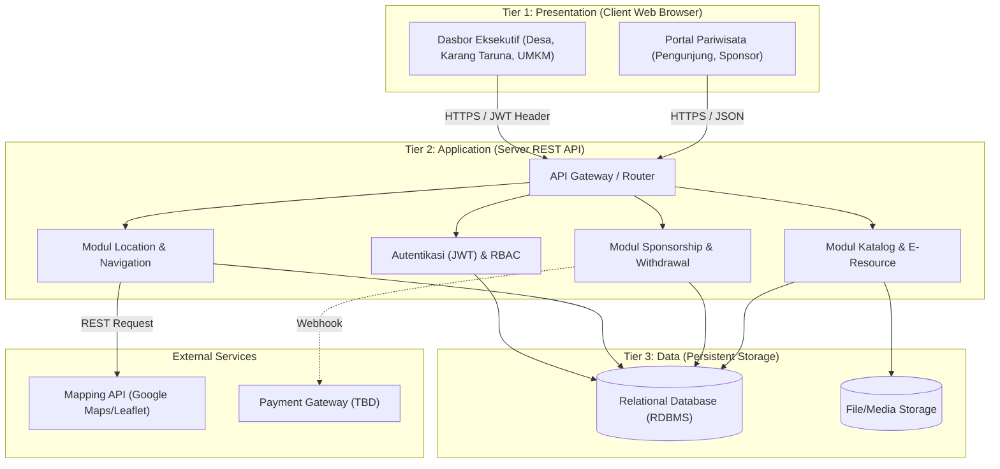
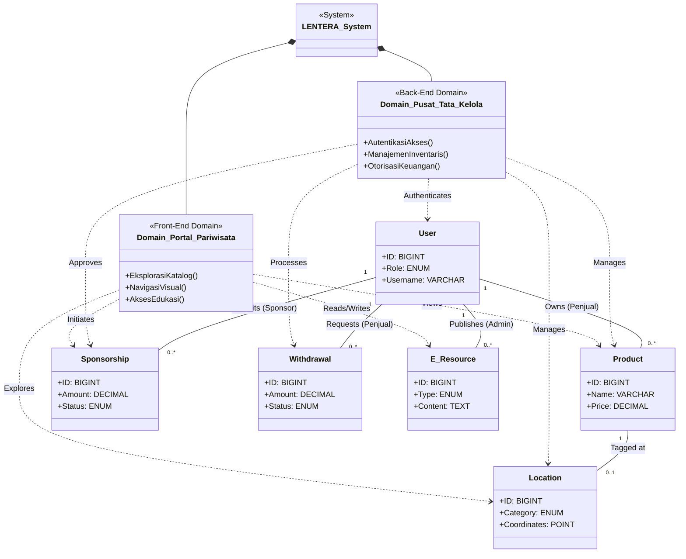
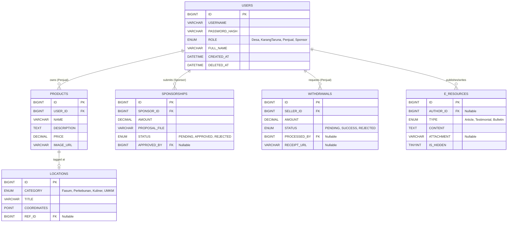

# Software Design Document
## for
## Sistem Manajemen Desa Wisata
**Berdasarkan Standar:** IEEE Std 1016-1998

---

## Section 1 - Project Description

### 1.1 Project
Proyek **Sistem Manajemen Desa Wisata** (selanjutnya disebut sebagai **LENTERA** - *Location, Education, Navigation of Tourism, E-Resource Application*) adalah platform *web application* bernuansa modern skala produksi yang dirancang untuk digitalisasi potensi desa wisata lokal (Desa Kucur). Proyek ini menggabungkan fitur pemberdayaan ekonomi komunitas (katalog produk UMKM), pemetaan titik destinasi wisata interaktif berbasis spasial, sistem informasi panduan bagi wisatawan, serta panel administratif eksekutif untuk menunjang kebutuhan birokrasi perangkat desa.

### 1.2 Description
Sistem Manajemen Desa Wisata (LENTERA) diimplementasikan melalui arsitektur web modern *Three-Tier* berstandar RESTful API. Sistem ini membagi fungsionalitasnya ke dalam dua area antarmuka utama:
1. **Portal Publik (Front-End Eksternal):** Menangani interaksi wisatawan dan pihak luar (seperti calon sponsor kemitraan) untuk menjelajahi katalog penjualan UMKM, melakukan reservasi checkout, mengakses peta pemetaan lokasi, melihat estimasi jarak rute GPS navigasi, membaca artikel buletin edukatif desa, serta mengirimkan ulasan testimonial.
2. **Dashboard Area (Back-End Internal):** Panel administrasi terproteksi otorisasi JWT beralur RBAC (*Role-Based Access Control*) bagi Kepala Desa, pelaku wirausaha UMKM (Penjual), dan Karang Taruna selaku admin operasional. Fungsi internal mencakup proses manajemen database (CRUD katalog & lokasi), pelacakan proposal sponsor, pengelolaan tiket pencairan dana (*withdrawal*) mitra, serta penayangan visualisasi grafik analitik statistik.

### 1.3 Revision History
| Version | Date | Author | Description |
| :--- | :--- | :--- | :--- |
| 1.0 | 2026-05-06 | Tim Pengembang | Initial Draft of Software Design Document untuk proyek LENTERA. |

---

## Section 2 - Overview

### 2.1 Purpose
Dokumen SDD (*Software Design Document*) ini bertujuan untuk mendefinisikan dan merinci arsitektur perangkat lunak dari LENTERA secara komprehensif. Dokumen ini menjadi pedoman teknis yang menjabarkan rancangan struktur data, antarmuka fungsional, dan model aliran aplikasi untuk dipatuhi oleh tim pemrogram selama fase pengkodean (implementasi).

### 2.2 Scope
Ruang lingkup desain meliputi sistem antarmuka halaman portal responsif untuk perangkat pintar, logika bisnis pemrosesan API di tingkat peladen, rancangan keamanan peran (*Role-Based Access Control*), mekanisme penyimpanan data yang tangguh di tingkat *database*, serta integrasi pemetaan dari layanan pihak ketiga (*Third-Party Mapping Service*).

### 2.3 Requirements
Kebutuhan fungsional dan non-fungsional diadaptasi langsung dari spesifikasi pada Dokumen SRS LENTERA v1.0. Inti dari kebutuhan fungsional melingkupi: Registrasi Transaksi Katalog, Pemetaan Desa Interaktif (Location), Navigasi Jarak Pariwisata, E-Resource & Edukasi, Pendaftaran Transparansi Sponsorship, dan Modul Tata Kelola Keuangan (Withdrawal).

#### 2.3.1 Estimates
| # | Description | Hrs. Est. |
| :--- | :--- | :--- |
| 1 | Modul 1: Katalog Etalase & Keranjang Belanja | 120 |
| 2 | Modul 2: Tata Laksana Dokumentasi & E-Resource | 80 |
| 3 | Modul 3: Otentikasi JWT & Manajemen Akses Dasbor | 60 |
| 4 | Modul 4: Integrasi Sponsorship & Proposal B2B | 100 |
| 5 | Modul 5: Pemetaan Visual Geospasial (Location) | 120 |
| 6 | Modul 6: Sistem Navigasi & Kedaruratan (Navigation) | 90 |
| 7 | Modul 7: Tata Kelola Keuangan & Penarikan Dana (Withdrawal) | 80 |
| | **TOTAL:** | **650** |

#### 2.3.2 Traceability Matrix
*Menautkan silang dokumen ini dengan dokumen spesifikasi kebutuhan (SRS) untuk setiap modul.*

| SRS Requirement | SDD Module |
| :--- | :--- |
| REQ-CAT-01 s/d REQ-CAT-04 | 5.2.1 (Portal Pariwisata - Komponen A1) |
| REQ-RES-01 s/d REQ-RES-03 | 5.2.1 (Portal Pariwisata - Komponen A3) |
| REQ-AUTH-01 s/d REQ-AUTH-03 | 5.2.2 (Pusat Tata Kelola - Komponen B1) |
| REQ-SPO-01 s/d REQ-SPO-03 | 5.2.2 (Pusat Tata Kelola - Komponen B3) |
| REQ-LOC-01 s/d REQ-LOC-03 | 5.2.1 (Portal Pariwisata - Komponen A2) |
| REQ-NAV-01 s/d REQ-NAV-02 | 5.2.1 (Portal Pariwisata - Komponen A2) |
| REQ-FIN-01 s/d REQ-FIN-03 | 5.2.2 (Pusat Tata Kelola - Komponen B3) |

---

## Section 3 - System Architecture
LENTERA mengadaptasi arsitektur terdistribusi **Three-Tier Architecture** yang berstandar komunikasi HTTP RESTful API. Berikut adalah visualisasi arsitektur sistem secara keseluruhan yang menunjukkan di mana letak masing-masing modul dan alur komunikasinya:



**Penjelasan Lapisan (Tiers) Arsitektur:**
1. **Presentation Tier (Client):** Lapisan antarmuka pengguna berbasis peramban (Blink/Gecko/WebKit). Merupakan *Single Page Application* (SPA) / Aplikasi Web responsif yang bertukar data murni menggunakan format JSON. Lapisan ini menjadi titik temu pengguna dengan modul-modul sistem (Katalog, Peta Navigasi, Form Investasi).
2. **Application Tier (Server API):** Peladen sentral tak berstatus (*stateless*) tempat logika bisnis dieksekusi. Berfungsi sebagai penengah (*middleware*) yang memvalidasi otentikasi kunci *JSON Web Token* (JWT), mengalkulasi transaksi keranjang, mencatat persetujuan (*Approval*) dari aparatur desa, dan berdialog dengan layanan eksternal.
3. **Data Tier (Database & File Storage):** Penyimpanan persisten sentral berwujud RDBMS. Mengelola data operasional menggunakan standar transaksi basis data (ACID) dan arsitektur penghapusan semu (*soft-delete*). Di samping basis data, lapis ini juga mengatur wadah penyimpanan binari unggahan dokumen PDF/gambar komoditas (*File Server*).

---

## Section 4 - Data Dictionary
Bagian ini merinci elemen data logis dan skema tabel basis data relasional inti yang akan didayagunakan oleh sistem LENTERA. Semua tabel inti diwajibkan menggunakan kolom pelacakan waktu (seperti `CREATED_AT` dan `UPDATED_AT`) serta mengadopsi pola *Soft-Delete* dengan kolom `DELETED_AT`.

### Tabel: `Users`
Menyimpan data identitas, kredensial masuk (login), dan hierarki peran (Role) dari setiap entitas pengguna yang memiliki otorisasi operasional panel Dasbor.

| Field | Notes | Type |
| :--- | :--- | :--- |
| `ID` | Primary Key. *Unique Identifier* tersentralisasi bersistem Auto-Increment. | `BIGINT` |
| `USERNAME` | Nama pengenal masuk. Bersifat unik (Unique) pada seluruh sistem. | `VARCHAR(50)` |
| `PASSWORD_HASH` | Kata sandi terenkripsi algoritma Bcrypt (tidak pernah disimpan *plain-text*). | `VARCHAR(255)` |
| `ROLE` | Hierarki hak akses pengguna: 'Desa', 'KarangTaruna', 'Penjual', 'Sponsor'. | `ENUM` |
| `FULL_NAME` | Nama asli lengkap representatif pengguna atau nama organisasi. | `VARCHAR(100)` |
| `CREATED_AT` | *Timestamp* keterangan kapan entitas akun diregistrasikan. | `DATETIME` |
| `DELETED_AT` | *Timestamp* jejak *soft-delete*. Jika benilai `NULL`, akun masih aktif. | `DATETIME` |

### Tabel: `Products` (Katalog UMKM)
Menyimpan rekam inventaris etalase dagang untuk memfasilitasi transaksi publik. Terikat secara relasional kepada tabel `Users` khusus warga (Penjual).

| Field | Notes | Type |
| :--- | :--- | :--- |
| `ID` | Primary Key. *Unique Identifier* produk dari *sequence*. | `BIGINT` |
| `USER_ID` | Foreign Key mengarah ke tabel `Users`. Pemilik asli katalog UMKM. | `BIGINT` |
| `NAME` | Judul/Nama komoditas yang diperjualbelikan (Contoh: "Kopi Robusta Kucur"). | `VARCHAR(150)` |
| `DESCRIPTION` | Teks penjelasan rinci, detail varian, dan komposisi produk dagang. | `TEXT` |
| `PRICE` | Harga komoditas (dalam format mata uang nilai desimal IDR Rupiah). | `DECIMAL(10,2)` |
| `IMAGE_URL` | *Path* tautan *File Storage* menuju aset berkas gambar produk. | `VARCHAR(255)` |

### Tabel: `Locations` (Pemetaan Geospasial)
Penyimpanan *marker* interaktif untuk ditayangkan ke dalam integrasi kanvas peta. Memuat fasilitas umum, perkebunan, hingga titik-titik gerai UMKM.

| Field | Notes | Type |
| :--- | :--- | :--- |
| `ID` | Primary Key. Nomor identitas unik penanda keruangan di atas peta. | `BIGINT` |
| `CATEGORY` | Klasifikasi *marker* indikator warna: 'Fasum', 'Perkebunan', 'Kuliner', 'UMKM'. | `ENUM` |
| `TITLE` | Teks keterangan (*tooltip*) yang *pop-up* saat titik penanda diklik publik. | `VARCHAR(100)` |
| `COORDINATES` | Titik referensi presisi (*Latitude* dan *Longitude*). Mendukung optimasi spasial. | `POINT / GEOMETRY`|
| `REF_ID` | Foreign Key referensi silang ke entitas lain (Misal mengarah ke ID `Products`). | `BIGINT` (Nullable) |

### Tabel: `Sponsorships` (Proposal Investasi)
Merekam jejak pengajuan investasi *Business-to-Business* (B2B) masuk, lengkap bersama muatan berkas resmi dan pengaturan hierarki otorisasi final.

| Field | Notes | Type |
| :--- | :--- | :--- |
| `ID` | Primary Key. Nomor seri *log* registrasi inisiasi proposal penanam modal. | `BIGINT` |
| `SPONSOR_ID` | Foreign Key ke tabel `Users` (Spesifik Role = Sponsor). Pemilik proposal. | `BIGINT` |
| `AMOUNT` | Nilai total nominal suntikan investasi yang ditawarkan pada proposal. | `DECIMAL(15,2)` |
| `PROPOSAL_FILE`| URL absolut/relatif dokumen PDF (*File Storage*) rincian proposal resmi. | `VARCHAR(255)` |
| `STATUS` | Penanda pergerakan keputusan: 'PENDING', 'APPROVED', 'REJECTED'. | `ENUM` |
| `APPROVED_BY` | Foreign Key ke ID `Users` (Desa) pelaku yang menekan eksekusi *Approve*. | `BIGINT` (Nullable) |

### Tabel: `Withdrawals` (Tata Kelola Keuangan)
Modul untuk mengantrekan permohonan pencairan profit finansial (*Withdrawal*) ke rekening bank pribadi dari pengguna UMKM (Penjual).

| Field | Notes | Type |
| :--- | :--- | :--- |
| `ID` | Primary Key. *Identifier* tiket tagihan / formulir pengajuan penarikan dana. | `BIGINT` |
| `SELLER_ID` | Foreign Key ke tabel `Users` (Role = Penjual) pengeklaim *withdrawal*. | `BIGINT` |
| `AMOUNT` | Jumlah angka penarikan tunai akumulatif dari dompet (Min. penarikan Rp 50.000). | `DECIMAL(12,2)` |
| `STATUS` | *State* siklus perjalanan tiket dana: 'PENDING', 'SUCCESS', 'REJECTED'. | `ENUM` |
| `PROCESSED_BY`| Foreign Key ID eksekutor (`Users` - Admin Finance) pencetak log persetujuan. | `BIGINT` (Nullable) |
| `RECEIPT_URL` | Tautan ke berkas bukti struk transfer perbankan ke pengeklaim. | `VARCHAR(255)` (Nullable)|

### Tabel: `E_Resources` (Dokumentasi Pariwisata & Buletin)
Wadah persisten konten *Content Management System* mini milik desa untuk mengudarakan artikel wisata, serta tempat warga melempar *review* (testimoni).

| Field | Notes | Type |
| :--- | :--- | :--- |
| `ID` | Primary Key. Nomor ID absolut rekaman referensi dokumen edukasi/ulasan. | `BIGINT` |
| `AUTHOR_ID` | Foreign Key kreator; bernilai Pengunjung (Anonim/Sesi) atau Penulis Admin. | `BIGINT` (Nullable) |
| `TYPE` | Tipe formasi konten *resource*: 'Article', 'Testimonial', 'Bulletin'. | `ENUM` |
| `CONTENT` | Ekstraksi *string* *long-text* muatan buletin, edukasi wisata, atau isi testimoni. | `TEXT` |
| `ATTACHMENT` | Berkas foto penunjang *review* atau gambar pelengkap artikel (Limit: 5 MB). | `VARCHAR(255)` (Nullable)|
| `IS_HIDDEN` | Saklar *Boolean* (0/1) indikator disembunyikannya artikel kadaluwarsa dari portal. | `TINYINT(1)` |

---

## Section 5 - Software Domain Design

### 5.1 Software Application Domain Chart
Bagian ini memodelkan domain perangkat lunak utama dari sistem LENTERA beserta relasi antar objek (entitas data) yang membentuk inti logika bisnis aplikasi. Diagram *Class* (UML) di bawah ini mendemonstrasikan bagaimana setiap domain saling berinteraksi dengan objek data persisten.



**Penjelasan Diagram UML:**
*   **LENTERA_System:** Merupakan representasi sistem utuh secara keseluruhan yang mewadahi dua domain utama (ditandai dengan relasi agregasi komposisi `*--`).
*   **Domain Portal Pariwisata (Front-End):** Bertugas melayani sisi publik. Domain ini dapat melihat (*Views*) data `Product` (katalog), mengeksplorasi (*Explores*) data `Location` (peta visual), membaca dan menulis (*Reads/Writes*) konten `E_Resource` (seperti testimoni), dan mengawali formulir (*Initiates*) `Sponsorship`.
*   **Domain Pusat Tata Kelola (Back-End):** Bertugas melayani sistem internal bagi pengelola. Domain ini mengautentikasi (*Authenticates*) `User` untuk masuk panel dasbor, serta memiliki kuasa untuk mengelola (CRUD/ *Manages*) entitas `Product` dan `Location`. Secara finansial, domain ini memproses (*Processes*) penarikan `Withdrawal` dan menyetujui (*Approves*) `Sponsorship`.
*   **Relasi Entitas Inti:**
    *   Entitas `User` merupakan aktor sentral. Seorang `User` (berperan sebagai *Penjual*) dapat memilik banyak `Product` dan meminta (*Requests*) banyak transaksi `Withdrawal`.
    *   Seorang `User` (sebagai *Sponsor*) dapat mendaftarkan (*Submits*) `Sponsorship`.
    *   Seorang `User` (sebagai *Admin/Desa*) dapat mempublikasikan (*Publishes*) konten artikel `E_Resource`.
    *   Setiap `Product` dapat diberikan tag (*Tagged at*) mengarah pada satu entitas keruangan `Location` agar bisa tampil di peta visual.

### 5.2 Software Application Domain
Sistem LENTERA secara arsitektural dibagi menjadi dua domain aplikasi utama (paket) dalam lingkup *Full-Stack Web Application*: **Domain Portal Pariwisata (Front-End)** dan **Domain Pusat Tata Kelola (Back-End)**. Pembagian ini bertujuan untuk mengisolasi *concerns* antara antarmuka penyajian data (publik) dengan mesin pemrosesan logika bisnis serta pengendali lapisan basis data (internal).

#### 5.2.1 Domain Portal Pariwisata (Front-End Eksternal)
Domain publik yang berorientasi pada penyajian layanan antarmuka pengguna (*Graphical User Interface*). Rumpun komponen di dalam domain ini beroperasi di lingkungan peramban (*Client-Side*) dan dibangun menggunakan *framework Javascript*. Domain ini tidak memiliki akses langsung ke *database domain* (RDBMS), melainkan harus melalui pertukaran JSON dengan antarmuka REST API server. 

##### 5.2.1.1 Komponen Katalog Etalase
Komponen visual yang mengatur penayangan inventaris produk UMKM ke layar pengunjung.
*   **Data Flow / Control:** Komponen menembakkan HTTP GET *request* ke *API Gateway*. API merespons dengan *payload* JSON berisi senarai objek persisten `Product`. Komponen di level *client* kemudian menelan data (*consume*) dan merendernya ke dalam arsitektur kartu antarmuka (*Card UI*).

###### 5.2.1.1.1 Task Eksplorasi Produk (Browse Products)
Tugas fasilitasi interaksi pengguna untuk melakukan filter dan penelusuran nama produk dagang.
*   **Data Flow / Control:** Saat pengguna memasukkan kata kunci di bilah pencarian, komponen DOM mencegat *event* masukan (*keystroke*), lalu memicu pembaruan parameter kueri URL secara asinkron. Kontrol pemrosesan akan didelegasikan ke *API* yang merespons dengan himpunan objek `Product` yang telah difilter.

##### 5.2.1.2 Komponen Eksplorasi Visual (Location & Navigation)
Komponen kanvas spasial interaktif berbasis tumpukan peta (*mapping engine*).
*   **Data Flow / Control:** Mengonsumsi metadata geospasial (titik kordinat entitas `Location`) berformat JSON dari peladen lokal, dan secara paralel menarik *tile layer* bergambar dari *Third-Party API* (*e.g., Google Maps API*) lalu menggabungkannya pada satu penampang *view*.

###### 5.2.1.2.1 Task Peringatan Navigasi Kedaruratan
Tugas memancarkan notifikasi cepat jika wisatawan tersesat atau membutuhkan panduan rute.
*   **Data Flow / Control:** Sistem akan mengekstrak objek kordinat GPS milik peramban (*Client*) saat ini dengan memanfaatkan fungsi murni *Geolocation API*. Titik ordinat tersebut diekstraksi ke dalam *string text intent* menuju proksi *platform messaging* pihak ketiga untuk dikirim kepada anggota Karang Taruna selaku tim penyelamat.

#### 5.2.2 Domain Pusat Tata Kelola (Back-End Dasbor Internal)
Domain tingkat peladen (*Server-Side*) yang ditugaskan penuh sebagai penggerak logika bisnis inti (*Business Logic*) dan penjaga gerbang basis data. Rumpun domain ini melingkupi fungsi pengontrol rute sistem (*router*), pemetaan objek-relasional (ORM), validasi data asupan, serta eksekusi transaksi (DML) yang melibatkan klausa ACID pada semua objek tabel.

##### 5.2.2.1 Komponen Manajer Autentikasi Lapis
Komponen lapis sekuritas yang memfasilitasi gerbang pendaftaran (*Login*) dan perisai akses kontrol *Role-Based Access Control* (RBAC).
*   **Data Flow / Control:** Menerima muatan HTTP POST berisi `USERNAME` dan `PASSWORD`. Kata sandi dikomparasi asinkron melalui fungsi *hash check* (contoh: *Bcrypt*) melawan data `PASSWORD_HASH` dari objek `User`. Jika sah, komponen *Auth* menerbitkan muatan kriptografi (JWT) beralgoritma HMAC/RSA.

###### 5.2.2.1.1 Task Verifikasi Akses Dasbor (Middleware Control)
Tugas penengah fungsional (*middleware*) untuk mencegat seluruh *request client* yang mengarah ke peladen tertutup.
*   **Data Flow / Control:** Fungsi sistem mencegat *header* `Authorization: Bearer <token>`. Jika dekode token berhasil (belum kadaluwarsa), *payload* atribut `ROLE` akan diekstraksi untuk memverifikasi kecocokan rute. Request yang gagal memvalidasi kontrol *role* langsung ditolak (Terminated) dengan nilai `HTTP 401/403`.

##### 5.2.2.2 Komponen Otoritas Arus Keuangan
Komponen *backend* penanggung jawab kalkulasi moneter absolut dan eksekusi izin proposal. Komponen menukangi logika *Database Layer* bagi entitas `Sponsorship` dan `Withdrawal`.
*   **Data Flow / Control:** Menerima ID pengajuan via API. Kontrol program memvalidasi kepemilikan. Data dialirkan ke pustaka *Object-Relational Mapping* (ORM) yang memetakan baris menjadi objek kode, otomatis menyisipkan stempel waktu mutasi (`UPDATED_AT`), dan menyematkan stempel pengotorisasi (`PROCESSED_BY`).

###### 5.2.2.2.1 Task Approval Withdrawal UMKM
Tugas *Super Admin* (*Role*: Desa) memverifikasi dan menyetujui mutasi penarikan dana dompet ke rekening nyata penjual.
*   **Data Flow / Control:** Mesin status logika dipicu (*State Machine*). Fungsi ORM mengeksekusi instruksi SQL bertipe `UPDATE` ke tabel `Withdrawals` dengan menyematkan `STATUS = 'SUCCESS'`. Operasi data ini secara ketat dibungkus dalam blok persisten *Database Transaction Lock* (*Begin Trans -> Commit*) demi menjamin rasio sukses ACID dan menghindari konflik mutasi dana paralel (*race condition*).

---

## Section 6 – Data Design
Bagian ini mendeskripsikan struktur data yang disimpan dalam basis data (*database*) dan struktur yang dibagikan antar domain dalam lingkup arsitektur proyek LENTERA. Data desain mencakup model relasional, jenis data statis, dan struktur dataset operasional.

### 6.1 Persistent/Static Data
Bagian ini mengilustrasikan model data logis dan rancangan diagram entitas-relasional (*Entity Relationship Diagram* / ERD) untuk data persisten yang dipertahankan dalam basis data RDBMS (*Relational Database Management System*) proyek LENTERA.



#### 6.1.1 Dataset
Dataset LENTERA merepresentasikan himpunan entitas data persisten yang saling berelasi (*Relational Dataset*), yang menjadi inti operasional fungsionalitas sistem.
*   **Dataset Entitas Pengguna (`Users`):** Menjadi pusat hierarki (*parent entity*) yang memegang kendali kepemilikan data atas objek-objek lain seperti `Products` (dimiliki Penjual), `Sponsorships` (diajukan Sponsor), dan pengajuan `Withdrawals`.
*   **Dataset Katalog UMKM (`Products`):** Terhubung ke tabel `Users` via `USER_ID`. Setiap produk dapat dikaitkan dengan satu penanda spasial (*marker*) di tabel `Locations` untuk kebutuhan pemetaan sebaran komoditas.
*   **Dataset Pemetaan (`Locations`):** Kumpulan data koordinat geografis independen yang sewaktu-waktu dapat dijadikan referensi/tagging oleh dataset operasional lain (melalui `REF_ID`).
*   **Dataset Transaksional (`Sponsorships`, `Withdrawals`):** Menyimpan status operasional dan nilai finansial. Bergantung kuat pada keberadaan dataset `Users` sebagai subjek pelaku transaksi dan subjek penyetuju (*approver*).

#### 6.1.2 Static Data
*Static data* (Data Statis) merupakan himpunan nilai referensi, konfigurasi, atau enumerasi (ENUM) yang bersifat tetap dan jarang mengalami perubahan (*immutable*) pasca kompilasi awal basis data. Pada LENTERA, data statis meliputi:
*   **Struktur Peran (*Role Hierarchy*):** Parameter hak akses otoritatif, terdefinisi statis sebagai `['Desa', 'KarangTaruna', 'Penjual', 'Sponsor']`.
*   **Klasifikasi Lokasi (*Category Marker*):** Indikator penanda di peta yang terdiri dari `['Fasum', 'Perkebunan', 'Kuliner', 'UMKM']`. Sistem mengacu pada nilai statis ini untuk menentukan jenis *icon* peta.
*   **Tipe Dokumen (*Resource Type*):** Identifikasi klasifikasi artikel wisata, yang secara statis didefinisikan sebagai `['Article', 'Testimonial', 'Bulletin']`.
*   **Status Dokumen Transaksional:** Jejak langkah persetujuan (`['PENDING', 'APPROVED', 'REJECTED']` untuk Sponsorship dan `['PENDING', 'SUCCESS', 'REJECTED']` untuk Withdrawals).

#### 6.1.3 Persisted data
*Persisted data* merujuk pada rekam jejak aktivitas (*Audit Trail*) atau data jangka panjang yang wajib dipertahankan meski entitas secara logis dianggap "terhapus" oleh pengguna aplikasi.
*   **Soft-Deleted Records:** Sistem LENTERA menggunakan metode *Soft-Delete* pada tabel mayor. Alih-alih menghapus (*drop*) baris data secara permanen, aplikasi akan mengisi nilai *timestamp* pada kolom log `DELETED_AT`. Data ini secara persisten tetap ada di dalam peladen RDBMS demi kebutuhan audit pelaporan historis dan dapat dikembalikan (*restore*) apabila diperlukan oleh eksekutif desa.
*   **Binary Object References:** Tautan teks persisten (*String URL / File Path*) yang merujuk pada berkas binari tak terstruktur seperti foto produk (`IMAGE_URL` di Products), berkas PDF investasi (`PROPOSAL_FILE` di Sponsorships), foto resi pencairan dana, dan gambar *review*. Tautan teks ini disimpan persisten di dalam basis data (DB), sementara berkas fisiknya dikunci pada ruang penyimpan berbasis *File System* peladen.

### 6.2 Transient/Dynamic Data
*Transient* atau *dynamic data* adalah data yang sifatnya sementara, tidak disimpan secara permanen di RDBMS, dan memudar (dihapus/kedaluwarsa) begitu siklus transaksinya selesai atau sesi pengguna ditutup. 

#### 6.2.1 Session & Authentication Data
Data ini dikelola di lapisan aplikasi atau peramban pengguna untuk menjaga *state* akses sistem.
*   **JSON Web Token (JWT):** Kunci sesi kriptografis (dikodekan dalam format Base64) yang diterbitkan saat proses *login*. Token ini disimpan secara sementara di `localStorage` atau `HttpOnly Cookies` klien dan memiliki batas masa pakai berdurasi (*expiration time*, misalnya 120 menit).
*   **User Session State:** Metadata sesi administrator yang sedang berjalan, sering kali diletakkan di dalam *state management* aplikasi *front-end* yang akan lenyap saat tab ditutup (*browser window closed*).

#### 6.2.2 Application State Data
*   **Keranjang Belanja (Shopping Cart):** Daftar ID Produk dan jumlah (*quantity*) sementara yang dipilih oleh wisatawan pengunjung sebelum proses *checkout*. Ini disimpan dalam *memory* sisi peramban atau *session storage* agar tidak membebani basis data persisten dengan transaksi yang belum final.
*   **Temporary Geospatial Caching:** Muatan koordinat navigasi pergerakan posisi sementara dari GPS gawai klien sebelum dimusnahkan.

### 6.3 External Interface Data
Bagian ini menjelaskan struktur data yang dipertukarkan saat LENTERA berkomunikasi dengan layanan sistem eksternal (*third-party APIs*).

*   **Mapping Payload Data (GeoJSON/JSON):** 
    Sistem mengekstraksi dan menyerap objek `JSON` dari antarmuka eksternal (*misal: Leaflet.js atau Google Maps API*). Data yang dipertukarkan murni berupa struktur koordinat geospasial (`latitude`, `longitude`), definisi ukuran kanvas peta batas wilayah (*polygons*), dan respons kalkulasi jarak (*Distance Matrix*). Tidak ada data persisten internal LENTERA yang dibocorkan keluar.
*   **Payment Gateway Webhook Payload:**
    (Jika kelak diaktifkan) Payload interaksi dari/ke sistem perbankan pihak ketiga (*Payment Gateway*). Berupa objek JSON yang mengandung UUID transaksi (`Order ID`), status persetujuan (*Success/Failed/Pending*), nominal tagihan finansial agregat (*Gross Amount*), dan penanda keamanan autentikasi pesan (*Signature Key*).

### 6.4 Transformation of Data
Transformasi data menjelaskan bagaimana elemen data diubah bentuk dan dikonversi saat beralih antar lapisan arsitektur.

*   **Kriptografi Kredensial (Hashing):**
    Elemen antarmuka memasok kata sandi murni (*plain-text password*) selama pendaftaran. Sebelum melintasi pintu basis data, algoritma fungsi *Hash* satu arah (seperti `Bcrypt`) mentransformasikan string tersebut ke dalam *Ciphertext* bergaram (*Salted Hash String*).
*   **Sterilisasi Masukan Pengguna (Sanitization):**
    Seluruh struktur formulir masukan publik (seperti konten artikel atau *review* pengunjung) ditransformasi melalui perisai sterilisasi lapis peladen. Struktur ini melewati proses sanitasi (pembersihan *tag* HTML asing) untuk mencegah injeksi *Cross-Site Scripting* (XSS).
*   **Pemetaan Objek-Relasional (ORM & Serialization):**
    Aliran data SQL relasional mentah (*rows/arrays*) yang diekstrak dari basis data, ditransformasi oleh perantara ORM menjadi bentuk Model Objek di dalam lapisan aplikasi. Saat hendak dikirimkan sebagai respons HTTP ke *Front-End*, model objek tersebut diserialisasi lebih lanjut menjadi susunan tipe berformat `JSON`.

---

## Section 7 - User Interface Design

### 7.1 User Interface Design Overview

Bagian gambaran umum desain antarmuka pengguna (UI) mendefinisikan konsep estetika, sistem desain (*design system*), dan parameter visual yang diterapkan di seluruh platform LENTERA:

#### 1. Konsep Estetika (Visual Concept)
*   **Tema Utama:** "Alam Lestari & Modernisasi Ekonomi". Desain memadukan keindahan alam pedesaan (kebun kopi/jeruk) dengan gaya *clean-modern interface* skala produksi.
*   **Arah Visual:** Mengadopsi prinsip *minimalist UI*, dengan *white space* (jarak antar elemen) yang cukup agar konten peta dan katalog produk memiliki fokus utama tanpa mengganggu kenyamanan mata pengguna.

#### 2. Sistem Warna (Color Palette)
Sistem warna dikonfigurasi menggunakan palet yang terharmonisasi guna membedakan status visual secara tajam:
*   **Warna Utama (Primary Green):** `#2E7D32` (Emerald Green) – Merepresentasikan warna alam perkebunan Desa Kucur, digunakan untuk tombol aksi utama, header navigasi, dan marker kategori Perkebunan.
*   **Warna Sekunder (Secondary Gray):** `#F5F5F5` hingga `#ECEFF1` – Warna latar belakang yang bersih untuk menonjolkan kartu produk.
*   **Warna Aksen & Status:**
    *   **Kuning Wisata (`#FBC02D`):** Digunakan untuk ikon marker kategori UMKM dan penunjuk rating bintang.
    *   **Oranye Kuliner (`#EF6C00`):** Digunakan untuk marker kuliner khas desa.
    *   **Merah Fasilitas Umum (`#D84315`):** Digunakan untuk marker pos darurat/fasum dan pesan penolakan (*error validation*).
    *   **Biru Informasi (`#1565C0`):** Digunakan untuk tautan teks informasi buletin desa.

#### 3. Tipografi (Typography)
*   **Font Keluarga Utama:** Menggunakan jenis huruf tanpa-kait (*sans-serif*) modern yang ditarik dari Google Fonts: **Inter** atau **Outfit** (untuk kenyamanan keterbacaan tinggi di peranti *mobile*).
*   **Hierarki Teks:**
    *   *Heading 1 (Judul Halaman):* Ukuran `24px - 32px`, ketebalan *Bold* (700).
    *   *Heading 2 (Sub-fitur):* Ukuran `18px - 22px`, ketebalan *Semi-Bold* (600).
    *   *Body Text (Deskripsi & Konten):* Ukuran `14px - 16px`, ketebalan *Regular* (400).
    *   *Micro-copy (Tooltip/Keterangan):* Ukuran `12px`, ketebalan *Light* (300).

#### 4. Grid & Responsivitas (Layout & Grid System)
*   **Sistem Grid:** Menggunakan model tata letak fleksibel (Flexbox dan CSS Grid) berbasis grid 12 kolom untuk menyusun tata letak dasbor admin dan portal publik secara presisi.
*   **Breakpoints Responsif:**
    *   *Mobile Portrait:* Max-width `480px` (layout kartu menjadi satu kolom vertikal, navigasi bersembunyi di balik tombol menu hamburger).
    *   *Tablet:* Max-width `768px` (katalog menjadi dua kolom kartu).
    *   *Desktop:* Min-width `1024px` (katalog menjadi 3-4 kolom kartu, dasbor admin menampilkan sidebar statis penuh di sebelah kiri).

#### 5. Gambar Mockup Utama (Representatif Visual Utama)
Berikut adalah visualisasi mockup halaman beranda publik utama (berdasarkan implementasi berkas **../prototipe/Home.html**):


### 7.2 User Interface Navigation Flow

Alur navigasi antar-antarmuka menggambarkan bagaimana pengguna berpindah dari satu layar ke layar lainnya berdasarkan peran dan otorisasi hak akses mereka:

```mermaid
graph TD
    Home["Beranda & Katalog"]
    Map["Peta Lokasi Wisata"]
    Edu["Portal Edukasi & Testimoni"]
    Sponsor["Portal Sponsorship"]
    Login["Layar Kredensial (Login)"]
    
    DashKades["Dasbor Eksekutif (Desa)"]
    DashUMKM["Dasbor Mitra (Penjual/UMKM)"]
    DashAdmin["Dasbor Operasional (Admin/Kartar)"]
    
    %% Alur Navigasi Publik (Dua Arah karena Navbar)
    Home <--> Map
    Home <--> Edu
    Home <--> Sponsor
    Home --> Login
    
    Map <--> Edu
    Map <--> Sponsor
    Edu <--> Sponsor
    
    %% Alur Login Autentikasi
    Login -->|Otorisasi Role: Desa| DashKades
    Login -->|Otorisasi Role: Penjual| DashUMKM
    Login -->|Otorisasi Role: Karang Taruna| DashAdmin
    
    %% Alur Aksi Internal & Kembali
    DashKades -->|Akses Evaluasi & Log| DashAdmin
    DashAdmin -->|Kelola Lokasi/Katalog| Home
    DashUMKM -->|Pratinjau Toko| Home
    
    %% Alur Keluar (Logout)
    DashKades -->|Aksi Logout (Hancurkan JWT)| Home
    DashUMKM -->|Aksi Logout (Hancurkan JWT)| Home
    DashAdmin -->|Aksi Logout (Hancurkan JWT)| Home
```

#### Penjelasan Alur Navigasi Antarmuka (User Interface Flow Explanation):

1.  **Zona Publik (Public Area Flow):**
    *   Pengunjung pertama kali masuk melalui halaman **Beranda & Katalog**. Melalui *Navigation Bar* (Navbar) yang bersifat persisten (selalu ada di setiap halaman), pengunjung dapat berpindah secara dua arah (bolak-balik) secara bebas ke halaman **Peta Lokasi Wisata**, **Portal Edukasi & Testimoni**, serta **Portal Sponsorship**.
    *   Wisatawan yang ingin berbelanja dapat melakukan *Checkout* dari halaman Beranda/Katalog, sedangkan calon investor dapat mendaftarkan proposal dari Halaman Sponsorship.
    *   Jika ada pengguna internal (Desa, Admin, atau Penjual UMKM) yang ingin mengelola data, mereka harus menekan tombol *Login* di Header untuk diarahkan ke **Layar Kredensial (Login)**.

2.  **Zona Autentikasi & Pengalihan Peran (Role-Based Redirection Flow):**
    *   Pada **Layar Kredensial (Login)**, pengguna memasukkan akun mereka. 
    *   Sistem *Backend* memvalidasi kredensial. Jika valid, sistem menerbitkan token JWT (*JSON Web Token*) yang disimpan secara lokal di browser, lalu secara otomatis mengalihkan (*redirect*) rute pengguna sesuai hak akses peran (*Role*):
        *   **Role 'Desa' (Kepala Desa/Super Admin):** Diarahkan langsung ke **Dasbor Eksekutif (Desa)**.
        *   **Role 'Penjual' (Mitra UMKM):** Diarahkan langsung ke **Dasbor Mitra (Penjual/UMKM)**.
        *   **Role 'Karang Taruna' (Admin Lapangan):** Diarahkan langsung ke **Dasbor Operasional (Admin/Kartar)**.

3.  **Zona Pengelolaan Dasbor (Dashboard Operations Flow):**
    *   Di dalam dasbor, pengguna dapat mengelola data secara internal. 
    *   Aparatur **Desa** memiliki akses khusus untuk meninjau dan mengevaluasi data persetujuan yang dikerjakan oleh Karang Taruna melalui pintu hubung ke **Dasbor Operasional**.
    *   **Admin Karang Taruna** dan **Penjual UMKM** dapat berpindah kembali ke halaman publik (**Beranda**) kapan saja untuk melakukan pratinjau hasil penambahan produk katalog atau titik pemetaan baru yang baru saja mereka inputkan di dasbor.

4.  **Zona Keluar Sistem (Logout Flow):**
    *   Pada setiap antarmuka dasbor, disediakan tombol **Logout**.
    *   Ketika tombol *Logout* ditekan, sistem secara otomatis menghancurkan kunci token JWT yang tersimpan di memori browser klien untuk mencegah pembajakan sesi, dan melempar kembali pengguna ke halaman awal **Beranda & Katalog** publik.

---

### 7.3 Use Cases / User Function Description

Berikut adalah deskripsi kegunaan layar (*screen usage*) serta fungsi tombol-tombol pada setiap antarmuka yang terimplementasi di direktori proyek `../prototipe/`, dilengkapi dengan peletakan gambar mockup masing-masing:

#### A. Kelompok Antarmuka Publik (Public Area)
 
##### 1. Halaman Beranda (UI-PUB-01-A)
*   **Fungsi Utama:** Menyajikan informasi utama, profil singkat desa wisata Kucur, dan gerbang masuk navigasi cepat bagi pengunjung publik.
*   **Aksi Antarmuka:**
    *   *Bilah Navigasi (Navbar):* Navigasi dua arah ke halaman Katalog, Peta Lokasi, Edukasi, Sponsor, dan Login.
    *   *Tombol CTA:* Mengalihkan pengunjung ke peta lokasi atau katalog.
*   **Tampilan Mockup:**
    
 
##### 2. Halaman Katalog Produk (UI-PUB-01-B)
*   **Fungsi Utama:** Menyajikan informasi etalase produk UMKM Desa Kucur bagi pengunjung publik serta memfasilitasi transaksi belanja keranjang sementara.
*   **Aksi Antarmuka:**
    *   *Tombol "Tambahkan Keranjang":* Memasukkan item produk ke sesi keranjang sementara.
    *   *Ikon Keranjang (Header):* Membuka panel sidebar keranjang di kanan layar untuk penyesuaian kuantitas.
    *   *Tombol "Checkout":* Mengagregasi harga total belanja dan meneruskan pengguna ke form isian pesanan.
*   **Tampilan Mockup:**
    
 
##### 3. Halaman Detail Produk (UI-PUB-01-DET)
*   **Fungsi Utama:** Menyajikan informasi deskripsi lengkap produk UMKM, galeri foto, bintang ulasan rating, serta ulasan spesifik dari pembeli terdahulu.
*   **Aksi Antarmuka:**
    *   *Tombol "Tambah Kuantitas (+/-)":* Mengatur jumlah pembelian barang sebelum dimasukkan ke keranjang.
    *   *Tombol "Beli Sekarang":* Memasukkan produk ke keranjang belanja dan langsung mengalihkan ke halaman checkout.
    *   *Tombol "Kembali":* Mengarahkan kembali pengguna ke katalog produk utama.
*   **Tampilan Mockup:**
    
 
##### 4. Halaman Formulir Checkout (UI-PUB-01-CHK)
*   **Fungsi Utama:** Halaman bagi pengunjung untuk mengisi informasi data pengiriman produk dan data kontak.
*   **Aksi Antarmuka:**
    *   *Form Input Data Klien:* Kolom pengisian nama pembeli, alamat pengiriman, dan nomor WhatsApp aktif.
    *   *Pilihan Ekspedisi:* Memilih opsi ambil di tempat (Desa Kucur) atau menggunakan kurir lokal.
    *   *Tombol "Buat Pesanan":* Mengirimkan data pembelian ke database dan secara otomatis memunculkan proksi pesan WhatsApp berisi invoice pesanan ke admin/penjual.
*   **Tampilan Mockup:**
    
 
##### 5. Halaman Peta Spasial (UI-PUB-02-A)
*   **Fungsi Utama:** Menyajikan peta interaktif Desa Kucur dengan titik marker berwarna sesuai kategori, membantu navigasi pengunjung, serta memberikan kontak bantuan darurat.
*   **Aksi Antarmuka:**
    *   *Checkbox Filter Kategori:* Menyaring pin marker di peta berdasarkan kategori (Fasum, Perkebunan, Kuliner, UMKM).
    *   *Klik Marker:* Menampilkan pop-up informasi singkat tempat dan tombol kalkulasi navigasi.
    *   *Floating Button WhatsApp (Kedaruratan):* Tombol melayang untuk membuka chat WhatsApp langsung ke Karang Taruna selaku pengelola darurat lapangan.
*   **Tampilan Mockup:**
    
 
##### 6. Halaman Sistem Navigasi (UI-PUB-02-B)
*   **Fungsi Utama:** Menampilkan rute perjalanan dinamis antara posisi GPS wisatawan dan titik lokasi tujuan di atas Leaflet.js.
*   **Aksi Antarmuka:**
    *   *Tombol "Navigasi Rute" (Pop-up):* Menampilkan rute jalan dan estimasi jarak tempuh dari koordinat GPS wisatawan saat itu.
    *   *Tombol "Kembali ke Peta":* Menutup penunjuk rute jalan dan kembali ke peta utama.
*   **Tampilan Mockup:**
    
 
##### 7. Halaman Edukasi Agrowisata (UI-PUB-03-A)
*   **Fungsi Utama:** Menyajikan portal e-resource artikel edukasi perkebunan jeruk dan kopi Desa Kucur bagi wisatawan.
*   **Aksi Antarmuka:**
    *   *Klik Kartu Artikel:* Membuka halaman detail konten edukasi pertanian.
*   **Tampilan Mockup:**
    
 
##### 8. Halaman E-Resource & Testimoni (UI-PUB-03-B)
*   **Fungsi Utama:** Menyajikan ulasan wisatawan ter-moderasi serta modul pengisian ulasan publik.
*   **Aksi Antarmuka:**
    *   *Form Tulis Ulasan:* Input nama, teks komentar, rating bintang 1-5, dan tombol upload gambar pendukung (maksimal 5MB).
*   **Tampilan Mockup:**
    
 
##### 9. Portal Sponsorship (UI-PUB-04)
*   **Fungsi Utama:** Menyajikan transparansi penggalangan dana sponsor kemitraan B2B dan pendaftaran bagi investor baru.
*   **Aksi Antarmuka:**
    *   *Formulir Pengajuan:* Pengisian nama institusi, nominal pendanaan, form upload proposal PDF (max 5MB), dan tombol kirim dengan status awal proposal `PENDING`.
*   **Tampilan Mockup:**
    
 
##### 10. Halaman Profil Pengguna (UI-PUB-05)
*   **Fungsi Utama:** Menyajikan data profil diri pembeli/wisatawan serta rekam jejak riwayat transaksi pemesanan produk yang telah dilakukan.
*   **Aksi Antarmuka:**
    *   *Tombol "Edit Profil":* Mengubah informasi nama lengkap dan kontak telepon.
    *   *Tabel Riwayat:* Menampilkan nomor invoice, total pembayaran, status pengiriman produk, dan tombol cetak bukti pesanan.
*   **Tampilan Mockup:**
    
 
---
 
#### B. Kelompok Antarmuka Dasbor Pengelola (Dashboard Area)
 
##### 11. Layar Kredensial Masuk (UI-ADM-01)
*   **Fungsi Utama:** Halaman otentikasi login admin, UMKM, dan aparatur desa menggunakan sandi yang di-hash Bcrypt untuk mendapatkan sesi JWT.
*   **Aksi Antarmuka:**
    *   *Kolom Username/Password:* Input identitas masuk.
    *   *Tombol "Masuk":* Melakukan pengiriman data ke server API.
    *   *Notifikasi Peringatan:* Menampilkan alert pop-up merah jika kredensial salah atau token kedaluwarsa.
*   **Tampilan Mockup:**
    
 
##### 12. Dasbor Perangkat Desa - Ringkasan (UI-ADM-02-A)
*   **Fungsi Utama:** Halaman pemantau KPI operasional dan keuangan bagi Kepala Desa selaku pengawas tertinggi.
*   **Aksi Antarmuka:**
    *   *Sidebar:* Berpindah tab dasbor.
    *   *Widget KPI:* Menampilkan total nominal transaksi e-commerce, total data UMKM aktif, dan total sponsor.
    *   *Filter Grafik:* Mengubah visualisasi diagram pemantau grafik batang/garis per bulan.
*   **Tampilan Mockup:**
    
 
##### 13. Dasbor Perangkat Desa - Kelola E-Resource (UI-ADM-02-B)
*   **Fungsi Utama:** Modul Content Management System bagi pengelola untuk mengunggah pengumuman, buletin, dan pratinjau media.
*   **Aksi Antarmuka:**
    *   *Form Artikel:* Input judul, jenis (Text/Foto/Video/PDF), isi tulisan, dan status publikasi.
    *   *Daftar & Edit:* Tombol preview, ubah, nonaktifkan, dan hapus.
*   **Tampilan Mockup:**
    
 
##### 14. Dasbor Perangkat Desa - Setting Akun (UI-ADM-02-C)
*   **Fungsi Utama:** Panel pengelolaan data identitas dan pembuatan akun admin Karang Taruna operasional baru.
*   **Aksi Antarmuka:**
    *   *Form Admin:* Input Nama, Email, Pilihan Role, dan status aktif.
    *   *Daftar Akun:* Tabel list pencarian akun admin desa.
*   **Tampilan Mockup:**
    
 
##### 15. Dasbor Perangkat Desa - Approval Sponsorship (UI-ADM-02-D)
*   **Fungsi Utama:** Halaman tata kelola dan persetujuan status kelayakan proposal sponsor kemitraan B2B.
*   **Aksi Antarmuka:**
    *   *Tombol "Approve/Reject":* Mengubah status proposal kemitraan investor dari `PENDING` menjadi `APPROVED` atau `REJECTED`.
*   **Tampilan Mockup:**
    
 
##### 16. Dasbor Perangkat Desa - Pengaturan Desa (UI-ADM-02-E)
*   **Fungsi Utama:** Panel pengaturan penetapan wewenang pelaksana Karang Taruna dan pembersihan basis data lokal.
*   **Aksi Antarmuka:**
    *   *Dropdown Pemilihan:* Menetapkan admin pelaksana aktif.
    *   *Tombol Aksi:* Sinkronisasi data demo, serta tombol Reset Storage.
*   **Tampilan Mockup:**
    
 
##### 17. Dasbor Mitra UMKM - Ringkasan (UI-ADM-03-A)
*   **Fungsi Utama:** Panel ringkasan keuangan UMKM, status pesanan baru, dan total produk yang terbit secara dinamis.
*   **Aksi Antarmuka:**
    *   *Statistik KPI:* Omset penjualan, jumlah produk, dan lencana pesanan masuk.
*   **Tampilan Mockup:**
    
 
##### 18. Dasbor Mitra UMKM - Produk Saya (UI-ADM-03-B)
*   **Fungsi Utama:** Panel pengelolaan data CRUD produk etalase UMKM (tambah, edit, hapus barang).
*   **Aksi Antarmuka:**
    *   *Form Produk:* Menginput nama, harga, deskripsi, dan upload foto produk (maksimal 2MB).
    *   *Aksi Etalase:* Tombol edit dan hapus produk.
*   **Tampilan Mockup:**
    
 
##### 19. Dasbor Mitra UMKM - Pesanan Masuk (UI-ADM-03-C)
*   **Fungsi Utama:** Mengelola riwayat pesanan belanja wisatawan yang masuk ke toko.
*   **Aksi Antarmuka:**
    *   *Tabel Pesanan:* Informasi invoice belanja, nama pelanggan, kontak, rincian barang, dan tombol konfirmasi pengiriman resi.
*   **Tampilan Mockup:**
    
 
##### 20. Dasbor Mitra UMKM - Penarikan Dana (UI-ADM-03-D)
*   **Fungsi Utama:** Pengajuan pencairan dana profit ke rekening bank penjual.
*   **Aksi Antarmuka:**
    *   *Form Penarikan:* Input nominal dana penarikan (minimal Rp 50.000) dan pilihan bank rekening.
    *   *Tabel Riwayat:* Status pencairan saldo (Success/Pending/Rejected).
*   **Tampilan Mockup:**
    
 
##### 21. Dasbor Mitra UMKM - Profil Toko (UI-ADM-03-E)
*   **Fungsi Utama:** Pengaturan data profil wirausaha UMKM dan akun bank transfer.
*   **Aksi Antarmuka:**
    *   *Formulir Profil:* Deskripsi ringkas toko, nama pemilik, nomor telepon, dan data rekening.
*   **Tampilan Mockup:**
    

---

## Section 8 - Other Interfaces

## Section 8 - Other Interfaces

Bagian ini mengidentifikasi seluruh antarmuka eksternal (*external interfaces*) dan lapisan integrasi penengah yang digunakan oleh sistem LENTERA untuk mengeksekusi logika bisnis, komunikasi data, serta pertukaran data dengan pihak ketiga:

### 8.1 Interface Database ORM (Object-Relational Mapping)
Sistem LENTERA tidak berkomunikasi langsung ke basis data menggunakan instruksi kueri SQL mentah (*raw queries*). Seluruh interaksi data dilakukan melalui lapisan abstraksi ORM guna menjaga keamanan dan portabilitas basis data.
*   **Teknologi:** Prisma ORM atau Sequelize (untuk runtime JavaScript/Node.js) atau Eloquent (untuk runtime PHP).
*   **Tipe Data & Protokol:** Pertukaran objek kelas internal pemrograman yang kemudian secara otomatis diterjemahkan oleh ORM menjadi kueri SQL termitigasi (berbasis *Prepared Statements*).
*   **Fungsi Keamanan:** Mencegah serangan Injeksi SQL (*SQL Injection*) pada form input katalog, user, dan log keuangan.

### 8.2 Third-Party Mapping Interface (API Pemetaan Spasial)
Digunakan pada modul **Location (Peta)** dan **Navigation (Estimasi Jarak)** untuk memetakan koordinat destinasi Desa Kucur secara dinamis ke layar pengguna.
*   **Teknologi:** Google Maps JavaScript API atau pustaka *open-source* Leaflet.js yang disinkronkan dengan peta OpenStreetMap (OSM).
*   **Protokol & Format Data:** Komunikasi berbasis HTTPS API. Data yang dipertukarkan berupa muatan objek **GeoJSON** atau **JSON** berisi parameter koordinat lintang dan bujur (`latitude`, `longitude`), serta data *tile map* gambar (format WebP/PNG).
*   **Data Pendukung:** Mengonsumsi GPS koordinat peramban wisatawan (HTML5 Geolocation API) secara asinkron untuk perhitungan radius jarak terdekat.

### 8.3 Third-Party Messaging Interface (WhatsApp Gateway Link)
Digunakan sebagai jalur darurat (*Emergency Button*) pada halaman navigasi dan sebagai modul konfirmasi pemesanan semi-manual (*booking fallback*) pada halaman keranjang belanja.
*   **Teknologi:** Protokol API WhatsApp Click-to-Chat (`https://wa.me/`).
*   **Protokol & Format Data:** Tautan HTTPS terenskripsi URL-encoded string.
*   **Data Pertinent:** Mengirimkan parameter berupa string teks pesan tercetak otomatis (*pre-filled text*) berisi data detail nama pelanggan, list produk pesanan, total tagihan belanja, atau koordinat lokasi wisatawan yang membutuhkan bantuan tim lapangan Karang Taruna.

### 8.4 Third-Party Payment Gateway Webhook Interface (Midtrans / Xendit - TBD/Opsional)
Disediakan sebagai arsitektur cadangan untuk validasi mutasi pembayaran e-commerce dan pengaliran dana investor secara asinkron otomatis.
*   **Teknologi:** RESTful Webhooks API.
*   **Protokol & Format Data:** HTTP POST request dengan muatan enkripsi data bertipe `application/json`.
*   **Data Pertinent:** Mengonsumsi data status transaksi (`settlement`, `pending`, `expire`), kode unik *order ID*, nominal rupiah, serta pengiriman kunci validasi tanda tangan (*Signature Key* berbasis SHA-512) demi mencegah pemalsuan status bayar.

### 8.5 Local/Cloud Object Storage Interface (Manajemen Aset)
Menjembatani pengunggahan media ulasan testimoni dan berkas PDF proposal investor kemitraan agar tidak membebani kapasitas basis data relasional.
*   **Teknologi:** Local filesystem stream module (Node.js `fs` / PHP `move_uploaded_file`) atau pustaka Cloud Object Storage SDK (seperti AWS S3 SDK).
*   **Protokol & Format Data:** HTTP multipart/form-data.
*   **Data Pertinent:** Validasi data biner file stream (mencegat lampiran yang melebihi ukuran maksimum 5MB dan memverifikasi *Mime-Type* dokumen seperti `application/pdf` atau `image/jpeg` sebelum disimpan).

---

## Section 9 - Extra Design Features / Outstanding Issues

## Section 9 - Extra Design Features / Outstanding Issues

Bagian ini merangkum keputusan desain tambahan (*Extra Design Features*) yang diterapkan untuk meningkatkan keandalan sistem, serta daftar isu-isu teknis yang belum terselesaikan (*Outstanding Issues*) pada fase pengembangan saat ini yang direncanakan untuk diselesaikan pada fase berikutnya:

### 9.1 Extra Design Features (Fitur Desain Tambahan)

1.  **Proteksi Data melalui Mekanisme *Soft-Delete*:**
    *   *Deskripsi:* Untuk menghindari hilangnya data krusial akibat kelalaian operasional (misalnya admin Karang Taruna tidak sengaja menghapus titik peta atau penjual menghapus katalog produk), sistem menerapkan status penghapusan semu (*Soft-Delete*).
    *   *Implementasi:* Kolom `deleted_at` pada basis data akan diisi stempel waktu ketika data dihapus, sehingga data tidak benar-benar lenyap dari cakram keras peladen dan dapat dipulihkan (*restore*) sewaktu-waktu oleh perangkat desa.
2.  **Auto-Compression Media Aset (Kompresi Otomatis):**
    *   *Deskripsi:* Menjaga performa kecepatan pemuatan halaman portal agar tidak mengalami degradasi akibat ukuran gambar produk UMKM atau testimoni yang terlalu besar.
    *   *Implementasi:* Server *backend* dilengkapi dengan pustaka pemroses gambar (seperti *Sharp* di Node.js atau *GD library* di PHP) yang otomatis mengompresi format dan ukuran resolusi gambar yang diunggah ke ukuran yang optimal (maksimal resolusi lebar 1200px dan dikonversi ke format `.webp` kompresi tinggi).
3.  **Fallback Pemesanan WhatsApp (Keranjang Belanja Semi-Manual):**
    *   *Deskripsi:* Solusi tangguh jika transaksi terhambat akibat kendala koneksi internet di pedesaan atau kendala perizinan sistem pembayaran otomatis.
    *   *Implementasi:* Antarmuka menyediakan tombol *Checkout via WhatsApp* yang merangkum seluruh keranjang belanja pembeli menjadi pesan terstruktur instan untuk dikirim langsung ke WhatsApp penjual UMKM terkait.

---

### 9.2 Outstanding Issues (Isu yang Belum Terselesaikan)

1.  **Integrasi Payment Gateway Otomatis (Gerbang Pembayaran perbankan):**
    *   *Status:* **TBD** (*To Be Determined* / Ditunda).
    *   *Kendala:* Integrasi otomatis menggunakan Midtrans/Xendit membutuhkan badan hukum resmi (seperti BUMDes) dan pembukaan rekening koran atas nama institusi desa yang sah untuk verifikasi KYC (*Know Your Customer*). Saat peluncuran, sistem masih menggunakan metode transfer manual dengan bukti unggah resi.
2.  **Sinkronisasi Validasi NIK Terintegrasi Dispendukcapil:**
    *   *Status:* **TBD** (*To Be Determined* / Ditunda).
    *   *Kendala:* Verifikasi otomatis keanggotaan penjual (apakah benar warga asli Desa Kucur) dengan NIK membutuhkan gerbang API resmi dari Dinas Kependudukan dan Pencatatan Sipil (Dispendukcapil) Daerah. Untuk sementara, validasi pendaftaran akun penjual dilakukan secara verifikasi manual oleh admin Karang Taruna di kantor desa.
3.  **Offline Caching Map & GPS untuk Wisatawan:**
    *   *Status:* **TBD** (*To Be Determined* / Ditunda).
    *   *Kendala:* Sinyal internet seluler di area perkebunan Desa Kucur bagian lereng bukit seringkali tidak stabil. Diperlukan teknologi *Progressive Web App* (PWA) dengan *Service Workers* untuk menyimpan cache data peta dan kontak darurat secara lokal agar tetap dapat diakses secara *offline* saat wisatawan kehilangan sinyal. Isu ini masuk ke antrean pengembangan Tahap 2.

---

## Section 10 – References
- Spesifikasi Kebutuhan Perangkat Lunak (SRS) LENTERA, Versi 1.0.

---

## Section 11 – Glossary

Daftar istilah dan definisi teknis yang digunakan di dalam dokumen perancangan sistem LENTERA:

*   **LENTERA:** Kependekan dari *Location, Education, Navigation of Tourism, E-Resource Application*. Platform ekosistem digital terpadu untuk digitalisasi Desa Kucur.
*   **ACID (Atomicity, Consistency, Isolation, Durability):** Empat prinsip transaksi basis data untuk menjamin integritas data operasional dan keuangan (misalnya pada modul *withdrawal* kas).
*   **JWT (JSON Web Token):** Standar industri berbasis RFC 7519 berbentuk token terkompresi dengan tanda tangan kriptografis untuk transmisi informasi otentikasi sesi secara aman antara klien dan peladen.
*   **RBAC (Role-Based Access Control):** Mekanisme pembatasan akses sistem berdasarkan peran jabatan pengguna (Desa, Karang Taruna, Penjual, Sponsor, Pengunjung).
*   **Soft-Delete:** Teknik penghapusan data secara logis menggunakan stempel waktu (`deleted_at`), di mana data disembunyikan dari antarmuka tetapi tidak langsung dihapus secara fisik dari media penyimpanan.
*   **XSS (Cross-Site Scripting):** Kerentanan siber berupa injeksi skrip berbahaya ke halaman web yang diakses pengguna lain, dimitigasi dengan sanitasi input teks ulasan.
*   **SQL Injection:** Serangan siber berupa injeksi kueri SQL ilegal ke database melalui celah input form, dimitigasi dengan parameterisasi kueri ORM.
*   **ORM (Object-Relational Mapping):** Teknologi abstraksi database yang memungkinkan pemrogram memanipulasi database relasional menggunakan objek berorientasi kelas tanpa menulis kueri SQL mentah secara manual.
*   **Three-Tier Architecture:** Pola arsitektur perangkat lunak yang memisahkan fungsionalitas sistem menjadi tiga lapisan independen: *Presentation Tier* (UI browser), *Application Tier* (Logika Bisnis Server), dan *Data Tier* (Penyimpanan database).
*   **RDBMS (Relational Database Management System):** Sistem basis data relasional (seperti MySQL atau PostgreSQL) yang menyimpan data dalam tabel-tabel baris-kolom yang saling terhubung menggunakan relasi kunci utama (*Primary Key*) dan kunci tamu (*Foreign Key*).
*   **RESTful API (Representational State Transfer):** Arsitektur layanan web tanpa status (*stateless*) berbasis protokol HTTP/HTTPS yang menggunakan metode standar (GET, POST, PUT, DELETE) untuk pertukaran data JSON.
*   **Bcrypt:** Fungsi hashing kata sandi satu arah berbasis algoritma *Blowfish* yang secara dinamis menambahkan garam (*salt*) enkripsi untuk menangkal serangan *brute force*.
*   **Spatial Data (Data Spasial):** Representasi data koordinat keruangan (seperti tipe data `POINT` berisi *latitude* dan *longitude*) untuk pemrosesan informasi geografis di peta visual.
*   **PWA (Progressive Web Application):** Metodologi pengembangan web modern agar aplikasi web dapat diakses secara cepat, responsif, dan mampu berjalan semi-offline menggunakan mekanisme *caching* *Service Workers*.
*   **Webhook:** Mekanisme panggilan balik (*callback*) HTTP/HTTPS otomatis dari server pihak ketiga (seperti gerbang pembayaran) ke server lokal ketika suatu peristiwa (*event*) transaksi terjadi.
*   **HMAC (Hash-based Message Authentication Code):** Konstruksi kode autentikasi pesan berbasis fungsi hash kriptografis dan kunci rahasia untuk memverifikasi integritas pesan (digunakan untuk validasi webhook).
